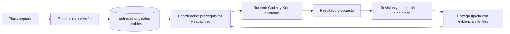

# Ejecución del plan aceptado y entregas entre agentes

El propietario acepta primero un grafo y autoriza después su ejecución sobre una
versión exacta. La decisión permite un turno de autor por tarea; cada resultado
sigue necesitando su revisión y aceptación existentes. No autoriza publicar,
aceptar código ni generar asignaciones a partir de un mensaje.

Por ejemplo, «investigar → corregir» inicia la investigación y conserva su
resultado como propuesta. Sólo su aceptación vigente permite admitir la
corrección. El segundo agente recibe identidad, contexto, fuentes e incertidumbres
del resultado aceptado. Un «gracias» o «terminé» no produce esa transición.

## Un dueño, identidades distintas

`PlanExecutions` usa la transacción del journal existente. La migración48 conserva
la autorización, un delivery por tarea y un paquete causal inmutable. El manifiesto
vincula aceptación del plan, repositorio original, tareas, versiones y dependencias.
La clave del propietario identifica la decisión; cada delivery tiene su clave de
admisión. Run, intento y thread/turn conservan identidades separadas.

Preparar un delivery no ejecuta nada. La admisión compara actor, contexto,
instrucción, evidencia y binding originales, y enlaza el run dentro de la misma
transacción que su recibo. Misma identidad con contenido distinto se rechaza.

El único `RuntimeService` propietario del journal observa la disponibilidad
de trabajo. Comprueba hechos persistidos; no consulta otro modelo para escoger
herramientas ni recrea el loop LLM antiguo. Usa workers, grants, presupuestos,
capacidad, aislamiento y cierre existentes. La observación periódica detecta
aceptaciones registradas por otras rutas del producto.

## Evidencia entregada

La entrega `work.request` distingue causa, destinatario y prerrequisitos. Las entregas nuevas versión2 incluyen además material original del plan, origen y
supuestos; [procedencia y terminal](terminal-owner-client.md). Para investigación incluye aceptación y snapshot inmutable: informes, fuentes, citas y
limitaciones. Aceptación documental no equivale a confianza científica. Para código
conserva aceptación e identidad de candidato/head/tree/diff y avisa que aceptar
no publica sus archivos en la fuente. Ampliar la lectura/uso de candidatos entre
tareas de código sigue pendiente; los SHA por sí solos no transfieren archivos.

El paquete se integra en el input congelado. El límite completo de entrada sigue
vigente: exceso de tamaño bloquea la inferencia sin omitir evidencia silenciosamente.
La entrega demuestra qué preparó el host, sin demostrar comprensión del modelo ni
contexto compartido con el usuario.

## Correcciones, Stop y reinicio

Una corrección de cualquier nodo pausa e invalida ese manifiesto. Incrementa los
contextos de los demás nodos, registra la causa como evidencia de herramienta,
cerca intentos, retira grants y vence preguntas. Así también rechazan resultados
obsoletos las fronteras existentes de aceptación y publicación. Conserva historia.

Esta primera política invalida todo ese grafo, incluidas ramas independientes;
no afecta automáticamente otros proyectos. Faltan selección por rama y
reautorización del grafo corregido. Hay una autorización original por plan; no
inventar otra para sortear contexto obsoleto. La recuperación explícita sigue en
el alcance del siguiente bloque.

Pausar persiste intención antes de retirar runs vinculados. Stop de proyecto pausa
autorizaciones antes de enumerar intentos. Su recibo reconoce la decisión, sin
afirmar cierre físico. Un reenvío histórico de pausa no detiene trabajo si el
estado durable actual está activo por otro control.

Al reiniciar sólo se programa el run original en cola que nunca tuvo intento.
Un intento emitido, incierto, detenido o fallido conserva identidad y requiere
controles/reconciliación existentes. Reanudar despacho no repite su prompt.

## Producto y evidencia

- `GET /api/projects/{id}/runs/{plan}/project-plan/execution`: manifiesto observado,
  autorización y entregas. Disponible también sin runtime activo.
- `POST` en esa ruta: `operation_key` y `manifest_sha256`, con owner/CSRF. Rechaza
  actores, prompts, grants y tareas arbitrarias del cliente.
- `POST /api/projects/{id}/plan-executions/{execution}/control`: identidad original,
  manifiesto y estado `active`/`paused`. No reinicia intentos.
- Tareas distingue aceptar y ejecutar, muestra pendientes/cierre y guarda paquetes
  completos de ejecutar/pausar/reanudar antes de enviar el POST.

[Resultados y límites](../modernization/plan-execution-results.json) y
[capturas](../design/audits/2026-11-05-plan-execution/report.md). La prueba física
usa broker/kernel/SQLite/Git y perfiles reales, con generación y Ken controlados:
planificador → investigación → aceptación → desarrollo privado, tres turnos,
fuente137 intacta, cero aceptaciones/publicaciones de código.

El navegador usa generación/cierre sintéticos explícitos. No se afirma inferencia
real, prompting evaluado, comprensión humana, suite global verde ni engine completo.
El cliente terminal se migró después; siguen otros consumidores antiguos,
comunicación explicativa de agentes, recuperación de entregas, paridad terminal avanzada,
lifecycle/inversas y exclusión física global del escritor legacy.
