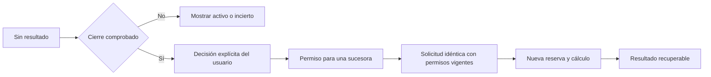

# Presupuesto del procesamiento local

El proyecto comparte un presupuesto durable entre las consultas del usuario y
las de los agentes. Se aplica a los procesos de extracción PDF/HTML/CSV/JSON/XML/
DOCX y al encoder semántico local, antes de arrancarlos. Es independiente de
los turnos/tokens del modelo y no informa facturación de la suscripción.

## Reserva, medición y reutilización

La migración61 incorpora políticas por proyecto y registros de trabajo local.
Una transacción comprueba proyecto, autoridad vigente y capacidad; después
reserva una operación y el techo duro de CPU del hijo. El proceso se ejecuta
fuera de la transacción. La plaza compartida se libera sólo tras el cierre
físico del transporte existente.

Los valores iniciales son200cálculos y600000ms de CPU por proyecto. Cada intento
nativo tiene además un techo de50cálculos y120000ms. Un cálculo puede agotar
cualquiera de los dos; ampliar el total del proyecto no elimina el límite del
intento. El techo de cada proceso conserva la política de su parser/encoder.
La reserva de CPU incluye el segundo adicional del límite duro de RLIMIT_CPU.

Una observación finita/no negativa sustituye el techo por el consumo medido.
Ausencia, error o muerte de proceso conservan la reserva completa. Cero se usa
sólo si el worker realmente informó cero. Los tamaños de entrada se registran
como bytes; no se convierten en tokens ni sustituyen las cuotas de CPU/operaciones.

La identidad del cálculo incluye proyecto, bytes de entrada, tipo, techo y una
huella de productores/dependencias/política. Se guardan los bytes originales del
resultado y su hash. Una consulta posterior autorizada puede recuperarlos sin
iniciar otro proceso. Esto modifica deliberadamente la antigua reconstrucción
en cada consulta. Las páginas de un mismo resultado no recalculan el encoder.
La respuesta indica `local_accounting.reused`, identidad de operación, intento
original y `measurement_origin=original_worker`: la medición describe el cálculo
guardado, no una ejecución nueva. En documentos se conserva en la procedencia.

No se reutilizan vectores sin versión ni resultados de otro proyecto. Se
revalidan fuente/corpus y permisos antes de divulgar. Cambiar productor,
dependencias, política o contenido crea otra identidad y no borra el consumo
previo. Una salida guardada puede ser un fallo del worker; repetir la consulta
recupera ese mismo resultado, sin fabricar éxito ni iniciar un bucle.

## Puntos de integración

- Consultas nativas de fuente y hallazgos: autoridad del grant, proyecto e intento.
- Consulta de hallazgos del propietario: base y proyecto de la sesión autenticada.
- Captura de referencia/web: parser construido con la misma autoridad; cambiar
  de formato conserva el objeto de contabilidad.
- Previsualización de archivos: proyecto comprobado antes de construir el parser.

El contexto de contabilidad se vincula dentro del tramo síncrono que llama al
worker y se restablece en `finally`; no depende de propagación entre distintas
dependencias síncronas de FastAPI. El transporte común realiza la reserva.
Las llamadas directas de biblioteca sin ese contexto conservan límites por
proceso, pero no representan una petición productiva asociada a un proyecto.

## Control del propietario

`GET /api/projects/{id}/work-budget` incluye `auxiliary`: operaciones, CPU
observada/contabilizada/retenida, datos desconocidos y capacidad restante. No
requiere iniciar Codex. La web distingue estos datos de la suscripción y explica
una reserva de3000ms cuyo consumo quedó desconocido.

El editor existente admite `auxiliary_operation_limit` y
`auxiliary_cpu_ms_limit` juntos. Comparten versión e identidad con la decisión
de presupuesto; los campos omitidos conservan la política local. Los packets y
recibos antiguos siguen válidos. Guardar no ejecuta un cálculo ni retira consumo.
Una respuesta perdida se recupera leyendo el recibo original después de recargar.
Reducir el total por debajo del consumo deja capacidad cero y conserva el exceso.

La inversa de61 sólo se admite sin políticas ni trabajo registrados y sin
migraciones posteriores. Una instalación usada necesita reparación hacia delante
o restauración verificada; no se descarta historial para simular una reversión.

## Diagnóstico y continuación explícita

Si la reserva no tiene resultado recuperable, se informa incertidumbre y no se
recalcula automáticamente. La migración62 registra la identidad del dueño en la
misma transacción que la reserva. El transporte marca la creación antes de
Popen, guarda la identidad del hijo antes de entregar datos y registra su cierre
después de esperar su salida física. No crea otro proceso dueño.

La identidad incluye PID, inicio del proceso, kernel y namespace del observador.
Se reutilizan las primitivas pidfd del runtime; no se aplica la prueba de cierre
de namespace-init a un parser ordinario. Estos workers son procesos confiables
fijos; el contrato no cubre ejecutar programas arbitrarios ni hijos no registrados.

El propietario consulta `GET /api/projects/{project_id}/local-work`, con páginas
acotadas. El diagnóstico distingue resultado completo, proceso activo, permiso
ya guardado, cierre comprobado e identidad/cierre inciertos. No devuelve blobs
de resultados ni identidades privadas del host. Una fase `closed` con recibo
todavía pendiente y dueño vivo no permite continuar: aún puede llegar el
resultado original.

`POST .../local-work/continuations` nombra una operación original exacta y una
clave de decisión. Se vuelve a comprobar el cierre dentro de la transacción.
Una operación admite una sola sucesora; reenviar la misma clave recupera el
recibo, mientras cambiar su contenido se rechaza. `GET .../continuations/{key}`
recupera una respuesta perdida sin otra escritura.

La autorización no inicia trabajo ni almacena otra copia del documento. La
próxima solicitud con el mismo contenido, productor y política consume esa
sucesora, revalidando permisos y reservando otra operación/CPU. Usuario o agente
con autoridad vigente pueden presentar la solicitud. No se reanuda un intento
nativo detenido ni se restaura un grant retirado. Si falta cupo, la autorización
permanece disponible; el rechazo no consume una operación nueva.

Ejemplo: quedaron3000ms desconocidos. Autorizar no cambia esa cifra. Al iniciar
la sucesora se reservan otros3000ms; si termina con10ms medidos, el total queda
3010ms. La primera operación conserva su estado y registro originales.

La web explica el alcance antes de guardar, persiste la decisión antes del POST
y permite consultar el recibo tras recargar. Los resultados completos siguen
recuperándose sin otra autorización. Una segunda interrupción requiere una
nueva decisión sobre la sucesora exacta, conservando toda la cadena anterior.

La inversa de62 sólo elimina tablas vacías. Tener una ejecución o autorización
registrada exige reparación hacia delante o restauración verificada.

## Alcance pendiente

Los registros anteriores sin identidad y los cambios de kernel/namespace no
permiten deducir cierre por ausencia del PID. Morir entre marcar creación y
guardar la identidad del hijo tampoco demuestra que no exista un trabajador.
Se explican estos casos y se rechaza la continuación desde esta pantalla.
Conectar una reconciliación basada en la autoridad de instalación/restore
existente permanece pendiente funcional, no pulido. E08 continúa abierto.

La CPU medida corresponde al worker, no a toda la CPU del servicio, verificación
de activos, transporte de red, preparación de Ken o administración. Los límites
de estos servicios tienen contratos propios. Tampoco se declara aceptación
integral de storage, datos históricos, interfaz o comprensión del usuario.
[Validación del presupuesto](../modernization/auxiliary-budget-review.md) y
[continuación explícita](../modernization/auxiliary-continuation-review.md).
