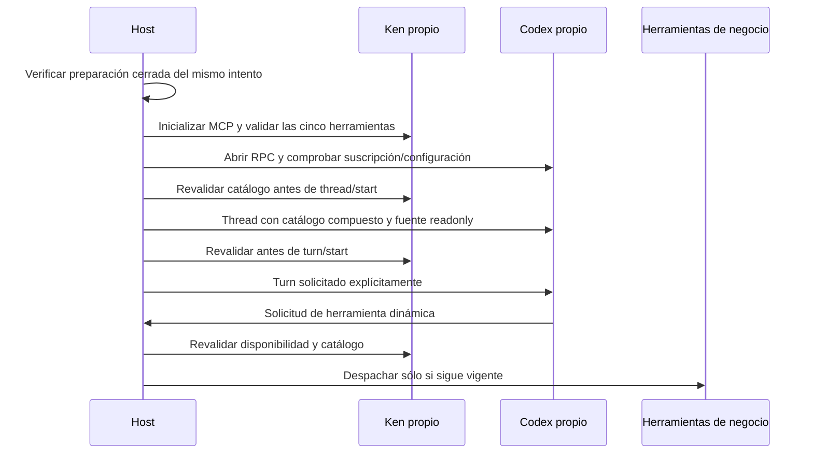

# Composición de Ken y herramientas del host antes de inferencia

`broker_inference` une una sesión `CodexSession` nueva con un endpoint Ken del
**mismo** `AsyncPeerBroker`. Reutiliza el loop nativo y las fronteras de herramientas
existentes; no es otro engine ni una fábrica productiva nueva.

El host aporta una preparación Ken del intento original que terminó con exit0 y
cierre confirmado. Se comprueban concesión activa, tipo/modo/perfil, instalación
y caché antes de abrir MCP. Un recibo de otro intento, de un servidor MCP o con
salida desconocida no habilita la sesión. Los modelos siguen offline y verificados.

## Catálogo obligatorio

`KenTools.connect` recorre como máximo ocho páginas/128 descriptores; rechaza cursores
repetidos, nombres ambiguos o falta de cualquiera de `ken_find`, `ken_read`,
`ken_recall`, `ken_related` y `ken_remember`. Filtra las capacidades adicionales del
servidor publicado. Copia y ordena las cinco seleccionadas para un hash estable.

Los esquemas se comprueban con JSON Schema2020-12 y resolución local. No se descarga
un `$ref` externo. Se rechazan referencias rotas y argumentos inválidos, no JSON o
mayores de200000 bytes antes de enviarlos a Ken. Las dependencias de validación
ya estaban fijadas transitivamente; ahora se declaran directamente sin cambiar
sus versiones. El resultado y la autoridad posterior usan la misma frontera
`McpTools` que las herramientas de negocio.

`ProjectTools` compone negocio, análisis y Ken con un propietario inequívoco por
nombre. Las colisiones se rechazan antes de crear el thread. No hay dispatch por
coincidencias parciales ni selección de permisos o credenciales por el modelo.

## Perfil nativo y secuencia

La opción de host `host_tools=True` exige el perfil de NET privado con política
CONNECT explícita. Queda registrada en el manifiesto y la intención; cambiarla
con una clave existente se rechaza. El perfil predeterminado conserva su conducta.

El perfil nuevo habilita `code_mode_host`, `code_mode_interrupt` y
`skip_host_skill_discovery`. Mantiene desactivados code-mode antiguo, shell,
ejecución unificada, plugins/apps, multi-agent, hooks y otras fuentes de acciones.
No configura servidores MCP dentro de Codex: Ken es una herramienta dinámica del
host, con proceso propio y supervisión original. Las capacidades y campos se
contrastaron con el SDK fijado0.166.0 y su `config/read` real, sin generación.

La sesión exige la raíz lógica readonly y un thread nuevo. Comprueba modelo y
workspace devueltos. Antes de cada turno y cada herramienta vuelve a comprobar
Ken y el hash. Si esa comprobación detecta una caída o cambio, impide otro turno/
dispatch y cierra el turno activo por el mecanismo nativo existente. Esto no prueba
disponibilidad continua entre comprobación y efecto; cada herramienta conserva
su propia frontera de autoridad y recibos. No hay fallback ni replay.
Sólo se aceptan solicitudes `item/tool/call`; una elicitación MCP nativa o petición
de ampliar autoridad permanece pendiente de decisión explícita.

El transporte MCP ahora conserva la excepción original del consumidor después
de drenar sus cancel scopes y cerrar el peer. Esto evita ocultar un rechazo de
admisión dentro de un `ExceptionGroup`, sin convertir fallas de cierre en éxito.

## Alcance de la evidencia y trabajo pendiente

Las pruebas de composición usan procesos/kernel reales con un protocolo nativo
controlado, sin modelo: lectura Ken, llamada de negocio, rechazo antes del thread
y caída/cambio de Ken durante el turno antes de un efecto de negocio. Otro ensayo
usa el `ken-rank` publicado y comprueba su catálogo y lectura mediados. Las pruebas
del perfil consultan configuración real de Codex sin cuenta ni generación.

Los facades de negocio/análisis se reciben ya admitidos; su inscripción y ciclo
de vida siguen siendo responsabilidad del host que compone la sesión. No se
afirma que todos sus actores estén dentro del nuevo dominio. `peers_closed` no
certifica el cierre del conjunto de actores aportados por el llamador.

Faltan el perfil de negocio/desarrollo, adopción de las fábricas productivas,
estado nativo durable/resume reconciliado, inscripción completa de actores y
carga conjunta real por suscripción. Tampoco se probaron aquí OAuth/WebSocket,
conservación de presupuesto remoto ni las71 herramientas. El trabajo global de
engine/loops, prompts, comunicación humana, web, datos y operación sigue abierto.

Evidencia: [contratos y límites](../modernization/ken-host-evidence.json),
[resultados](../modernization/ken-host-results.json),
[Ken publicado](../modernization/ken-host-live.json),
[paquete](../modernization/ken-host-packaging.json).
