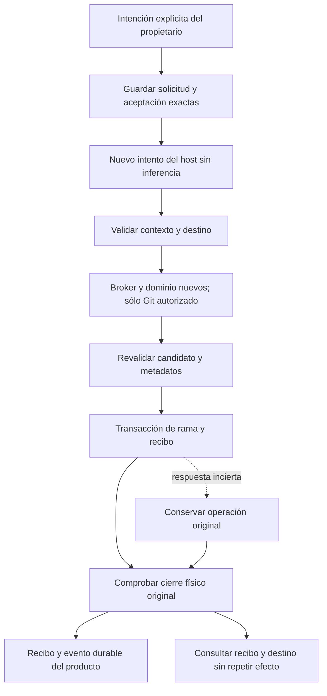

# Publicación de un candidato aceptado

La publicación es un efecto del host con autoridad y recibo propios. El autor y
el revisor ya terminaron sus intentos; una aceptación histórica no reactiva sus
procesos ni autoriza nuevos comandos. Este contrato desarrolla E06, E10 y E12 del
plan completo y conserva pendientes push, PR, merge y su reconciliación remota.

**Estado actual:** `backend/runtime/publication_git.py` implementa y prueba la
política de referencias Git mediante un puerto confiable. No tiene ruta HTTP,
admisión durable, integración con el broker ni acción web habilitada. Las pruebas
usan Git real sobre repositorios temporales y un adaptador de procesos exclusivo
del test. No demuestran autoridad de producción ni publicación completa del producto.

## Qué se publica y qué evidencia conserva

La primera operación local coloca el commit exacto del candidato en una rama
observada explícitamente. El destino puede estar ausente o señalar la base/candidato
aceptados; no se fuerza una rama que cambió desde la observación. No se actualiza
una rama abierta en ningún checkout, porque sus archivos quedarían desalineados.
El contenido del working tree original permanece en su versión anterior.

Una transacción `git update-ref --stdin` actualiza la rama y crea su recibo
`refs/researcher/publications/<huella>` juntos. La huella incluye identidad de la
operación, rama y SHA previo observado. El recibo apunta al head exacto del
candidato. Cambiar el destino conservando una etiqueta de solicitud no permite
adoptar el recibo de otra intención.

Ejemplo: se publica el candidato A en `refs/heads/reviewed-change`. Git confirma
la transacción, pero se pierde la respuesta. Tras comprobar que el proceso original
cerró, se consulta el recibo y la rama. Si otra persona movió después esa rama a B,
se conserva «A fue publicado por esta operación; el destino ahora apunta a B».
La diferencia no se convierte en «no ocurrió nada» ni dispara otro efecto.

`target_current` sólo expresa que la referencia Git todavía apunta al head del
candidato. No acredita vigencia del contexto de la tarea, aceptación actual,+cierre de procesos ni éxito remoto. Esas condiciones pertenecen al controlador.

## Recorrido del producto que falta conectar

La solicitud debe fijar proyecto, tarea, aceptación, intento del autor, contexto,
huellas de candidato/revisión, rama y SHA previo. El controlador usa el propietario,
leases, fences y capacidad existentes. No necesita un turno de modelo ni otros
agentes; Codex y Ken continúan en los recorridos de autoría/revisión.

El análisis con un subagente de contexto limpio confirmó que reutilizar la sesión
de inferencia crearía dependencias incorrectas: `_claim` rechaza tareas terminadas
y cambia su estado; `AttemptPeers` prepara native/business; `_closed_peer_proof`
los exige; `GitCapsule` mantiene el origen en lectura. Se decidió conservar esas
reglas para sus tipos actuales y añadir un perfil específico de publicación.

Cambios siguientes, con consumidores concretos:

1. Admitir `code_publication` con una solicitud inmutable ligada a la aceptación.
   `_claim`/`_authority` validarán ese sujeto sin reabrir una tarea terminada.
   Se mantendrán los controles existentes para investigación, autoría y revisión.
   La nueva operación no podrá reservar inferencia.
2. Preparar sólo peers de comandos. La prueba de cierre exigirá los comandos
   reales del efecto y sus recibos, sin crear native/business ficticios.
   La lectura de aceptación reconocerá sólo su publicación exactamente vinculada;
   no excluirá cualquier trabajo por su etiqueta de tipo.
3. Añadir un launch/capsule Git específico. Origen en lectura, sólo `.git` original
   escribible y candidato aceptado en lectura bajo otra ruta. Los descriptores
   fijarán device/inode originales. La entrada completa de la transacción debe
   quedar incluida en el manifiesto del broker; el executor actual no envía stdin.
4. Guardar la etapa antes del efecto. Una respuesta perdida exige cerrar/reconciliar
   la operación anterior, consultar recibo/destino y conservar su evidencia. Un
   resultado obsoleto puede ser historia de un efecto aplicado; no es publicación
   vigente del nuevo contexto. La autorización al liberar el efecto y la corrección
   posterior deben tener un punto de orden definido y comprobado.
5. Conectar API y Tareas con el cuerpo original persistido, igual que aceptación y
   revisión. Después integrar push/PR/merge con identidad remota exacta y consulta
   de efectos antes de retry. Crear una rama local no completa esas capacidades.

## Problemas examinados y soluciones

| Qué pasaría si… | Solución y evidencia actual |
| --- | --- |
| La referencia cambia entre preflight y escritura | CAS de referencia y creación del recibo en una sola transacción; prueba real verifica que no queda un recibo parcial. |
| Git confirma y se pierde la respuesta o falla la consulta posterior | Se conserva incertidumbre; reconciliación sólo con cierre original probado y sin otra transacción. Probado en Git real. |
| Alguien mueve la rama después | Se conservan efecto histórico y destino observado por separado. Probado. |
| Se reutiliza el ID con otra rama | Recibo ligado a la intención completa; no adopta el anterior. Regresión observada y corregida. |
| Se reemplaza `.git` por una copia con las mismas referencias | Identidad original de metadatos conservada; rechazo aunque el recibo copiado parezca válido. Probado en política; fijación de descriptor en capsule pendiente. |
| El commit coincide pero los archivos del candidato cambiaron | Se reutiliza la validación Git/diff/bytes de revisión. Probado. |
| Se intenta publicar sobre un checkout primario o vinculado | Se rechaza el destino; comprobado en ambos casos. No hay checkout/reset automático. |
| Una corrección llega después de liberar un efecto | El controlador deberá conservar el efecto y su contexto original, sin promoverlo al contexto nuevo. Integración pendiente. |
| Un merge legacy empieza justo antes de la primera admisión nativa | El preflight legacy existente no constituye exclusión física. Debe resolverse en el cutover de escrituras y autoridad; no está cerrado por estas pruebas. |

## Verificación

Las [pruebas dirigidas](../modernization/publication-policy-results.json) incluyen
Git real, fallos de transporte controlados y candidatos/destinos temporales.
Las nuevas definiciones tienen [docstrings en inglés](../modernization/publication-policy-docstrings.json).
La [suite global del checkpoint anterior](../modernization/resumed-baseline-results.json)
terminó antes de incorporar esta política al producto y no se atribuye a ella.
No hubo inferencia nueva ni cambios en repositorios del usuario durante estos tests.
