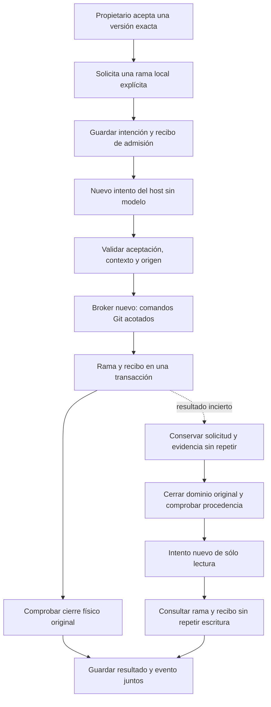

# Publicación de un candidato aceptado

La publicación es un efecto del host con autoridad y recibo propios. El autor y
el revisor ya terminaron sus intentos; una aceptación histórica no reactiva sus
procesos ni autoriza nuevos comandos. Este contrato desarrolla E06, E10 y E12 del
plan completo. Push, PR, merge y ampliación de carreras físicas siguen pendientes.

**Estado actual:** el propietario puede publicar desde Tareas el commit aceptado
en una rama local nueva. La solicitud queda guardada con su aceptación exacta;
un intento nuevo del host usa su propio broker y dominio, sin inferencia.
La integración con Git, kernel, broker y SQLite reales verifica el efecto, el
cierre físico y la conservación de los archivos originales. Autoría/revisión usan
generación controlada en ese test; no es un nuevo ensayo de calidad del modelo.

## Qué se publica y qué evidencia conserva

La operación coloca el commit exacto del candidato en una rama explícita. La
interfaz crea únicamente ramas ausentes; la política interna también admite una
referencia previamente observada con precondiciones. No se fuerza una rama que
cambió desde esa observación ni se actualiza una rama abierta en algún checkout.
El contenido del working tree original permanece en su versión anterior.

Una transacción `git update-ref --stdin` actualiza la rama y crea su recibo
`refs/researcher/publications/<huella>` juntos. La huella incluye identidad de la
operación, rama y SHA previo observado. El recibo apunta al head exacto del
candidato. El manifiesto original del broker incluye toda la entrada de esa
transacción; otro cuerpo no puede adoptar su recibo.

Ejemplo: se acepta A y se solicita crear `researcher/cambio-revisado`. La rama
señala A, pero los archivos del checkout abierto siguen en su versión anterior.
Aceptar A, crear esa rama y subirla a un servidor son decisiones separadas.

`target_current` sólo expresa que la referencia Git todavía apunta al head del
candidato. No acredita vigencia del contexto de la tarea, aceptación actual,
cierre de procesos ni éxito remoto.

## Recorrido conectado

`code_publication_schema.sql` añade la versión 43 y la solicitud inmutable.
`CodePublications` fija proyecto, tarea, aceptación, intento del autor, contexto,
huellas de candidato/revisión, destino y SHA previo. `_claim`/`_authority` validan
ese sujeto sin reabrir la tarea terminada. No se puede reservar inferencia ni
crear peers native/business para este tipo de ejecución.

Sólo las publicaciones ligadas a esa aceptación exacta se excluyen de sus bloqueos
de trabajo simultáneo. No existe una excepción general por etiqueta de ejecución.
Los tipos anteriores conservan sus requisitos de tarea y cierre.

`PublicationGitCapsule` mantiene el origen en lectura salvo su `.git` original,
y el candidato aceptado en lectura bajo una ruta independiente. Los descriptores
fijan device/inode antes del spawn. El executor usa el broker existente, sin
fallback de subprocess del host. El controlador retira el dominio original antes
de entregar evidencia al servicio. Resultado, evento y estados se guardan juntos.
Una corrección posterior no promueve el efecto histórico al contexto nuevo.

API: `POST /api/projects/{project}/runs/{author}/code-publications` admite la
intención estricta; `GET /api/projects/{project}/code-publications/{run}` recupera
la solicitud guardada. Se aplican pairing/CSRF y alcance de propietario existentes.
El cliente guarda cuerpo y clave antes de enviar. Una respuesta perdida y una
recarga conservan la rama y la aceptación originales; repetir el POST recupera
la admisión anterior y no agenda otro intento.

## Problemas examinados y soluciones

| Qué pasaría si… | Solución y alcance comprobado |
| --- | --- |
| La referencia cambia entre preflight y escritura | CAS de referencia y recibo en una sola transacción; Git real verifica ausencia de recibo parcial. |
| Git confirma y se pierde la respuesta o falla la consulta posterior | La política conserva incertidumbre y reconcilia sólo con cierre original probado. El producto cierra la autoridad original y crea un intento de observación de sólo lectura, con recibo propio; nunca repite la transacción. |
| Alguien mueve la rama después | La política conserva efecto histórico y destino observado por separado. No convierte la diferencia en permiso para repetir. |
| Se reutiliza el ID con otra rama | Recibo ligado a intención completa; no adopta el anterior. |
| Se reemplaza `.git` por una copia | Identidad original en política y descriptores en capsule; rechazo de metadatos sustituidos. |
| Cambian los archivos del candidato | Validación Git/diff/bytes antes del efecto; no basta que coincida un nombre de rama. |
| Se intenta publicar sobre un checkout primario o vinculado | Rechazo sin checkout/reset automático. |
| El cliente cierra stdin, pero Git no recibe EOF | Se reprodujo un writer duplicado retenido por el broker. El transporte es ahora dueño del input después de G; prueba de pipe real y publicación física pasan. |
| Llega una corrección | La autoridad viva se retira; un efecto aplicado pertenece a su contexto original. Almacenamiento comprueba retirada y conserva recibo; falta ampliar carreras físicas. |
| Un merge legacy empieza antes de la primera admisión nativa | El preflight legacy no constituye exclusión física global. Resolver en el cutover de escrituras. |

El análisis previo con un subagente de contexto limpio ayudó a separar la nueva
operación de las sesiones cerradas de inferencia. No reemplaza estas pruebas ni
constituye la revisión independiente final de toda la rama.

## Recuperación operativa conectada

El propietario envía el intento y fence observados con una clave estable a
`POST /api/projects/{project}/code-publications/{run}/recovery`. Antes de ejecutar
otra consulta, el host verifica en el journal global la procedencia original de
base de datos, proyecto, tarea, intento y fence. Retira los dominios originales y
proyecta su cierre a los peers originales. Un broker vivo no se adopta como muerto.
No se acepta del cliente un booleano que afirme cierre.

La migración 44 conserva el comando, prueba de cierre y **nuevo intento de
observación** en `runtime_publication_observations`. Conserva la solicitud de
publicación original; no reutiliza su lease cerrado. Esta autoridad específica
permite únicamente consultas exactas `for-each-ref` del destino y recibo originales.
El broker rechaza usarla con un launch de escritura. La capsule fija `.git` en
lectura, sin montar el candidato ni otorgar acceso de escritura a metadatos.
El candidato puede haber desaparecido; el origen y sus metadatos deben conservar
sus identidades y registro originales.

Esto permite observar un efecto histórico después de corregir la tarea. Sólo el
observador de lectura tiene esa excepción de contexto; los gates de inferencia y
publicación con escritura conservan sus precondiciones. El nuevo dominio también
debe cerrar físicamente antes de guardar resultado, evento y recibo juntos.

La respuesta distingue `published`, `not_applied` y `uncertain`. En el primer caso
se conserva por separado si la rama aún apunta al candidato; una rama movida no
borra el efecto histórico. El segundo acredita que el efecto original no se
aplicó y permite solicitar explícitamente una publicación nueva. El tercero
conserva un recibo de observación, sin inventar un resultado final de publicación
ni autorizar una nueva escritura. Volver a enviar una consulta completada devuelve
su recibo original sin ejecutar Git otra vez.

## Verificación y pendientes

[Resultados de recuperación](../modernization/publication-recovery-results.json)
y [paquete](../modernization/publication-recovery-packaging.json). La integración
física confirma pérdida de respuesta después del commit, una única transacción,
un intento de lectura distinto y ningún turno adicional del modelo. Las pruebas
de almacenamiento usan testigos explícitamente sintéticos y verifican contexto
corregido, prueba original exacta, estado incierto y ausencia de efecto.
Las [capturas de recuperación](../design/audits/2026-11-05-publication-recovery/report.md)
comprueban el mismo comando después de respuesta perdida y recarga; no son prueba
del efecto físico Git. [Docstrings](../modernization/publication-recovery-docstrings.json).

La [entrega local anterior](../modernization/publication-connected-results.json)
conserva sus pruebas y límites históricos. Los fixtures de reversión de esquemas
anteriores y las inversas 43/44 quedan en [detalles diferidos](../modernization/deferred-details.md).
No se afirma una suite global actual verde; el [baseline](../modernization/resumed-baseline-results.json)
es anterior a estas integraciones.

Siguiente capacidad principal: push/PR/merge con identidad remota exacta y consulta
antes de retry. También siguen pendientes exclusión física durante cutover legacy,
ampliación de carreras/crashes, migración/restore y evaluación de producto completo.
La recuperación local no completa esas capacidades ni el plan general.

El siguiente checkpoint conserva el [protocolo remoto interno](remote-publication.md)
de push/PR/merge y sus pruebas; todavía no habilita su transporte y controles
productivos. La conexión local descrita aquí permanece separada.
