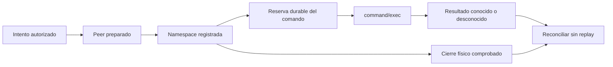

# Comandos: resultado y cierre físico

La ejecución nueva de comandos comparte el registro de procesos del engine. Un
comando puede haber devuelto un código y conservar hijos activos; también puede
haber perdido su respuesta y estar físicamente cerrado. Son hechos distintos.

| Resultado del comando principal | Cierre del peer | Interpretación |
| --- | --- | --- |
| Conocido | Sin comprobar | El recibo no demuestra que todos los hijos hayan terminado |
| Desconocido | Sin comprobar | Faltan resultado y prueba de cierre; no repetir |
| Desconocido | Comprobado | Ya no puede actuar localmente; efectos y éxito siguen sin conocerse |
| Conocido | Comprobado | Se conserva el recibo y el cierre; no implica éxito de cada hijo ni aceptación |

`command_executor` requiere journal, lease, workspace y control privado. Prepara
un peer `command` del intento registrado. Su launcher enlaza el init de una namespace
PID antes de soltar el payload. El ejecutor valida el prefijo del launcher, intento,
fence y origen; no admite un transporte arbitrario ya abierto. El app-server usa
un HOME privado, sin cuenta, y el perfil explícito de filesystem/red anterior.
No envía `turn/start`. El runtime de inferencia conserva su suscripción y Ken MCP.

La migración 27 añade `runtime_jobs.peer_id`. Reserva y evento enlazan el comando
al peer bound del mismo intento/fence dentro de una transacción. El vínculo no
cambia con un retry; triggers impiden prestarlo o reescribirlo. Los registros antiguos
quedan con NULL, sin inferir propiedad. Un job incierto sin vínculo verificable
sigue necesitando reconciliación histórica. El journal mantiene sus recibos.

`CommandJob.local_execution_closed` deriva del peer cerrado. No se deduce de un
exit code, EOF o confirmación de terminate. Se supervisa la vida del peer incluso
sin comandos pendientes: un padre que devolvió cero puede dejar hijos con setsid.
La comprobación de autoridad tiene un plazo explícito —un segundo con los valores
predeterminados— y una DB ocupada no deja al peer actuar indefinidamente.

Cancelar retira este peer completo. Se intenta obtener la respuesta nativa durante
la gracia y después se exige el cierre de la namespace. Transporte y comprobación
física se cierran en paralelo; para un peer bound, la lectura WAL y la señal física
preceden a esperar el writer que guardará la prueba. El código confirmado se conserva;
sin respuesta sigue desconocido. El peer cancelado no acepta más despachos. Otra
operación requiere un peer nuevo con autoridad vigente, sin reenviar la incierta.

Los transportes nativos y de comandos registrados deshabilitan señales a números
de grupos: controlan sólo su hijo directo y usan la barrera pidfd/namespace para
descendientes. El transporte genérico conserva su fallback para diagnósticos; no
recibe garantías universales de cierre. El SDK MCP también tiene teardown propio,
con una prueba de namespace independiente para el engine.

La recuperación puede cerrar jobs inciertos registrados y retirar el intento.
Un dispatching/cancelling sin recibo pasa a unknown, con evento y cambio de estado
en la misma transacción; nunca a exited/cero. Conserva bytes observados y separa
aceptación e inferencia. La inspección presenta resultado y cierre por separado,
hasta 25 comandos con marca de truncado. Origen distinto o job incierto sin vínculo
siguen bloqueando; un contador de resultados desconocidos no prueba procesos vivos.

[Evidencia](../modernization/command-ownership-evidence.json): dos ensayos con el CLI
fijado, cero turnos generativos, aislamiento/red, SQLite ocupado, hijo separado,
otro propietario intacto, pérdida de conexión y SIGKILL del holder seguido de
recuperación de la misma DB. Ésta conserva unknown/NULL con cierre comprobado,
sin replay ni aceptación. Hay 216 pruebas de runtime aprobadas; la suite completa
tiene 1041 aprobadas, los mismos 100 fallos heredados y 3 omitidas. Pasan 12 pruebas
de frontend y TypeScript/Vite. Los [resultados](../modernization/command-ownership-results.json)
conservan los fallos: la suite global sigue roja. Una copia sintética 26→27 preservó
las 108 tablas originales, valores/rowids y FK; no se modificó una base del usuario.

Esto entrega el primitivo y su recuperación. Falta migrar consumidores de herramientas
y flows, Git/review/CI, exclusión de workspaces entre bases, transferencia/restauración,
presupuesto ante borrado y el resto del plan. Cerrar no revierte efectos externos.
La presentación aún requiere navegador, teclado, accesibilidad y comprensión humana.
