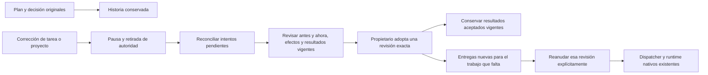

# Adoptar un grafo corregido

El plan propuesto por un agente y la decisión del propietario se conservan. Si
cambian las condiciones del trabajo, el propietario puede revisar el grafo
actual y adoptarlo mediante otra decisión explícita. Esto crea una revisión de
la autorización original; no atribuye al agente una propuesta que nunca hizo.

Por ejemplo, corregir el tamaño de una muestra puede cambiar el objetivo de la
investigación. Tareas muestra el texto anterior y el actual, los resultados
aceptados que siguen vigentes y las tareas que requieren otra entrega. Adoptar
el grafo lo mantiene pausado. Reanudar esa revisión es una decisión separada.

## Una historia, revisiones distintas

La migración51 añade `runtime_plan_execution_revisions`, una secuencia inmutable
por ejecución. `runtime_plan_executions` mantiene manifiesto, clave y aceptación
originales. La vista `runtime_plan_effective_executions` resuelve la revisión
vigente; el registro original no se reescribe para aparentar continuidad.

La invalidación del grafo consulta ahora los contextos de esa revisión vigente.
Otra corrección pausa, cerca intentos y revoca grants como antes. Una tarea no
puede seguir con el contexto de una revisión anterior porque el primer manifiesto
ya no figure como vigente.

La revisión observa tareas y dependencias originales del grupo, sus textos y
criterios actuales, correcciones atribuidas, contexto actual del proyecto y del
plan, historia de ejecuciones hijas, efectos y consumo registrados. Las diferencias
se comparan contra la decisión anterior, o contra la propuesta aceptada original
para la primera revisión. Una escritura de metadata no demuestra quién la pensó;
la adopción posterior sí registra una nueva decisión del propietario.

Se exige un grafo cerrado, sin ciclos y con tipos actualmente soportados. No se
añaden nodos arbitrarios ni se reinterpretan herramientas legacy como permiso.
El repositorio sigue siendo el original registrado y se revalida antes de ejecutar.

## Cierre, reemplazo y resultados retenidos

Revisar exige despacho pausado. Un intento hijo ejecutándose, cancelándose o
reconciliándose bloquea la adopción. Los intentos históricos necesitan protocolo
de peers conocido, origen de DB comprobable y cierre registrado. Un comando sin
resultado confirmado conserva su incertidumbre; no se supone que careció de
efectos. El transporte de un efecto remoto debe estar cerrado.

Las entregas nunca emitidas pueden sustituirse sin inventar un intento anterior.
También se puede sustituir una sucesora que fue autorizada pero quedó obsoleta
antes de arrancar. La cadena de entregas conserva ambas decisiones y no se bifurca.

Las propuestas cerradas que se reemplazan pasan a historia y sus preguntas
pendientes vencen. No se convierten en aceptaciones. Los efectos y reservas de
inferencia permanecen registrados; no se reinicia el presupuesto del proyecto.

Un resultado nativo aceptado y vigente puede conservarse **explícitamente** dentro
de la nueva decisión. Su identidad y evidencia deben coincidir exactamente con
lo revisado. No se crea otra aceptación ni se ejecuta esa tarea otra vez. Una
aceptación cuyo contexto ya cambió sigue como historia; no satisface el contexto
nuevo. La prueba dirigida de retención usa investigación; la aceptación integral
de código retenido y publicación sigue dentro de la verificación del producto.

La admisión, el input y las fronteras de autoridad comparan la revisión de cada
entrega. La procedencia aceptada de una revisión anterior sólo se conserva si la
decisión actual retuvo ese resultado exacto. Las observaciones tardías sobre
ejecuciones anteriores se revalidan sin incluir como historia de aquella decisión
los nuevos runs que autorizó después.

Una solicitud manual de trabajo hijo tampoco puede usar una adopción del padre
que perdió vigencia por evidencia tardía. Esta comprobación usa la DB de la
transacción, sin suponer que la configuración global señala esa misma base.

## Controles e input

- `GET /api/projects/{proyecto}/plan-executions/{ejecución}/reauthorization`
  ofrece snapshot, diferencias y hashes sin activar trabajo.
- `POST` en esa ruta acepta sólo `operation_key` y `snapshot_sha256`, con owner y
  CSRF. El host determina nodos, permisos, entregas y resultados que conserva.
- Pausar/Reanudar identifica `authorization_revision` además del manifiesto.
  Dos decisiones pueden tener el mismo grafo: su hash no sustituye la identidad
  de la revisión que observó el usuario. Los controles históricos de revisión0
  conservan el formato y recibo originales.
- Tareas y terminal guardan el paquete original antes de enviarlo. Perder la
  respuesta, recargar o reiniciar recupera la misma revisión y las mismas entregas.
  Un recibo de otra revisión o con entregas incompletas queda sin resolver.
- Terminal: `/graph-revision EJECUCION`, `/reauthorize-plan EJECUCION`, después
  `/execution RUN_DEL_PLAN` y, si corresponde, `/resume-plan RUN_DEL_PLAN`.

El input nativo distingue el plan/modelo original de `reauthorization`, la nueva
decisión owner con el grafo corregido. Los resultados anteriores son evidencia
atribuida, no órdenes ocultas. No se reabre una sesión nativa ni se incorporan
archivos privados de candidatos por inferencia. Se mantiene el límite completo de
entrada: un exceso bloquea inferencia y no resume silenciosamente el contenido.

## Evidencia y alcance pendiente

El upgrade50→51 verifica que un fallo al registrar la migración revierte tablas y
vista nuevas, manteniendo manifiesto original y miembros anteriores. El reintento
conserva claves foráneas e identidad original. Los recursos47–50 no se modifican.

Las pruebas cubren correcciones de tareas y proyecto, retención de investigación,
rechazo de ciclos/contexto no observado/autoridad anterior, sustitución de una
sucesora sin intento y nueva invalidación tras una segunda corrección. La prueba
física usa broker/kernel/Git reales con generación y Ken controlados; no acredita
calidad de prompting ni comprensión humana representativa.

[Resultados](../modernization/plan-reauthorization-results.json),
[paquete](../modernization/plan-reauthorization-packaging.json),
[docstrings](../modernization/plan-reauthorization-docstrings.json) y
[recorrido visual](../design/audits/2026-11-05-plan-reauthorization/report.md).

El siguiente bloque principal es la migración real de flows, autonomía,
claims/listeners y herramientas restantes al único owner. Permanecen la adopción
de drafts/runs manuales aún no aceptados y archivos de candidatos, retención y
publicación integrales, exclusión física global legacy, todos los tipos de tarea,
prompts/evaluaciones, diseño de las páginas restantes, inversas43–51/restauración
y aceptación global. Los detalles secundarios se registran, sin otra pasada de
pulido de este panel ahora.
