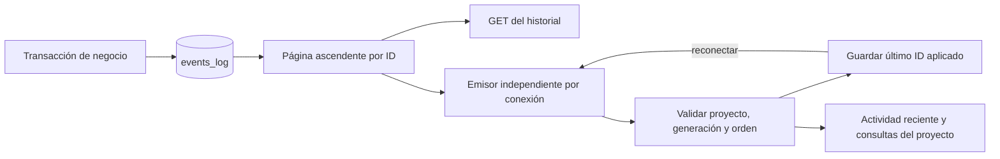

# Eventos conservados y reconexión

HTTP y WebSocket leen el mismo registro confirmado de `events_log`. El canal
anterior sólo escuchaba `EventBus`, mientras que el runtime nativo escribe en
SQLite. Ya no se inventan identificadores con fechas o contadores del navegador.

Cada conexión recupera páginas de100 eventos, sin ordenar por fecha, y continúa
con las nuevas transacciones. Retiene una sola página, sin cola global de tareas
de difusión. Si un cliente no recibe dentro del plazo, sólo se cierra su conexión
con1013. Reconectar recupera observaciones desde el último ID aplicado; nunca
reenvía un prompt ni una operación. El polling local es de250ms y el plazo de
envío de5s; no constituyen una medición de latencia ni garantía de tiempo real.

Se entregan los hechos que conservan el runtime y los triggers de negocio:
admisión, contexto, intentos, despacho/consumo, comandos, mensajes y entregas.
Las señales antiguas que sólo pasaron por un callback volátil no se convierten
en evidencia histórica.

## Contrato de lectura

- `GET /api/events/{project_id}?after_id=244&limit=100` devuelve un sobre paginado,
  no la antigua lista descendente. HTTP lleva `Cache-Control: no-store`.
- `/ws?project_id=101&after_id=244` usa el mismo sobre, `type=events.page`.
- Los IDs/cursos son cadenas decimales exactas para conservar la precisión de
  SQLite en JavaScript. `next_after_id` permite continuar; `has_more` anuncia
  otra página de la instantánea consultada. El máximo por página es200.
- Un payload ilegible conserva identidad/tipo/fecha, con `data=null` y
  `data_unavailable=true`; no se inventa un resultado exitoso vacío.
- `/runtime-events` conserva su forma anterior, pero rechaza cursores vencidos.
  El protocolo de recuperación es `/api/events`. Recargar la interfaz al
  actualizar: un cliente antiguo no es compatible con el nuevo sobre.

El navegador valida toda la página antes de entregarla y descarta IDs ya
aplicados. A→B→A crea generaciones distintas: una respuesta de la primera visita
no puede entrar en la última. Las consultas se invalidan por las posiciones
explícitas de proyecto en sus claves, agrupadas por250ms. El panel muestra100
eventos recientes; ese límite visual no limita el avance del cursor.

## Retención y límites

La migración59 guarda, en la misma transacción que un borrado, hasta qué ID de
ese proyecto se perdió continuidad. No se añadió una purga automática. Un cursor
anterior recibe `reset_required=true`, un motivo y `resume_after_id`. El navegador
mantiene la advertencia de historial incompleto, solicita lecturas nuevas del
estado actual y continúa con eventos posteriores. Esa consulta no reconstruye
los eventos perdidos. Un cursor adelantado a la base también exige reiniciar.

La migración no descubre borrados anteriores a59. Los cursores no sustituyen la
identidad de instalación ni la sesión del propietario. No se publica una inversa
general de59. Estas pruebas tampoco aceptan todas las cachés históricas, todas
las páginas o el plan completo.

[Resultados](../modernization/durable-events-results.json),
[paquete instalado](../modernization/durable-events-packaging.json) y
[navegador real](../design/audits/2026-11-07-durable-events/report.md).
