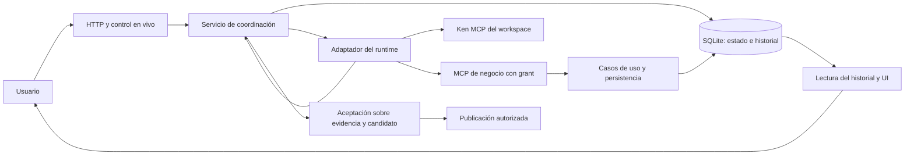

# Rediseño del engine y de la coordinación

Estado: primer recorrido productivo de investigación conectado a la API autenticada
mediante `RuntimeService`, Codex y Ken aislado. La migración del engine completo
sigue pendiente: orchestrator/LoopEngine y los demás flows todavía existen.
Ver `native-runtime-boundary.md` y `runtime-decision.md`.

## Un dueño por decisión

Researcher posee el trabajo del usuario: contexto vigente, tareas, grants,
intentos, resultados persistidos, aceptación y publicación. El runtime elegido
posee el turno de inferencia, su planificación interna y la selección de
herramientas dentro del alcance concedido. No duplicar la planificación interna
con un segundo bucle de pseudoherramientas `think/plan/done`.

El canal vivo avisa; SQLite permite reconstruir lo ocurrido. Perder un WebSocket
no vuelve a ejecutar la petición del usuario. Un evento de texto que diga
«terminé» tampoco cambia el estado del producto.

## Identidad y estados

Cada operación identifica proyecto, tarea, run, intento, actor, versión de
contexto y clave de operación. Una sesión nativa identifica su thread/turn por
separado. Los identificadores del runtime no sustituyen la identidad de dominio.

Separar al menos estas dimensiones:

- **Ejecución:** en cola, ejecutando, esperando entrada, cancelando,
  reconciliando, terminada, fallida o interrumpida.
- **Resultado:** sin propuesta, propuesta recuperable, pendiente de revisión,
  aceptado, rechazado u obsoleto.
- **Efectos:** no despachados, en curso, confirmados, fallidos o inciertos.

Un turno completo con un informe provisional produce una propuesta para
revisión. No marca automáticamente la tarea `done`. Un turno interrumpido puede
coexistir con una herramienta que ya guardó una fuente: conservar ese hecho y
reconciliarlo, sin fingir que la cancelación deshizo la escritura.

Los valores finales de persistencia y DTO deben fijarse con las pruebas del
servicio; esta lista expresa dimensiones, no una nueva enum ya implementada.
No sobrecargar `tasks.status` con el estado de cada llamada al runtime.

## Claim, lease y fencing

SQLite es la fuente de verdad local. Claim, transición y evento correspondiente
se escriben en la misma transacción. Un único intento activo posee el trabajo;
el contador de fencing cambia al invalidar o reemplazar su autoridad. Cada
resultado compara identidad, contexto y fence vigentes dentro de la transacción.
Un resultado viejo sigue siendo evidencia histórica, pero no puede aceptar ni
publicar el trabajo actual.

Expirar una lease **no autoriza repetir el prompt**. El nuevo dueño pasa primero
por reconciliación de thread, procesos propios, jobs y receipts. Sólo después
decide continuar el mismo thread, abrir un nuevo intento o pedir una decisión
que realmente falte. Los relojes y pausas pueden adelantar una expiración falsa;
el fencing y la reconciliación deben impedir que eso se convierta en doble efecto.

La admisión agrega presupuesto durable por operación/proyecto y limita
concurrencia. Los límites de `CodexSession` son hoy locales al proceso; no
sustituyen este presupuesto. Datos de cuota/consumo ausentes quedan desconocidos.

## Corrección y comunicación

Una corrección conserva su fuente explícita —mensaje, ejemplo, ejecución o
suposición declarada—, incrementa la versión de contexto e invalida los efectos
futuros autorizados con la versión anterior. Registrar por separado que la
corrección se recibió, se entregó al runtime y se aplicó en un resultado
comprobable. Si cambia una premisa central, coordinar la detención/reconciliación
del intento antes de continuar; no prometer una aplicación por el mero steer
receipt.

Chat entre agentes sirve para explicar, explorar y señalar evidencia.
Asignaciones, claims, revisión, aceptación, cambios de contexto y solicitudes al
usuario usan operaciones tipadas. Cada mensaje de trabajo conserva causa,
destinatario y alcance. Un agradecimiento no reactiva trabajo; una corrección
repetida no se pierde por parecer un duplicado textual. Limitar ping-pong por
cadena causal y presupuesto, y mostrar por qué se detuvo.

Las explicaciones siguen `docs/interaction/communication-guide.md`: conclusión
comprensible, evidencia recuperable, ejemplo útil y límites. Por ejemplo:
«Guardé el informe 12 como borrador. La fuente dice X; el código hace Y.
Con 100 y una tasa de 0,21, la diferencia es 100,21 frente a 121,00. No ejecuté
tests, por lo que aún falta comprobar el comportamiento de los llamadores».
El identificador y el ejemplo permiten corregir un desvío sin preguntar a cada
paso «¿entendí bien?».

## Cancelación y recuperación

1. Persistir la intención de parar y bloquear nuevo despacho/efectos del grant.
2. Interrumpir el turno nativo y cancelar jobs propios con identidad comprobada.
3. Esperar dentro de un plazo acotado; retirar la conexión incierta. Un PID de
   otro namespace no se señala como si fuera un PID del host.
4. Reconciliar efectos y estados terminales; anunciar cancelación confirmada sólo
   cuando la evidencia lo permita. Si queda algo incierto, explicar qué y cómo
   se recupera; no presentar el timeout de observación como finalización.

Al arrancar, recuperar operaciones en curso desde DB y consultar sus identidades
nativas. No reenviar automáticamente el prompt ni contestar con un handle de
permiso expirado. Conservar autorizaciones válidas dentro de su alcance; una
solicitud nativa perdida se regenera/reconcilia sin volver a pedir una decisión
de producto que el usuario ya dio.

## Eventos y canal vivo

Reutilizar `events_log.id` como secuencia durable. Publicar al canal vivo sólo
después del commit y transportar ese mismo id. La lectura de recuperación se
ordena por id ascendente, pagina hasta alcanzar el vivo y deduplica por id. Un
cursor vencido requiere resincronización explícita. El bus global actual no es
una cola durable y el endpoint descendente actual todavía necesita migración;
no conectarlos directamente como si ya cumplieran este contrato.

## Retirada por consumidores

| Parte actual | Destino y condición para retirarla |
| --- | --- |
| `engine/loop_engine.py`, `loop_models.py`, parser, cliente LLM y resúmenes internos | Runtime seleccionado; retirar al migrar todos los llamadores y cualquier inferencia auxiliar, sin preservar pseudoherramientas por compatibilidad |
| `orchestrator.py` | Casos de uso de coordinación y aceptación; quitar la regla «retorno sin excepción = tarea terminada» |
| `autonomy/agent_loop.py`, handlers y dispatchers | Un solo claim y despacho durable; despertar por hechos persistidos, con recuperación. No conservar vías competidoras que ejecuten la misma tarea |
| `flows/*`, `api/flow_manager.py` | Recorridos del producto sobre el mismo servicio; investigación, revisión científica, desarrollo y CI deben conservar sus resultados acordados |
| Comunicación/protocolos/listeners globales | Mensajes persistidos y control tipado; sin coordinación oculta mediante chat |
| `events_log`, bus y WebSocket | Persistencia atómica y recuperación paginada con id estable; suscripciones efímeras como proyección |
| Herramientas, memoria CrewAI y bootstrap Git | Destinos de `capability-matrix.md` y `inference-inventory.md`; grants por intento y efectos reconciliables |

No instalar simultáneamente dos adaptadores productivos por mantener la
comparación. Los runners de evaluación pueden conservar ambos candidatos.
Se eligió Codex como destino de la migración por el control y la integración
demostrados. Esta decisión no convierte los escenarios pendientes en aprobados
ni justifica desplegar dos dueños del mismo trabajo.

## Próxima entrega verificable

El primer recorrido conserva admisión, contexto, grants, reservas, eventos y
propuestas; Stop y correcciones están conectados al propietario. Los fallos de
teardown mantienen incertidumbre, y un turno completo no acepta la tarea.
Ampliar ahora el servicio con recuperación operable, preguntas humanas,
comunicación entre agentes, herramientas de desarrollo y aceptación versionada
Git/review/CI. Migrar los consumidores antiguos y el control/historial del
frontend; conservar todos los entregables visuales y de prompting del plan.
Ninguno de los 43 escenarios queda aprobado por la existencia de este documento.
