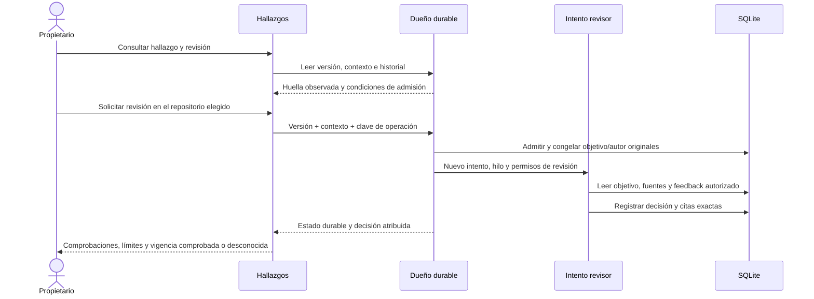

# Revisiones de hallazgos ligadas a una versión

Una revisión es un intento admitido por el propietario que registra comprobaciones
atribuidas sobre una versión concreta. No acepta la tarea, no cambia el hallazgo,
no publica informes y no asigna una probabilidad de certeza científica.

## Recorrido

El modo se decide en la admisión del host, no por el nombre que el agente diga
asumir. El revisor tiene `sources.read`, `findings.read`, `reports.read`,
`wiki.read`, `questions.ask` y `findings.review`. No recibe las escrituras de
capturas, hallazgos, informes o wiki del autor. El catálogo ordinario tiene 23
herramientas; el de revisión, 17. Ambos pueden leer feedback de revisiones.
Ken publicado sigue siendo obligatorio en la sesión nativa.

## Qué identifica la versión

`backend/knowledge/reviews.py` construye una instantánea íntegra y acotada con el
hallazgo, citas guardadas, metadatos y huellas de sus fuentes, informes enlazados
con su contenido y procedencia del intento autor. Omite el embedding derivado y
los estados administrativos del informe o de la propuesta. Un cambio de contenido,
cita, fuente, metadatos o contexto impide transferir la decisión a esa otra versión.
No se recorta silenciosamente un objetivo que exceda los límites.

La autoría de la versión exige más que un `agent_id`: los efectos nuevos del
escritor guardan un sello del contenido, tema, alcance, declaraciones de fuentes y
citas exactas. Para efectos anteriores se reconstruye y compara el intento exacto
del escritor, conservando el orden original de sus referencias. Si no coincide,
la procedencia queda desconocida. Un hallazgo heredado marcado como activo o
validado no acredita un intento nativo autor.

La admisión verifica un autor cerrado y un revisor con actor e intento distintos.
También rechaza reutilizar el hilo nativo del autor. El único trabajo anterior
con propuesta pendiente que puede coexistir con esta admisión es su propio autor;
los otros intentos incompatibles bloquean el inicio.

## Persistencia y autoridad

La migración 34 añade `finding_review_requests`, `finding_review_decisions` y
`finding_review_evidence`, además del tipo de ejecución durable. Las solicitudes,
decisiones y metadatos de citas son inmutables. Las fuentes citadas tienen claves
foráneas incluso cuando constituyen contraevidencia ajena a las citas del autor.

La decisión usa el recibo normal de operaciones, el permiso real, el intento,
fence, contexto y autoridad vigente. Se admite una decisión por solicitud. Un
reintento con la misma clave devuelve el recibo anterior; no añade otra decisión.
La revocación, el cierre o una versión distinta impiden nuevos efectos.

La lectura de feedback de un agente vuelve a comprobar su propio permiso y alcance
en la misma transacción SQL que proyecta el historial o la decisión. Un revisor
puede leerlos; un autor ordinario también. Leer feedback no concede `findings.review`.

`restore_review_schema` sólo permite volver al esquema anterior antes de admitir
cualquier revisión y sin migraciones posteriores. Conserva los datos anteriores y
reconstruye el índice original dentro de la misma transacción. No es una estrategia
para descartar revisiones ya registradas.

## Lectura y comunicación

- `supported`: **Respaldado en lo comprobado**, con comprobaciones y límites atribuidos.
- `needs_revision`: **Requiere cambios**.
- `inconclusive`: **Sin conclusión suficiente**.
- `subject_current=true`: las dependencias coinciden con la versión revisada. No demuestra corrección científica.
- `subject_current=false`: cambió alguna dependencia o el contexto. La revisión queda como antecedente de otra versión.
- `subject_current=null`: no pudo comprobarse la vigencia. La decisión guardada sigue disponible para inspección.

El metadato barato del registro de hallazgos declara presencia de una revisión con
`currentness=not_checked`. No equivale a una revisión vigente. Las antiguas
`confidence` y `validation_method` siguen presentándose como declaraciones históricas.
Las comprobaciones del revisor son afirmaciones atribuidas, no evidencia de que
haya comprendido todo el problema ni de que se haya repetido el experimento.

La vista muestra primero la afirmación, después la revisión y luego las fuentes.
Los identificadores, intentos y huellas quedan en los detalles de procedencia.
Al abrir una cita se solicita su fuente con el hash revisado; un cuerpo distinto
no se presenta como la captura original. El texto se muestra literalmente.

## API y recuperación

| Acceso | Operación |
| --- | --- |
| Propietario | `GET /api/projects/{p}/findings/{f}/review-state` |
| Propietario | `GET /api/projects/{p}/finding-reviews/{request}` |
| Propietario + CSRF | `POST /api/projects/{p}/tasks/{t}/finding-reviews` |
| Permiso de lectura | `GET /api/research-tools/findings/{f}/reviews` |
| Revisor admitido | `GET /api/research-tools/review-subject` |
| Revisor admitido | `POST /api/research-tools/review-decisions` |

Las lecturas del propietario no se almacenan en caché HTTP. El POST lleva hallazgo,
huella observada, versión de contexto, repositorio y clave de operación. Una pérdida
de respuesta conserva el paquete original, también al recargar la página cuando
session storage está disponible. El reenvío exige una acción del propietario y usa
la misma clave. La lectura del estado puede reconciliar su recibo sin otro turno.

Un fallo de lectura no se convierte en «sin revisiones». Se valida el proyecto,
tarea, hallazgo y solicitud antes de renderizar datos. El historial tiene cursor;
la selección inicial usa la revisión más reciente aunque no esté en su primera
página. Un intento activo de otro hallazgo de la tarea bloquea otro inicio.
Cerrar o detener el intento conserva las decisiones ya confirmadas.

Una solicitud cuyo resultado siga siendo incierto permanece fijada al paquete
original. No se descarta automáticamente para crear otra con una clave nueva.
Un conflicto persistente requiere inspeccionar la tarea y su contexto; la interfaz
no promete que una respuesta perdida equivalga a ausencia de efectos.

## Evidencia y obligaciones abiertas

Las pruebas dirigidas cubren autoría de versión, independencia, permisos, citas,
contraevidencia, migración, API de propietario y feedback de agentes. El navegador
prueba el recorrido sobre SQLite/API/coordinador reales con generación controlada,
además del reenvío tras recargar, aislamiento de proyectos y fuentes cambiadas o
corruptas. Los resultados de cada ensayo se guardan en `docs/modernization` y
`docs/design/audits/2026-11-02-finding-review`.

Este contrato no completa la revisión científica del proyecto: faltan el corte de
consumidores heredados, evaluaciones amplias de calidad, aceptación completa de la
página, todos los escenarios del plan y la revisión final independiente de la rama.
