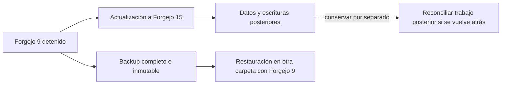

# Forgejo: actualización, TLS y restauración

El Compose fija Forgejo **15.0.11 por digest**, publica sólo en loopback y sirve
HTTPS. Exige elegir los directorios existentes de datos y certificados; una ruta
ausente no se crea automáticamente. El cliente nativo de Researcher exige un
origen HTTPS y verifica el certificado. El cambio de HTTP a HTTPS es parte de la
migración: las URLs antiguas de repositorios necesitan una revisión explícita.

El ensayo documentado parte de **9.0.3**, conserva un repositorio privado con
ramas y PR, migra a 15.0.11 y prueba el cliente de publicación nativo. Después
restaura el backup de 9 en otra carpeta y comprueba cuentas, token, commits y PR.
La copia actualizada conserva por separado su PR posterior. Véanse los
[resultados](../modernization/forgejo-upgrade-results.json) y el
[ensayo ejecutable](../../evals/operation/forgejo_upgrade.py).

La ruta oficial permite actualizar directamente cuando no aplica una excepción
documentada; exige backup consistente y revisión de compatibilidad. Una instancia
que haya migrado desde Gitea/Gogs, use almacenamiento externo o tenga personalizaciones
necesita comprobar también esas condiciones. El tag del repositorio no demuestra
qué versión está ejecutando un host. [Guía oficial de actualización](https://forgejo.org/docs/v15.0/admin/upgrade/).



Restaurar el backup devuelve el estado de su fecha. Las escrituras posteriores
permanecen en la copia actualizada y requieren reconciliación; no aparecen en el
backup antiguo. Volver a arrancar el binario 9 sobre la base ya migrada a 15 no
es el procedimiento de restauración.

## Preparación de una instalación nueva

Para datos previos, elegir exactamente su directorio actual y hacer primero el
backup del apartado siguiente. Para una instalación nueva, preparar directorios
fuera de los workspaces de agentes. Los siguientes comandos son ejemplos para
el usuario local UID/GID1000:

```sh
export FORGEJO_DATA_DIR="$HOME/.local/state/researcher/forgejo-data"
export FORGEJO_TLS_DIR="$HOME/.local/state/researcher/forgejo-tls"
export FORGEJO_PORT=3000

sh <<'SH'
set -eu
mkdir -p -m 700 "$FORGEJO_DATA_DIR" "$FORGEJO_TLS_DIR"
test ! -e "$FORGEJO_TLS_DIR/server.key"
test ! -e "$FORGEJO_TLS_DIR/server.crt"
openssl req -x509 -newkey rsa:2048 -nodes -sha256 -days 365 \
  -subj /CN=localhost -addext 'subjectAltName=DNS:localhost,IP:127.0.0.1' \
  -keyout "$FORGEJO_TLS_DIR/server.key" -out "$FORGEJO_TLS_DIR/server.crt"
chmod 600 "$FORGEJO_TLS_DIR/server.key"
SH
```

Este certificado es local y autofirmado. Importar **sólo el certificado público**
en el almacén de confianza del navegador y en el bundle CA usado por Researcher;
conservar la clave privada en el directorio TLS. Un certificado de la CA de la
organización puede ocupar esos mismos archivos. La renovación es una operación
explícita; el arranque no reemplaza certificados existentes.

Con Docker:

```sh
docker compose config
docker compose up -d forgejo
```

Con Podman rootless sobre el host UID/GID1000 del ensayo:

```sh
podman compose -f docker-compose.yml -f compose.podman.yml config
podman compose -f docker-compose.yml -f compose.podman.yml up -d forgejo
```

El override conserva la identidad del usuario mediante `keep-id`. El supervisor
de la imagen usa root dentro de su namespace; Forgejo se ejecuta como UID1000.
En otros mapeos hay que ajustar y verificar la propiedad de los directorios.
Docker Compose se usó para validar/renderizar la configuración; la ejecución
del ensayo fue con Podman. No se afirma una prueba del daemon Docker.

La URL es `https://127.0.0.1:3000`, o el puerto elegido. El Compose mantiene
registro público deshabilitado, confianza de proxies limitada y autenticación
por cabeceras de proxy deshabilitada. Estos valores son explícitos porque la
imagen v15 conserva un default de confianza de proxies demasiado amplio para
este servicio local. [Configuración de la imagen oficial](https://forgejo.org/docs/v15.0/admin/installation/docker/).

`INSTALL_LOCK` no crea un administrador. En una instalación nueva, crearlo como
una acción separada; sustituir usuario/correo por los elegidos. Para Podman, usar
el mismo prefijo `podman compose -f … -f …` de arriba:

```sh
docker compose exec --user 1000 forgejo forgejo admin user create \
  --config /data/gitea/conf/app.ini --username ADMIN_ELEGIDO \
  --email CORREO_ELEGIDO --admin --random-password --must-change-password=true
```

La contraseña generada se muestra al operador una vez. Crear después una cuenta
de servicio y un PAT con los permisos necesarios, guardado fuera de workspaces
en un archivo privado de modo0600. El ensayo verificó que `write:repository` con
`read:user` rechaza crear repositorios; `/user/repos` requiere `write:user`.
Publicar ramas/PR requiere los permisos de repositorio. Ajustar permisos y alcance
si se elige una organización. [Permisos de tokens](https://forgejo.org/docs/v15.0/user/authentication/token-scope/).

La configuración nativa usa este apartado opcional en el JSON externo seleccionado
por `INFINIBAY_RUNTIME_CONFIG`; las rutas de ejemplo se reemplazan por las reales:

```json
{
  "remote_publication": {
    "api_base": "https://127.0.0.1:3000/api/v1",
    "username": "CUENTA_DE_SERVICIO",
    "token_file": "/ruta/privada/forgejo.pat",
    "ca_bundle": "/ruta/publica/bundle-con-ca-forgejo.pem"
  }
}
```

El bundle es material público de confianza, separado del token y de la clave TLS.
El transporte mantiene verificación de nombre/cadena, sin redirects ni fallback a
HTTP. Las nuevas URLs deben conservar la identidad del repositorio y sus SHAs;
el cambio de instalación no modifica automáticamente los remotos de checkouts.

## Actualizar una instancia existente

1. Registrar versión y digest reales, configuración efectiva, UID/GID y todos
   los almacenamientos utilizados. Conservar la configuración anterior y el
   digest para el ensayo de restauración. Revisar las notas de versiones mayores.
2. Detener admisiones, usuarios y otros productores durante el corte. Ejecutar
   `forgejo manager flush-queues --config /data/gitea/conf/app.ini --timeout 1m`
   dentro de la instancia original como su usuario, y detenerla de forma ordenada.
3. Con el servicio detenido, archivar el volumen `/data` completo, incluidos DB,
   repositorios, configuración, adjuntos, claves y permisos. Conservar además TLS
   y cualquier almacenamiento externo. Registrar hash, imagen/configuración y
   ubicación del backup en un directorio privado fuera de los workspaces.
4. Restaurar ese archivo en **otra carpeta** y comprobarlo con la imagen anterior.
   El ensayo automatizado usa `tar` con propietarios numéricos dentro de
   `podman unshare` y `tar --compare` antes de iniciar la copia restaurada.
5. Apuntar `FORGEJO_DATA_DIR` a la copia que se va a actualizar, preparar TLS y
   revisar `compose config`. Iniciar la imagen fijada; comprobar logs, cuentas,
   permisos, clone, push y PR con sus IDs/SHAs esperados. Ejecutar
   `forgejo doctor check --all --config /data/gitea/conf/app.ini` y revisar la web.
6. Reabrir el trabajo únicamente después de esas comprobaciones. Si se necesita
   volver atrás, preservar primero la copia actualizada y usar la restauración
   del backup con su imagen anterior. Identificar y reconciliar las escrituras
   posteriores antes de dar el retorno por completo.

El ensayo cubre el volumen local SQLite de este Compose. El despliegue real del
usuario, su restauración, datos históricos de Researcher y aprovisionamiento del
host nativo siguen requiriendo sus pruebas específicas.

## Repetir el ensayo sintético

Descargar las dos imágenes por los digests declarados en el script/Compose y usar
el Python instalado del proyecto. La carpeta de salida debe ser nueva:

```sh
python evals/operation/forgejo_upgrade.py --output /tmp/researcher-forgejo-check
```

El script usa `docker-compose` para renderizar la configuración, Podman para la
ejecución, OpenSSL y Git. `--compose` permite elegir el ejecutable de Compose;
`--podman-command` admite un archivo JSON con un prefijo de comando aislado.
Conserva datos/logs/backup, elimina sólo sus contenedores identificados y no llama
a modelos ni accede a la instancia del usuario. Tras un fallo, inspeccionar el
recibo y el estado real antes de iniciar otra ejecución; los POST no se reintentan.
