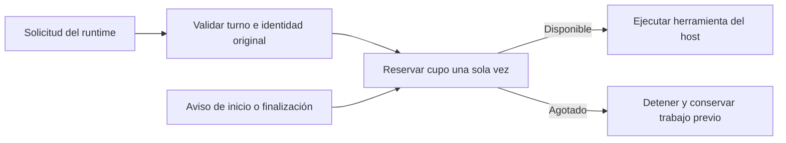

# Límite de herramientas antes del efecto

Una solicitud de herramienta del host consume su cupo antes de entrar al callback
que puede escribir o ejecutar. No depende de recibir antes un aviso
`item/started`. Por ejemplo, con cupo de seis, se pueden guardar fuentes y un
borrador en seis llamadas; la séptima no llega a proponer el resultado. El
borrador se conserva y la tarea explica el agotamiento sin marcar éxito.

## Identidad y orden

La clave es `(turnId, callId)` para solicitudes y `(turnId, item.id)` para
avisos. En Codex 0.166, ambas identidades coinciden: lo muestran la
[construcción de la solicitud](https://github.com/openai/codex/blob/6ff1e1ca3b30fc8b914720681fcf5fe62e95f856/codex-rs/app-server/src/bespoke_event_handling.rs#L1087)
y la [prueba oficial del protocolo](https://github.com/openai/codex/blob/6ff1e1ca3b30fc8b914720681fcf5fe62e95f856/codex-rs/app-server/tests/suite/v2/dynamic_tools.rs#L451).
Es una propiedad verificada de esa versión; hay que comprobarla al actualizar.

El conteo une solicitudes y avisos conocidos. Avisos repetidos o tardíos no
consumen otro cupo. Una finalización sin aviso de inicio sí cuenta. Una nueva
solicitud RPC con identidad ya admitida termina la conexión antes de repetir
el efecto; no se inventa ni se reproduce un recibo anterior. Falta de identidad
o cambio del tipo de herramienta para una misma identidad también se rechaza.
Otro turno puede reutilizar el ID, pero no reinicia el cupo de la sesión.

Sólo la primera finalización de una identidad renueva el plazo de progreso.
Repetir el mismo aviso no mantiene vivo un intento sin avance.

## Observaciones y límites

El campo histórico `observed.tool_starts` se conserva por compatibilidad, pero
ahora cuenta identidades observadas por solicitud, inicio o finalización. Incluye
la primera que excede el límite. `host_tool_requests_admitted` cuenta las
solicitudes admitidas antes del callback; no afirma que su efecto terminó.
`tool_count_basis` describe esta diferencia. En el ejemplo anterior son siete
identidades observadas y seis solicitudes admitidas.

El host controla el despacho de sus herramientas. Para herramientas ejecutadas
por el runtime nativo, los avisos siguen siendo observaciones: el efecto puede
haber ocurrido antes de recibirlos. Tampoco se puede deducir consumo cero de la
ausencia de avisos de tokens. No se afirma una garantía preventiva equivalente
para esos efectos ni que se haya cerrado el presupuesto agregado por proyecto.

[Ensayos, recibos y alcance pendiente](../modernization/host-tool-budget-review.md).
