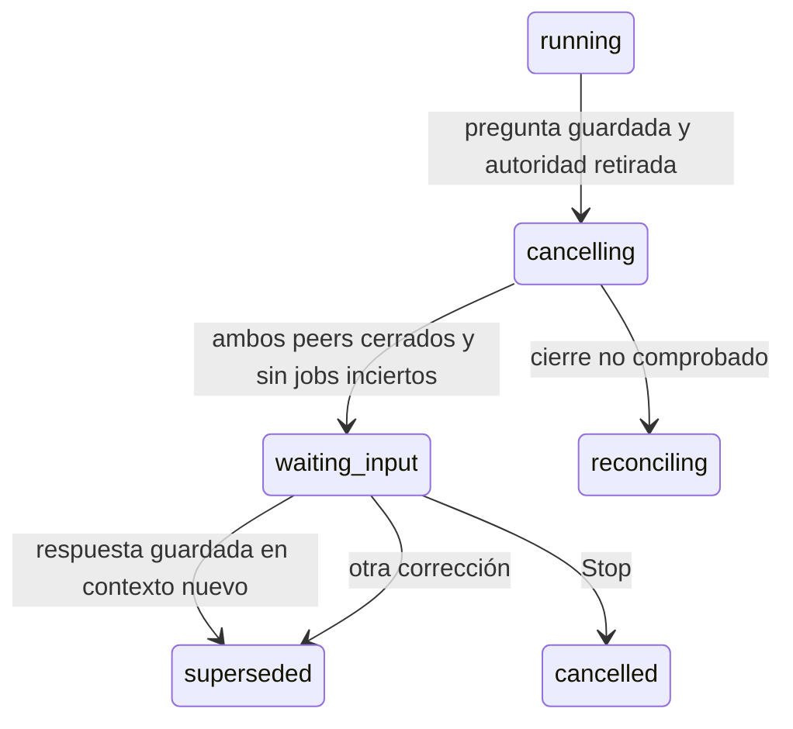

# Preguntas, pausa y respuestas con procedencia

## Contrato actual: opciones identificadas y texto libre (2026-11-07)

Las opciones nuevas aceptan `{id, label}`. La selección se guarda como
`{option_id: "mass_kg"}` y se explica usando su etiqueta original, por ejemplo
«Kilogramos». El texto libre permanece literal aunque coincida con un ID.
El servidor valida la selección contra la pregunta original; proyecto, solicitud,
hilo, contexto y reintento mantienen los controles descritos abajo. Las opciones
históricas de texto conservan su forma; no se les inventan identificadores.

HTTP/MCP, persistencia, contexto y formulario usan este contrato. La bandeja muestra
la prioridad observada de la tarea, sin deducir urgencia. Los clientes antiguos
abiertos no quedan declarados compatibles: la distribución debe actualizar backend
 y frontend conjuntamente. [Verificación actual](../modernization/interaction-acceptance-review.md).
El catálogo actual es9; las referencias siguientes a catálogos2/3 y sus ensayos
son historia, no una afirmación de que siga pendiente retirar el motor anterior.

## Primer recorrido y evidencia histórica

Estado: recorrido de investigación conectado a HTTP, MCP, coordinador y formulario.
La prueba por suscripción `questions-709512e4` usa dos turnos explícitos y datos
temporales. La revisión visual y de comprensión humana sigue pendiente.

## Una pregunta retira la autoridad antes de esperar

El catálogo nativo3 exige llamar a `researcher_ask_user` cuando falta información
que cambia materialmente el resultado o la próxima acción. Una pregunta escrita
sólo en el mensaje final no crea una solicitud respondible. Se agrupan las dudas
después del trabajo independiente útil; un ejemplo condicional no confirma una
premisa ausente. Si el contexto ya responde la duda, no se vuelve a preguntar.
La herramienta no disponible o un recibo incierto se explican como tales, sin
inventar una espera. El host no intenta deducir una pregunta mediante signos de
interrogación ni agrega otra llamada LLM de clasificación.

El catálogo2 conserva su identidad histórica al leer snapshots antiguos; no se
le atribuyen retrospectivamente las instrucciones de la versión3. Las pruebas de
política no garantizan obediencia para cualquier generación. La observación real,
las limitaciones y el recorrido con respuesta guionada quedan en la
[revisión de comunicación](../modernization/communication-flow-review.md).

`researcher_ask_user` recibe una clave de operación y de una a tres preguntas.
Cada pregunta conserva id, texto, motivo, ejemplo opcional y cero o de dos a cuatro
opciones. La respuesta libre siempre es posible. Proyecto, tarea y actor proceden
del grant ligado al intento y turno nativos. Pedir información no concede permiso
para publicar ni amplía las herramientas autorizadas.

Una transacción guarda solicitud, mensaje humano, relaciones con run/intento/contexto
y recibo; cambia el run a `cancelling`, revoca grants y cambia el fence. Un escritor
que esperaba SQLite debe revalidarse antes de confirmar. El host retira también la
autoridad volátil e interrumpe el proceso exacto.

Sólo el finalizador dueño de ambos peers confirma `waiting_input`. No basta un
recibo de interrupción. Stop y correcciones tienen precedencia durable, aunque
cambie el orden de callbacks. Un cierre desconocido conserva `reconciling`;
jobs sin recibo terminal tampoco permiten confirmar espera. El host no mantiene
un turno de modelo ni renueva una lease mientras espera al usuario.
El cierre local no demuestra consumo remoto final: si falta ese dato, la reserva
de presupuesto conserva su límite, sin devolverlo por suposición.

## Responder registra contexto; continuar requiere una instrucción

`POST /api/projects/{p}/tasks/{t}/questions/{id}/answers` exige sesión del propietario,
versión esperada, clave de operación, todas las respuestas por id y pausa confirmada.
Comprueba proyecto y tarea, texto no vacío y límite conjunto de 12.000 bytes.
La ruta antigua `/api/user-requests/{id}/respond` rechaza estas preguntas nativas.

Respuesta, incremento de contexto, procedencia, mensaje en el hilo, invalidación
del run anterior, evento y recibo se confirman juntos. Un error revierte todo.
Reenviar la misma intención recupera la versión original; cambiar respuestas con
la misma clave produce conflicto. Stop u otra corrección caducan la pregunta.
El siguiente contexto conserva las preguntas y respuestas literales, además de la
revisión atribuida al usuario; no depende sólo del resumen de un agente.

La web muestra motivo, ejemplo, opciones y respuesta libre sin elegir por el usuario.
Congela una copia de la intención y conserva su clave si se pierde el recibo.
El polling sólo consulta; guardar no crea otra ejecución. El historial distingue
`question` y `answer` por relaciones canónicas y muestra la versión de la respuesta.
No infiere esa relación de metadatos enviados por un autor.

Por ejemplo, una fuente establece tasa 0,21 pero no la base que el usuario prefiere.
Preguntar por 100 o 200 evita inventar esa preferencia. Después de responder 200,
el informe siguiente explica impuesto 42 y total 242: la base viene del usuario;
la tasa, de la fuente. Eso no prueba que el código de cálculo sea correcto.

## Evolución y comprobaciones

La migración 24 amplía el CHECK de estados mediante copia transaccional de la tabla.
Conserva rowids, referencias, índices y triggers propios, comprueba FK antes del
commit y restaura las opciones de conexión aun ante un error. Sigue el procedimiento
de reconstrucción de [SQLite](https://www.sqlite.org/lang_altertable.html).
Las pruebas comprueban rollback y preservan vista, trigger e índice adicionales.
Una copia de la prueba de conversación se actualizó de 22 a 24 conservando filas y
columnas originales de 104 tablas, sin errores de FK y con actualización repetible.
No se migró una base del usuario.

`human-question-results.json`: 1.110 tests, 1.007 pasan, los mismos 100 fallan y tres
se omiten. La suite completa sigue roja. `human-question-evidence.json` conserva
la prueba real de pregunta, cierre, respuesta repetida sin nuevo despacho e informe
posterior. Se revocaron los grants; no hubo eventos de autonomía antigua ni tarea done.
Pasan ocho tests Node y TypeScript/Vite. Sin navegador disponible, no hay evidencia
de presentación, teclado, accesibilidad ni comprensión humana.

Este recorrido usa la herramienta de negocio de preguntas. Otros pedidos nativos
de entrada o ampliación de permisos siguen cerrándose conservadoramente; no se
aceptan automáticamente. Quedan por migrar preguntas y coordinadores antiguos,
conversación general de roles, recuperación operable de incertidumbre y el resto del plan.
