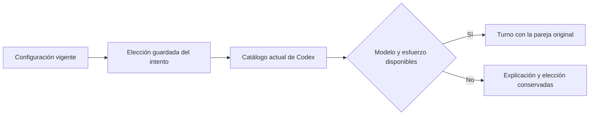

# Modelo y razonamiento por ámbito

El botón **Modelos** de la cabecera permite guardar o restablecer una pareja de
modelo/esfuerzo para todo el espacio, para un proyecto o para un identificador
de agente dentro de ese proyecto. No cambia credenciales ni permisos. La conexión
mantiene Codex por suscripción y Ken obligatorio.

| Prioridad | Ámbito | Si hereda |
| --- | --- | --- |
| 1 | Agente del proyecto | Usa el valor del proyecto |
| 2 | Proyecto | Usa el valor global |
| 3 | Global | Usa la configuración inicial del host |
| 4 | Host | `model` y `reasoning_effort` del JSON del runtime; esfuerzo `low` si falta |

Se hereda la pareja completa. Un cambio no combina el modelo nuevo con un esfuerzo
procedente de otro modelo. Los identificadores de agente son literales: Tareas
muestra el de cada ejecución; una revisión de código solicitada desde esa página
usa `code-reviewer`. No se deduce identidad por un nombre de rol o profesión.

`GET /api/model-settings?project_id=…&actor_id=…` muestra el ámbito, su revisión,
el valor efectivo y, si existe, el último catálogo observado. Sin parámetros se
consulta el predeterminado global. `PUT` exige los mismos identificadores,
`expected_revision`, `model` y `reasoning_effort`. Ambos campos nulos significan
heredar; un cambio concurrente devuelve409 y la web conserva el borrador.
Las rutas requieren sesión local del propietario y CSRF; las credenciales de
herramientas no conceden acceso. Guardar configuración no inicia inferencia.

La migración55 conserva las revisiones de ajustes restablecidos. Al borrar un
proyecto vacío, se eliminan sus ajustes futuros; reutilizar su número no recupera
la configuración de otro proyecto. Las elecciones ya realizadas pertenecen a los
intentos originales y no se borran al cambiar ajustes.

El runtime fija modelo, esfuerzo, procedencia y revisión bajo el lease real antes
de abrir sus actores. La elección se expone como `model_selection`; `model` sigue
siendo la procedencia de inferencia realmente registrada. La pareja se verifica
con `model/list` de la conexión nativa, antes de crear el thread o enviar el turno.
Si falta, se registra `native_model_unavailable`, sin sustitución de modelo,
esfuerzo o proveedor. `turn/start` recibe el esfuerzo elegido; ya no está fijado
a `low`. Esos campos están documentados por [Codex App Server](https://learn.chatgpt.com/docs/app-server#list-models-modellist).

El catálogo visible es una observación fechada, no una promesa sobre la cuenta.
Antes de observar uno, se permite escribir identificadores exactos, indicando que
se comprobarán al iniciar. No se fabrica un catálogo ni se consulta una API de
facturación por uso para llenar el selector.

[Resultados](../modernization/model-settings-results.json),
[instalación](../modernization/model-settings-packaging.json),
[recorrido web](../design/audits/2026-11-06-model-settings/report.md).
El selector de actores conocidos, coherencia de tokens visuales y otros detalles
secundarios quedan para el pulido posterior a todas las tareas principales.
