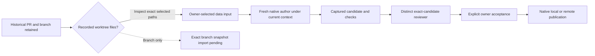

# Historical Git effects and native publication

Every project now uses native owner policy, including before its first admission.
Old PR status is historical metadata: `approved` or `merged` cannot authorize a
source merge, remote merge or deletion of retained branches. Previously the legacy
guard protected admitted tasks and registered physical sources, but a PR without
a task in an unregistered source could still merge directly. Branch creation also
ran Git before a later native task guard rejected its metadata update.

Legacy branch creation, PR merge and direct local/Forgejo merge helpers now refuse
before Git/network/status/events. Old local/remote/merged/stale cleanup and its
periodic worker also refuse; age and old labels do not establish that material is
dispensable. Readers and explicit historical annotations/comments remain. Refusal
does not claim that an old worker has physically closed, material was imported or
the project has a prior native run. Native exact-candidate owner publication,
acceptance, remote transport and recovery keep their existing implementations.

`GET /api/git/prs/{id}/owner-entry` reads the actual project, same-project task,
repository and worktree records correlated by project/repository/branch. A foreign
recorded task remains a label; it does not redirect data or navigation to another
project. The bridge does not inspect Git or files and reports availability and
original context as unknown. The real prior native admission ID is nullable and
is not manufactured from an old PR/agent label. No run, grant or acceptance is
created. Repositories → expanded PR explains the distinction and links to Tasks.

Selected old-worktree and private-copy file imports already use the existing
admission receipt/frozen input, preserving exact bytes and explicit unknowns as
data. Original task type still matters: research history is not silently treated
as a development task. The owner must choose a development task for code input.
Worktree records in this bridge do not prove those paths remain available.

The later [exact branch-input capability](prior-branch-input.md) now acquires
registered branch-only material through the existing owned preparation, with an
explicit full commit and unchanged source. The bridge points to that selection
when an actual branch record exists; it does not invent one. Automatic successor
material selection and broader retained-publication scenarios remain separate.
An ambient host `git show` or trusting a moving branch label would bypass the
existing physical/source policy.

Verification uses actual local Git fixtures (`137` current vs `999` historical),
preadmission PRs without tasks, unavailable historical clones, no remote calls or
new cleanup threads, and actual paired owner HTTP requests. Existing native
candidate/acceptance/publication/remote/recovery and file-data tests exercise the
affected boundaries. The isolated installed-wheel receipt records exact scope;
these contract checks are not another full physical author/reviewer publication
turn, real model/Ken ranking, complete browser/visual acceptance or global suite.
No real model call is required for this retirement.
