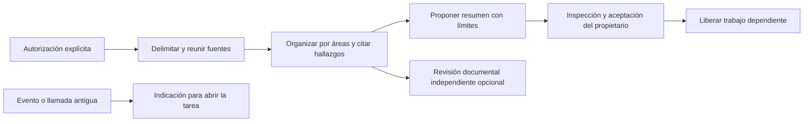

# Investigación exploratoria en el motor nativo

Una tarea `investigation` usa el mismo propietario durable, ejecución Codex,
Ken MCP y sandbox de lectura que la investigación documental. Su resultado propio
es un resumen de alcance, áreas examinadas, hallazgos citados, conclusión, límites
y siguientes pasos. No fuerza PICO, ACH ni una calificación científica.

La última flecha no admite trabajo. Una notificación procesada significa que se
atendió esa notificación; no significa que terminó la tarea o que se detuvieron
los procesos antiguos.

## Resultado y procedencia

`researcher_investigation_summary` recibe un DTO estricto y acotado. Cada área
puede referenciar hallazgos existentes o declarar un aspecto sin evidencia; el
informe completo necesita al menos un hallazgo real. No se inventa una cita para
rellenar un área desconocida. La transacción reutiliza la inserción de informes,
valida las evidencias, escribe el Markdown y guarda el resumen estructurado
inmutable con su contexto, grant, operación y hash en el esquema52.

Un reintento idéntico devuelve el recibo original. Reusar su clave con otra
conclusión se rechaza. `result_propose` sólo admite resúmenes tipados para estas
tareas: un informe libre marcado `summary` no sustituye ese contrato. El snapshot
entregado conserva el resumen completo y su procedencia. El mismo snapshot pasa
al trabajo dependiente después de la aceptación explícita.

Los informes se leen mediante las ventanas y vistas existentes. Los hallazgos
siguen el protocolo independiente de revisión sobre un sujeto exacto. Revisión,
aceptación administrativa y confianza científica siguen siendo conceptos distintos.
La migración conserva tareas e informes históricos; no los convierte en resultados
nativos aceptados.

## Comunicación y límites de conocimiento

Las instrucciones distinguen evidencia observada, explicación o ejemplo aportado
por el usuario e interpretación del agente. No tratan la profesión o una analogía
familiar como prueba de contexto compartido. Piden agrupar las dudas que cambian el
resultado, explicar una interpretación concreta y ofrecer puntos de corrección.

Ejemplo: «La fuente registra137 unidades. Un cálculo separado produce200. No hemos
repetido la medición original ni recibido su protocolo». Esto permite corregir la
interpretación sin confundir leer un dato, calcular con él y verificarlo empíricamente.
Los ejemplos y diagramas ayudan cuando aclaran la decisión; no se exige usarlos
como decoración. Las limitaciones y siguientes pasos quedan en el resultado,
no sólo en un mensaje transitorio.

Se aplicaron contratos explícitos y reutilización de una única fuente de verdad
(`the-pragmatic-programmer`), además de instrucciones delimitadas, entradas tipadas,
ejemplos y evaluación separada, de la [guía oficial de prompting de OpenAI](https://developers.openai.com/api/docs/guides/prompt-engineering).
Las pruebas actuales verifican persistencia, permisos e integración. La evaluación
de calidad con el modelo configurado y de comprensión con personas sigue pendiente;
no se deduce de una prueba con generación controlada.

## Entradas antiguas

`InvestigationFlow.kickoff`, `TaskFlowHandler`, los handlers de revisión/retrabajo
y `TakeTaskTool` devuelven referencias de ejecuciones originales o la acción para
abrir la tarea. No seleccionan agentes, reclaman la investigación, lanzan rescates
ni completan por la palabra `VALIDATED`. La lectura exige el proyecto y la tarea
reales; un identificador ajeno se rechaza.

`MainProjectFlow` filtra esas tareas y termina su despacho con
`native_owner_required`, sin volver a evaluar el progreso mediante el motor antiguo
ni declarar completo el proyecto. El scavenger no las vuelve a ofrecer como
trabajo antiguo huérfano. Los exports de flows son perezosos: importar la entrada
exploratoria no inicializa `MainProjectFlow` ni `LoopEngine`.

La misma protección cubre tareas de otros tipos con historial de admisión nativa.
**El soporte nativo y la retirada completa de un consumidor son condiciones
diferentes.** La investigación científica antigua conserva resultados propios que
faltan migrar; no se la deshabilita sólo porque exista la investigación documental
nativa. Tampoco se afirma exclusión física global de todos los writers/listeners.
Antes de admitir trabajo nativo se conservan las comprobaciones de arranque y
cierre del propietario existente. Una indicación antigua no prueba ese cierre.

## Evidencia

[Resultados y límites](../modernization/investigation-results.json),
[paquete instalable](../modernization/investigation-packaging.json),
[docstrings](../modernization/investigation-docstrings.json).
La prueba con broker/kernel/Git usa generación y Ken controlados; no consume una
inferencia real ni demuestra todos los escenarios del plan.
