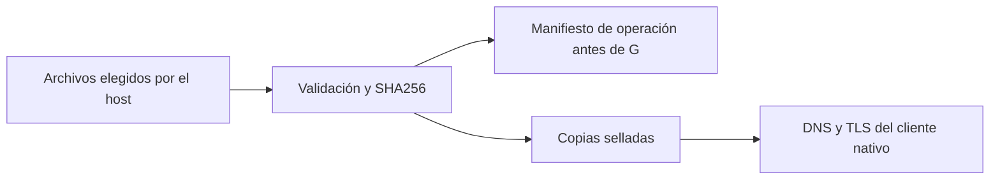

# DNS y certificados públicos del perfil nativo

`NativeNetwork` incorpora archivos de resolución y confianza seleccionados por el
host al transporte nativo del broker. No incorpora credenciales ni configura una
lista de destinos permitidos. La fábrica productiva sigue pendiente de migración.



El host valida y registra los archivos antes de arrancar. Después monta copias
inmutables para el cliente; cambiar los originales no cambia esas copias. El
manifiesto permite identificar qué configuración recibió cada operación.

## Admisión y montaje

```python
network = NativeNetwork.inspect(
    resolver="/etc/resolv.conf",
    ca_bundle="/etc/ssl/certs/ca-certificates.crt",
)
endpoint = owner.native(
    registry, peer_id, operation_key=operation_key,
    asset=codex_asset, network=network,
)
```

Las rutas son decisiones del host. No llegan del prompt ni de argumentos de una
herramienta. El resolver acepta hasta 64 KiB, de uno a tres nameservers numéricos
y directivas de configuración reconocidas. El bundle acepta hasta 4 MiB, bloques
PEM de certificados públicos y comentarios, también con etiquetas Unicode. Se
comprueba que OpenSSL pueda cargar los certificados; los bloques de clave privada
y el contenido arbitrario se rechazan.

Cada entrada debe ser un archivo regular, de root o del usuario del host, sin
escritura para grupo/otros. Se fijan ruta canónica, dispositivo, inode, tamaño,
mtime/ctime y SHA256. La apertura es existente, sin seguir el último symlink y no
bloqueante; FIFO, ausencia, contenido inválido o cambios durante lectura fallan.
Se vuelven a comprobar identidad y contenido antes de preparar el proceso. Los
errores no incluyen los bytes de entrada.

El perfil rechaza rutas dentro de su fuente admitida. Copia los bytes verificados
a memfds sellados y monta sólo esas copias en `/etc/resolv.conf` y
`/run/researcher-network/ca.pem`, en lectura. Los descriptores de los archivos del
host no se pasan al cliente. Se fijan `CODEX_CA_CERTIFICATE` y `SSL_CERT_FILE` a la
copia pública; no se heredan variables de proxy, API keys, HOME ni configuración
OAuth del usuario.

La operación nativa conserva los dos manifiestos y un SHA256 del módulo que
valida los assets, además de las medidas de ejecutable/perfil/gate ya existentes.
Cambiar los inputs invalida reutilizar la misma clave de operación. Consultar un
recibo ya existente con el manifiesto original no vuelve a leer ni lanzar los
assets; tampoco repite la operación si sus originales cambiaron después.

## Evidencia

- El **Codex 0.166.0 real** recibió tokens ficticios y consultó un servidor TLS
  local con CA efímera, sin ningún destino externo. Con CA/nombre válidos se observó
  una petición HTTP; con emisor desconocido o nombre distinto se rechazó TLS y no
  llegó una petición HTTP. El servidor no conserva headers ni tokens.
- En el caso válido, los originales se cambiaron después del sellado y antes de
  spawn: el cliente siguió usando las copias admitidas. La respuesta `{}` del
  servidor no contiene un workspace y Codex la rechazó. No es una cuenta aceptada.
- Inputs modificados antes de preparar el proceso y assets dentro de la fuente
  se rechazaron sin enviar G. Cambiar el manifiesto con la misma clave de operación
  no modificó el journal ni inició otro proceso.
- Un ELF/Python de diagnóstico, **distinto de Codex**, resolvió
  `learn.chatgpt.com`, verificó su nombre/certificado con TLS 1.3 y obtuvo HTTP 200
  mediante HEAD a `/docs/app-server` desde este perfil. No envió credenciales ni
  turnos de modelo; el dominio se retiró al terminar. Es una observación de
  conectividad pública, no una garantía futura del servicio.
- La wheel extraída importa el mismo módulo, arranca Codex real sin cuenta con
  los inputs públicos y comprueba sus hashes en el manifiesto del broker.

La [documentación oficial de autenticación](https://learn.chatgpt.com/docs/auth?surface=cli)
describe `CODEX_CA_CERTIFICATE`, su fallback a `SSL_CERT_FILE` y su uso para HTTPS y
WebSocket. Aquí se comprobó HTTPS del SDK fijado. WebSocket aún requiere su ensayo.

## Límites que siguen abiertos

El perfil comparte la red del host. Los assets permiten DNS/TLS, pero **no impiden
conectar a destinos ajenos, loopback u otros puertos**, ni establecen una política
de egress por cuenta/operación. Las pruebas locales usaron un override de endpoint
exclusivamente en el test; no se añadió ese control al catálogo del modelo.

Siguen pendientes la restricción de destinos, WebSocket, estado nativo persistente,
endpoint administrado inscrito/autoridad por cuenta, OAuth real, Ken y negocio en
el nuevo perfil, code-mode y adopción productiva. El perfil de análisis conserva
su denegación de sockets. Los loops, herramientas, comunicación, prompts, datos y
rediseño de doce páginas siguen dentro del plan completo.
