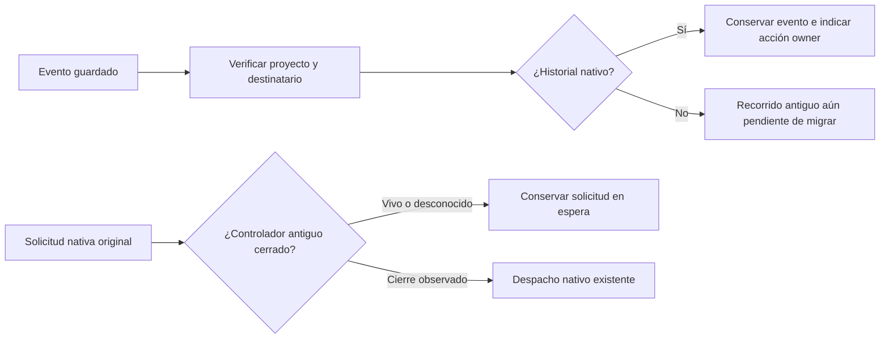

# Transición del proyecto al propietario nativo

## Resultado y fundamento

Un proyecto con una admisión real en `runtime_runs` ya no puede activar sus
productores antiguos registrados, ni siquiera para una tarea nueva que todavía
no tenga ejecución propia. Se comprueba la base del proyecto explícito, no el
rol del agente, su carpeta, un heartbeat ni una etiqueta de la interfaz.
`research` e `investigation` conservan además su protección previa a la admisión.
El historial nativo excluye al productor antiguo; no autoriza una ejecución nueva.

La comprobación compartida vive en `runtime/legacy_handoff.py` y `lifecycle.py`.
La consumen el arranque y la reanudación de AgentLoop/FlowManager/listeners,
MainProjectFlow, el motor antiguo, mensajes/salud/progreso, scavenger y recuperación.
Los proyectos que aún usan sólo capacidades antiguas mantienen esos recorridos
hasta migrar sus resultados. Los datos y worktrees previos se conservan.

## Contexto observado y comunicación

Ejemplo: un mensaje de un proyecto puede llegar cuando el mismo agente atendió
antes otra tarea. El despacho carga el evento persistido y verifica proyecto,
destinatario y tarea antes de modificarlo. El texto de la llamada no sustituye
al almacenado. Establece otra vez el contexto del proyecto, tarea o ausencia de
ella, carpeta, ejecución y reanudación; no hereda las identidades anteriores.
Una reanudación debe coincidir con el progreso guardado.

Para proyectos nativos se guarda en el progreso del evento una indicación de
la acción siguiente. El contenido original permanece intacto. Marcar el evento
como procesado significa que se atendió el mensaje, no que se terminó o aceptó
la tarea. No se crean notas owner, intentos ni permisos a partir de ese mensaje.

En sentido inverso, las fábricas HTTP de RuntimeService observan los controladores
antiguos registrados antes del despacho nativo, incluido un AgentLoopManager
registrado directamente. Un hilo vivo, referencia opaca o error de observación
retiene la solicitud original. El usuario recibe una explicación y una acción:
«El inicio está en espera: no pudimos comprobar que el proyecto esté libre de una
ejecución anterior». Puede detenerla y reintentar, conservando la solicitud.
La explicación declara lo que se desconoce en lugar de dar por probado el cierre.
El dispatcher del plan puede continuar el trabajo autorizado tras observarlo.

## Parada y recuperación

Stop establece una señal cooperativa ligada al proyecto real. El motor antiguo
la verifica antes/después de inferencia y antes de herramientas, resumen y
reintentos. Una respuesta que llega después de la parada o admisión nativa no
habilita la siguiente acción. Esto no interrumpe de forma inmediata una petición
externa que ya estaba ejecutándose.

Un join con plazo vencido conserva el hilo y su registro. FlowManager no mantiene
su lock mientras espera al worker, que lo necesita para terminar. AgentLoopManager
conserva hijos/watchdog vivos. Los callbacks conectados de los listeners siguen
contando como actividad hasta retirarlos explícitamente. Stop sigue disponible
para proyectos nativos y devuelve `registered_workers_closed` junto al alcance
`registered_legacy_threads_only`. Pausado expresa intención del propietario;
no acredita por sí solo el cierre físico de todos los productores.

La recuperación de tareas vuelve a comprobar el propietario en la transacción
de escritura. Ni la inferencia de un agente muerto ni un cierre antiguo resetean
asignación/estado de tareas de proyectos nativos. El scavenger no las reofrece.

## Evidencia y límites

21 casos nuevos verifican estas fronteras. La regresión de autonomía/motor pasa
145 casos; los grupos dirigidos se solapan. El wheel extraído pasa 417 casos sin
fallos ni omisiones en 167,81 segundos, con cuatro casos históricos excluidos
explícitamente. Carga 435 módulos backend sólo del paquete y sus 773 fuentes
Python/SQL coinciden con el checkout. El recorrido de 44,61 segundos usa kernel,
broker, SQLite y Git reales, cuatro turnos científicos/desarrollo controlados,
revisión independiente y aceptación explícita. No consume inferencia real.
Frontend pasa 92 pruebas y compilación; el cambio de texto no supone aceptación
visual o una prueba de comprensión. Hay 107 definiciones nuevas/modificadas con
docstring en inglés. Los avisos de estilo quedan registrados como detalles.
[Resultados](../modernization/project-owner-results.json),
[paquete](../modernization/project-owner-packaging.json).

Este corte no demuestra exclusión atómica entre todos los controladores/procesos,
ni cierre de callbacks ya activos, hijos externos o productores sin registrar.
No se ha retirado todo el motor antiguo: desarrollo/revisión, otros tipos y las
rutas auxiliares de inferencia aún requieren migración. La adopción explícita de
trabajo parcial y candidatos previos es una capacidad principal pendiente; no
se presenta un worktree antiguo como autor nativo ni se rebaja la revisión.
La instalación completa, restore/inversas43–53, suite global, prompts/modelos,
comprensión humana, demás pantallas y revisión final siguen en el plan completo.
