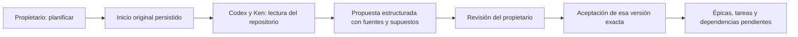

# Planificación nativa de proyectos

Estado: inicio, propuesta y aceptación conectados. El [despacho aprobado](accepted-plan-execution.md)
se incorporó después de este contrato. Sigue pendiente la retirada integral de motores antiguos.

Aceptar equivale a incorporar un plan al proyecto. Por ejemplo, una propuesta
«investigar el parser → corregirlo» crea dos tareas y su dependencia; ninguna
empieza por aceptar. La propuesta del modelo tampoco puede asignar actores,
crear tareas, aprobar resultados ni activar agentes.

## Responsabilidades y contexto

`ProjectPlans` conserva el inicio original, captura el material en la transacción
de admisión y publica una propuesta bajo el intento/contexto auténticos. La política
pura de `models.py` valida las claves locales, tipos, límites, citas y DAG; no
depende de SQLite, HTTP o del modelo. Las herramientas host
`researcher_plan_context` y `researcher_plan_propose` usan el lease original y se
sellan/drenan antes del cierre del dominio. El perfil es el de investigación de
sólo lectura existente, con Ken, sin el permiso genérico `results.propose`.

El material distingue mensaje del propietario, instrucción predeterminada del
host, metadatos del proyecto/tarea y correcciones atribuidas. «El usuario lo dijo»,
«aparece en los metadatos» y «lo supongo» tienen distinta fuerza. Las citas deben
existir literalmente en la fuente atribuida; esto comprueba procedencia textual,
sin demostrar que la conclusión se deduzca de ella. Los supuestos se muestran
separados para que el propietario pueda corregirlos. La ventana de lectura informa
hash, longitud total y cola pendiente, sin ocultar truncamiento.

La propuesta admite hasta 12 épicas y 32 tareas `research`, `code` o `bug_fix`.
Rechaza claves duplicadas, dependencias externas/cíclicas y campos de autoridad
introducidos por el modelo. La expansión añade trabajo y conserva el existente.

## Decisiones durables

La aceptación exige propuesta/hash/contexto exactos, intento original terminado,
resultado nativo completado, ámbito de peers registrado y cierre comprobado de
todos ellos. También rechaza cancelación, contexto cambiado y otro trabajo sin
resolver de la misma tarea. Una transacción crea épicas/tareas/dependencias,
aceptación, resultado y recibo. Reenviar la misma operación devuelve los mismos
identificadores; reutilizar la identidad con otro contenido se rechaza.

El cambio de nombre/descripción del proyecto invalida el contexto de planificación.
Cambiar el contexto de un plan aceptado incrementa el de sus tareas hijas, registra
la causa como evidencia de herramienta, retira permisos y cerca intentos activos.
La historia anterior sigue siendo consultable. Una tarea derivada requiere la
aceptación vigente de su plan y resultados aceptados vigentes de sus prerrequisitos
antes de otra admisión. El estado `done` no puede obtenerse con texto sin resultado.
La invalidación transitiva por cambios de prerrequisitos individuales queda para
el bloque de coordinación.

## API e interfaz

- `POST /api/projects/{id}/start`: persiste el inicio antes de admitir el turno;
  acepta `operation_key`, `prompt` y `repository_id`. Devuelve el mismo inicio ante
  pérdida de respuesta. El cliente web guarda el paquete completo antes del POST.
- La compatibilidad sin cuerpo deriva una clave de los metadatos; el cliente nuevo
  siempre envía una clave explícita. No usar la compatibilidad para inferir una
  decisión nueva después de una respuesta incierta.
- `GET /api/projects/{id}/runs/{run}/project-plan`: material, propuesta, aceptación
  histórica y vigencia/impedimento actuales, sin inferencia.
- `POST /api/projects/{id}/runs/{run}/project-plan/accept`: decisión del propietario
  con `operation_key`, `proposal_sha256` y `context_version`; protección owner/CSRF.
- `POST /api/projects/{id}/stop`: solicita retirada de trabajo nativo y teardown
  antiguo registrado. El estado pausado expresa intención, sin inventar cierre.

Se necesita un repositorio registrado. La API permite selección explícita; el
inicio web actual requiere un único registro activo. Selector múltiple y arranque
de proyecto vacío quedan registrados para la integración de Proyectos. Tareas
muestra fuentes, supuestos, criterios y dependencias; conserva la aceptación
original tras recarga y enlaza el trabajo creado pendiente.

`/start` ya no inicializa equipos, threads ni autonomía CrewAI. Registros locales
de flows, listeners o autonomía antiguos bloquean su entrada aunque haya terminado
el thread raíz. Eso no demuestra exclusión física global de consumidores antiguos:
FlowManager, LoopEngine y otros flows aún requieren cutover. El [cliente terminal](terminal-owner-client.md)
sustituyó después el orchestrator/CLI/TUI antiguo; su paridad avanzada sigue pendiente.

## Evidencia y límites

[Resultados](../modernization/native-planning-results.json): 94 pruebas backend
dirigidas, 83 frontend y compilación; 100 pruebas desde wheel aislado. La integración
nativa usa controller, broker, kernel, fuente readonly y cierre reales, con generación
y comando Ken controlados. No equivale a un turno de modelo real.

[Auditoría de interfaz](../design/audits/2026-11-05-native-planning/report.md): nueve
estados con API y almacenamiento reales, generación y testigos de cierre sintéticos
explícitos. Dos reenvíos de inicio/aceptación producen un turno, una propuesta y un
grafo, con cero ejecuciones hijas. No demuestra comprensión humana representativa,
aceptación de páginas completas ni suite global verde.

Siguen pendientes despacho durable y handoffs tipados, retirada integral legacy,
lifecycle/borrado/restore, inversas de migración, ampliación de tipos, evaluación
de prompting y rediseño integral. Los detalles secundarios están en
[la lista diferida](../modernization/deferred-details.md).
