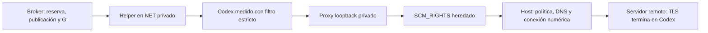

# Cliente nativo en red privada

El broker ya compone NativeProxyCapsule, el helper sellado proxy_payload.py y el
puente del host. Es un perfil explícito del transporte nuevo; la fábrica productiva
de CodexRuntime todavía usa su lanzador anterior y requiere migración.

G autoriza el arranque. El helper crea su listener en el namespace privado; Codex
sólo puede salir mediante él. El host recibe el socket y autoriza su CONNECT. El
contenido TLS permanece cifrado hasta llegar al cliente/servidor.

## Admisión y capacidades

El caller del host suministra asset, NativeNetwork y EgressPolicy a owner.native o
broker.run_native. Se omite share-net: hay loopback, sin ruta al host. El perfil
anterior sin egress conserva su contrato y no ofrece esta restricción. El modelo
no recibe un parámetro para cambiar política ni seleccionar el helper.

La operación conserva readonly-native-codex-connect-v1, política completa, medidas
de ejecutable/perfil/gate, inputs públicos y hashes de helper/puente/canal/validador.
Cambiar política con la misma clave da conflicto; retry equivalente sólo consulta
el recibo, sin otro canal/proceso. El canal se crea después de reservar y registra
bajo lock de decisión antes de G. Stop durante creación o bind impide enviar G.

El FD hijo se duplica bajo lock y permanece fijado hasta spawn. La versión probada
de bubblewrap conserva ese FD heredado sin flags adicionales; no existe la opción
preserve-fds considerada inicialmente. Después de G, el helper cierra los FDs extra
y se declara no inspeccionable sin autoridad de ptrace. Abre loopback y crea el
hijo nativo; éste cierra canal/listener y añade un filtro seccomp antes de exec.
No puede bind/listen/accept, crear sockets Unix con dirección, controlar namespaces,
leer/escribir memoria ajena ni usar pidfd_getfd. Ambos siguen en el dominio original.

El helper fija HTTP_PROXY, HTTPS_PROXY y ALL_PROXY a su listener y NO_PROXY vacío,
sin credenciales heredadas. Conserva hogar privado efímero y CA sellada; la fuente
sigue readonly. No se monta auth.json ni el hogar administrado.

La copia resolv.conf describe el entorno del cliente. El puente resuelve con la
configuración del host, no con esa copia: se valida cada respuesta y conecta por
IP numérico. No se afirma que el DNS del host esté congelado. Su resolver por
defecto usa un hijo directo acotado fuera del cgroup nativo probado; inscripción y
origen completo de servicios del host siguen pendientes.

## Cierre y evidencia

Stop retira canales/sockets antes de SQL y de esperar constructores. Cerrar un peer
retira sólo su canal/namespace; el análisis hermano puede continuar. El dominio
drena canales antes de confirmar su cierre durable. EOF del host termina al nativo;
salir del namespace retira también descendientes. Se espera con plazo el evento
real cgroup vacío: waitpid del supervisor y ese contador no son el mismo evento.

El broker guarda el hijo inmediatamente después de spawn, antes de cualquier
limpieza que pueda fallar. Se reprodujo y corrigió el caso que retiraba el dominio
pero perdía la recogida del hijo en el host por hacer esa limpieza primero.

Codex0.166.0 real hace HTTPS por el puente al servidor de prueba con tokens ficticios.
CA/nombre correctos llegan a HTTP; emisor/nombre incorrectos no. La respuesta vacía
no acredita cuenta/workspace y el SDK la rechaza. Su redirección de prueba produce
un CONNECT nuevo denegado antes de resolver/dial el nombre ajeno, sin salida directa.

Un ELF/Python de diagnóstico, distinto de Codex, no conecta al listener del host,
ve NET diferente y no escribe fuente ni inspecciona FDs del helper. Sólo recibe
FDs0/1/2 y el proxy fijo; bind/Unix/pidfd_getfd se deniegan. Retirar el filtro hizo
fallar la prueba; se restauró. También se prueban túnel activo con SQL ocupado,
pérdida de canal con descendientes, análisis hermano, carreras Stop/arranque y
retry/política cambiada. La wheel aislada usa el perfil con Codex real sin cuenta.

Un ensayo separado con la autenticación existente logró account/read de tipo
ChatGPT por este perfil, sin thread/start ni turn/start. No se persistió auth.json
en el hogar nativo; dominio, peer y canales se cerraron. No se publicaron datos de
cuenta ni tokens en la evidencia. Esto verifica metadatos autenticados, no permisos
de un modelo, renovación OAuth ni una generación por suscripción.

Faltan generación real con Ken y WebSocket del SDK, estado nativo persistente,
endpoint administrado inscrito/convivencia por cuenta, OAuth, Ken/negocio/code-mode,
adopción productiva y origen completo de actores. TCP opaco tampoco es firewall L7
ni demuestra autorización remota. Las pruebas de contrato usan credenciales ficticias; el ensayo de cuenta usó sólo
la lectura de autenticación existente, sin generación de modelos. El plan completo de engine, herramientas, prompts, comunicación, datos
y doce páginas sigue activo.
