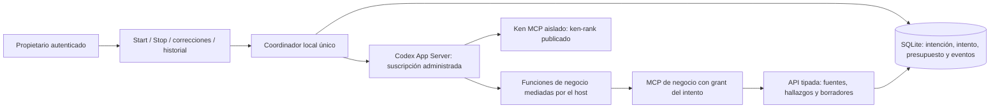

# Runtime nativo y coordinación del primer recorrido

Estado: implementado para tareas de investigación mediante la API del propietario.
El engine heredado y sus demás capacidades todavía requieren migración. Tareas
y Chat ya tienen entrega funcional sobre este coordinador; ver `human-workspace.md`.
No hay aceptación visual ni reemplazo completo de los flows antiguos.



## Responsabilidades

`RuntimeService` coordina un turno nativo por solicitud explícita; no implementa
un loop de planificación LLM. `SQLiteRunStore` conserva identidad, fencing,
recibos, contexto y presupuestos. FastAPI traduce comandos del propietario.
El adaptador Codex posee inferencia y ejecución interna. Los imports y el
arranque del servidor no envían turnos.

El dueño se excluye mediante `flock` sobre un archivo junto a la ruta canónica
de la DB, con descriptor no heredable y apertura sin seguir symlinks. Después
de adquirirlo se retira autoridad de los intentos activos de otro dueño. Quedan
en reconciliación; nunca se reenvía automáticamente su prompt. Cancelar el
arranque drena la adquisición pendiente y libera su descriptor.

El propietario selecciona un repositorio registrado del proyecto. Debe estar
dentro de la raíz administrada, sin DB/control/credenciales dentro del código,
y sin solapamiento con otro proyecto. Varios repositorios requieren selección
explícita. La configuración global permite elegir `model` y requiere reiniciar para
cambiarlo; todavía no hay selector web ni elección por agente. El modelo no
elige rutas, actor, proyecto ni grants. Este recorrido
admite tareas `research`; no simula disponer todavía de herramientas de desarrollo.

## Antes del turno

1. Admitir idempotentemente por intención y reclamar un intento con lease/fence.
2. Emitir un grant, vincularlo al intento y registrar autoridad volátil en el host.
3. Abrir los peers en una única tarea asíncrona. Comprobar cuenta `chatgpt`,
   proveedor OpenAI, CLI 0.166.0, configuración efectiva y disponibilidad de Ken.
4. Guardar thread, catálogo SHA256, versión, workspace y límites antes de `turn/start`.
5. Reservar un turno y su margen de tokens dentro del presupuesto del proyecto.
   Una reserva existente nunca autoriza reenviar el turno.
6. Guardar el turn id cuando llega su recibo. Heartbeats y límites temporales
   impiden actividad indefinida. La espera de un callback no bloquea Stop.

La migración 21 conserva reservas y presupuestos **acumulados del proyecto**, sin
ventana temporal ni renovación automática. Una política ya persistida no cambia
por editar la configuración; hace falta una decisión explícita del host. La
concurrencia predeterminada es dos proyectos y un intento por proyecto.

Los contadores nativos son observaciones acumuladas: se conserva su máximo,
no su suma. Si se pierde el resultado, se cobra al presupuesto de trabajo el
mayor entre la reserva y lo observado. Sin uso reportado, se conserva la reserva;
no se muestra cero. Esto no mide saldo de suscripción ni garantiza un límite
físico de facturación; una llamada despachada puede consumir antes de observarla.

## Dos MCP con fronteras distintas

Ken usa la distribución aislada publicada `ken-rank==0.18.0`, no el checkout
de desarrollo. `ken_worker.py` ejecuta bubblewrap sin red, código de ese proyecto
en lectura, sólo su `.ken` en escritura y HOME privado. Los archivos de modelos
públicos se montan individualmente después de verificar tamaño y SHA256 contra
los cuatro manifiestos del paquete. No se monta todo el cache del usuario.
Descriptores fijan los mounts antes del arranque; no quedan accesibles al worker.
Se necesita preparar el índice con esos assets disponibles. Ken sí realiza
inferencia local de embeddings/ranking; no es inferencia generativa facturada.

El MCP de negocio conserva sus diez herramientas. El host copia sus schemas y
resultados a funciones dinámicas de Codex. El bearer permanece en su propio
child MCP; no entra en argv, config ni entorno del peer del modelo. Las reglas
de negocio siguen en la API/servicio existente, sin duplicarlas en el puente.
La API de herramientas vuelve a comprobar grant, contexto, lease y fence dentro
de la transacción. La autoridad volátil también se comprueba allí: un writer
que esperaba SQLite no puede confirmar una nueva operación después de Stop.

Codex conserva acceso a su autenticación administrada. El modelo sólo recibe
el perfil de inferencia de lectura; shell, ejecución directa, apps, hooks,
skills de host e integraciones ajenas están desactivados. El endpoint de cuenta
es el de ChatGPT, admitiendo su normalización con slash final. No hay copia de
OAuth, cliente de refresh propio ni fallback a una API por uso.

El catálogo de `gpt-6.1-sol` selecciona `code_mode_only`. Desactivar su host
JavaScript dejó todas las herramientas inutilizables en la primera prueba real.
Ahora se requieren `code_mode_host` y `code_mode_interrupt`; sus herramientas
delegadas conservan las fronteras anteriores. El código oficial de la versión
0.166.0 describe un isolate V8 sin Node, filesystem ni red; esa descripción no
sustituye las comprobaciones de cada herramienta delegada. [Fuente oficial](https://github.com/openai/codex/blob/rust-v0.166.0/codex-rs/code-mode-protocol/src/description.rs).

## Stop, correcciones y cierre

Stop retira primero la autoridad volátil e inicia interrupción física en paralelo
con la intención durable. Una escritura SQLite ocupada no retrasa esa retirada.
Su recibo HTTP 202 puede mostrar `cancelling`; no equivale a proceso terminado.
El adaptador retira su proceso RPC directamente poseído, nunca un PID reportado
por un namespace. El MCP drena sus contextos en la misma tarea que los abrió.
Sólo con ambos cierres confirmados, revocación persistida y ausencia de jobs
inciertos se permite el estado final `cancelled`.

Un error de teardown conserva `reconciling`, la propuesta disponible, el contexto,
las reservas y la prohibición de repetir. Un fallo nativo con peers cerrados
conserva su recibo y puede terminar en `failed`. Los demás errores que no tienen
prueba de cierre quedan pendientes de reconciliación. No existe aún una UI ni
un procedimiento completo para resolver todos los intentos inciertos tras crash.

Una corrección valida contenido y versión antes de retirar actividad, registra
procedencia y crea contexto nuevo. No afirma haberse aplicado dentro del turno
anterior ni inicia otro por su cuenta. El siguiente run explícito recibe tarea,
solicitud y revisiones ordenadas. Ejemplo del recorrido probado: base 100 → base
200; misma tasa 0.21; impuesto 42 y total 242. Los informes siguen siendo drafts
y ninguna finalización nativa cambia la tarea a `done`.

## Entrega y configuración

Configurar `INFINIBAY_RUNTIME_CONFIG` con un archivo JSON del host, fuera de las
fuentes administradas; ver `docs/config/runtime.example.json`. Sus paths deben
existir, salvo `control_root`, que se crea privado. `api_url` debe apuntar al
servidor local. El servidor sigue sin inferir al arrancar. Sin configuración,
la admisión nueva responde 503 y explica que falta configurar el runtime.

Se requiere el CLI fijado, bubblewrap, Python/uv, MCP de negocio con su lock,
instalación aislada de Ken y sus assets públicos verificados. Este avance no
incluye un instalador limpio ni descarga/bootstrap completa de esos assets.
Preparar un workspace con la misma frontera usada por el servidor:

```sh
.venv/bin/python -I -m backend.runtime.ken_worker \
  --ken-command /ruta/aislada/bin/ken --workspace /workspaces/alpha \
  --model-cache /cache/publico/huggingface/hub --prepare
INFINIBAY_RUNTIME_CONFIG=/estado/researcher/runtime.json uv run python -m backend.api.run
```

El propietario se empareja con el mecanismo local de sesión. Endpoints nuevos:

| Operación | Ruta |
| --- | --- |
| Iniciar | `POST /api/projects/{p}/tasks/{t}/runs` |
| Leer ejecución | `GET /api/projects/{p}/runs/{run}` |
| Stop | `POST /api/projects/{p}/runs/{run}/stop` |
| Corregir | `POST /api/projects/{p}/tasks/{t}/context-corrections` |
| Contexto | `GET /api/projects/{p}/tasks/{t}/runtime-context` |
| Historial durable ascendente | `GET /api/projects/{p}/runtime-events?after_id=0` |

Start recibe `operation_key`, `context_version`, `request` y opcionalmente
`repository_id`. La cookie del propietario y CSRF protegen mutaciones. Un bearer
de agente no autoriza estos controles. Historial usa id de commit, conserva
entidad/fuente y pagina sin reordenar eventos con timestamps iguales. Sigue
pendiente integrar este catch-up con el frontend y WebSocket, así como cursores
vencidos por retención.

## Evidencia y trabajo que queda

`product-runtime-evidence.json` conserva la prueba real fuente → cita → informe
→ corrección → segundo informe y los intentos fallidos. `product-stop-evidence.json`
conserva Stop real durante generación. `native-boundary-evidence.json` contiene
metadatos, Ken, negocio, restricciones y cierre sin turnos generativos;
`ken-isolation-evidence.json` contiene el ensayo del paquete publicado.

La reanudación no sustituye un catálogo dinámico: exige hash guardado y workspace
coincidente. El intento de reabrir un thread sin turnos falló como `thread not loaded`;
no prueba reanudación productiva. El coordinador crea un thread para cada solicitud
explícita y no usa esa ruta para repetir trabajo incierto. Recuperación completa,
preguntas humanas pendientes, capacidades restantes, migración de escritores
antiguos, presupuestos operables desde UI, todas las evaluaciones de prompts y
el rediseño de las doce páginas siguen abiertos.
