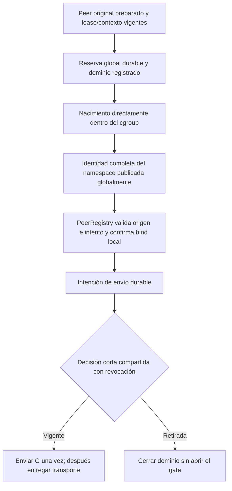

# Broker de peers: reserva global, publicación y gate

Después de `9b352c8`, `PeerBroker` compone el registro testificado, el dominio
Linux y `PeerRegistry` en una operación de host: `run_peer`. El coordinador no
tiene que ejecutar por separado reserve/spawn/bind/G. El primer perfil concreto
es **análisis Python de biblioteca estándar con fuente de solo lectura**.

Es un componente interno implementado y probado con procesos reales. Todavía
no sustituye los lanzadores productivos de `RuntimeService`, no tiene endpoint
IPC/HTTP y no aprovisiona el dominio completo de Researcher. No habilita edición.

## Qué ocurre antes de permitir el programa



La reserva liga DB física original, intento/fence, proyecto/tarea, versión de
contexto, binding de fuente, identidad del dominio y propietario del broker.
Una referencia global admite una sola concesión participante a la vez y aumenta
su fence monotónico. Dos DBs que consideran suyo el mismo directorio no pueden
activar ambos brokers sobre el mismo registro. Esta serialización tiene coste
de concurrencia y no incluye todavía los escritores heredados que lo evitan.
La referencia al intento original permanece después de retirar su dominio: un
dominio nuevo no puede reutilizar esa misma DB/intento/fence aunque el SQL local
todavía conserve una lease válida. Hace falta un intento nuevo explícito; los
recibos antiguos siguen siendo consultables sin recuperar autoridad.

`PeerRegistry.admission` y `bind` revalidan la lease mediante el mismo adaptador
concreto. No se acepta un callback que sólo afirme `local_bound=True`. Antes de
`bind`, la identidad ya está confirmada globalmente; antes de G, el vínculo local
ya está confirmado. La fuente abierta se compara contra el binding original y
se monta en la ruta lógica privada, sin resolver nuevamente el nombre durante uso.

El cliente recibe copias de los extremos de datos **después** de G. El broker
retiene sus descriptores de supervisión y el reaping. Cerrar el transporte del
cliente no puede cerrar el pidfd del propietario. No hay un método público para
volver a enviar el gate ni se entrega un transporte al repetir la operación.

## Evidencia de envío y respuesta perdida

Una clave de operación identifica código y perfil lógico; cambiar la intención
con la misma clave se rechaza. Repetirla devuelve sólo el recibo existente.

| `gate_sent` | Evidencia que conserva |
| --- | --- |
| `false` | El broker no intentó el envío, o conserva prueba viva de retirada anterior. |
| `true` | Observó que el kernel aceptó el byte. No demuestra que el programa terminara. |
| `null` | La intención de envío se confirmó, pero falta evidencia durable de si se envió. |

Por ejemplo: el programa imprime su resultado, muere el broker antes de guardar
la confirmación y el recuperador sólo encuentra `dispatching`. Se conserva `null`;
no se cambia a «no ejecutado» ni se repite G para averiguarlo. Un broker que aún
conserva la observación del write puede guardarla durante la retirada. El exit
code desconocido tampoco se convierte en cero por cerrar el dominio.

## Revocar sin esperar a SQLite

Revocar comparte sólo la decisión corta de G: retira la admisión antes de esperar
SQL, cierre o constructores. Detiene físicamente el dominio mediante su handle
fijado, drena el lanzamiento/bind local y después confirma los tombstones y la
liberación global. Una DB global ocupada no impide ese cierre físico; impide
declarar la liberación durable. La misma instancia conserva el recibo físico para
reintentar la persistencia sin repetir la ejecución.

Si otro proceso recupera una concesión, primero exige prueba de que el propietario
anterior terminó: pidfd/start ticks del propietario en el observador registrado.
Un propietario vivo se rechaza; falta de visibilidad conserva incertidumbre. El
recuperador abre el dominio por identidad desde el registro y no abre ni recrea la
DB del proyecto. El cierre y la liberación se confirman sin aceptar una tarea.

## Transporte asíncrono y alcance del cierre

`JsonRpcClient` conserva correlación, streaming, límites y backpressure sin crear
ni señalar procesos. Su endpoint tiene `open(limit=...)` y `aclose(timeout=...)`;
es quien posee el ciclo de vida. `StdioRpcClient` mantiene el adaptador CLI actual
y sus consumidores mientras se migra el lanzamiento productivo. No hay dos loops
de inferencia ni otra implementación del protocolo.

`AsyncPeerBroker` conecta ese cliente con `PeerBroker.run_peer` real. Usa tuberías
no bloqueantes del event loop y tres ejecutores separados: lanzamiento, cierre
de un peer y Stop de todo el intento. Admite ocho lanzamientos pendientes y un
historial máximo de 128 endpoints. Cada endpoint se abre una sola vez; un recibo
repetido sin transporte exige reconciliación y no provoca otro lanzamiento.

```python
async with AsyncPeerBroker(broker) as owner:
    endpoint = owner.peer(registry, peer_id, operation_key=key, code=program)
    async with JsonRpcClient(endpoint) as client:
        result = await client.request(method, params)
```

Este ejemplo requiere objetos de host ya aprovisionados/admitidos. No crea un
dominio a partir de una ruta vacía ni conecta por sí solo el servicio productivo.
El perfil de análisis actual puede ejecutar un peer JSON-RPC de ensayo; no es un
perfil autorizado para ejecutar Codex o Ken.

Los cierres tienen alcances distintos:

| Acción | Efecto demostrado |
| --- | --- |
| Cerrar un endpoint conectado | Cierra su namespace original y persiste `execution_closed`; conserva la concesión y los peers hermanos. |
| Cancelar un arranque que aún no entregó transporte | Retira todo el intento, porque la identidad/entrega aún es incierta; recoge también los FDs que terminen de llegar. |
| Cerrar el propietario asíncrono | Retira admisión y dominio completos antes de esperar publicación, SQL o trabajadores; después drena el trabajo de cierre pendiente. |

`PeerBroker.close_peer` prueba cierre físico antes de intentar confirmar su recibo
global. Si SQLite está ocupado devuelve contención, conserva la concesión y permite
reintentar sólo ese cierre. No proyecta todavía la retirada en el SQL del proyecto:
esa integración queda pendiente. Ya se corrigió el prerrequisito de apertura: las
transacciones de `SQLiteRunStore`, el registro de workspaces, las vistas del dueño
y el store de investigación usan `mode=rw`. Si la DB desaparece, falla la apertura
sin crear un fichero vacío; el bootstrap explícito mantiene su creación normal.
La codificación de la URI conserva nombres con `?`, `#`, `%` y espacios. Este modo
no demuestra identidad física, no sustituye los checks de origen y no protege por
sí solo una sustitución de un fichero existente.

Una escritura bloqueada tiene deadline y no retiene el event loop. Al cerrar se
aborta la tubería de escritura antes de liberar sus FDs: un cierre graceful podría
dejar un callback pendiente escribiendo sobre un número reutilizado por otro
archivo. Las pruebas reprodujeron ese fallo y su interferencia con SQLite. El
arranque tampoco devuelve una conexión si su cierre ya empezó; un error de limpieza
queda encadenado al error original en lugar de desaparecer.

El cierre físico, el recibo durable y la aceptación de la tarea siguen siendo
hechos distintos. Ninguna de estas operaciones marca la tarea como completada.

## Perfil de análisis implementado

El capsule parte de filesystem vacío: runtime Python/base y bibliotecas declaradas,
fuente readonly, `/proc` privado y directorios temporales nuevos. No monta HOME,
credenciales, cgroupfs, sockets del administrador ni el registro de autoridad.
El gate y el filtro se copian a memfds sellados; los FDs auxiliares sólo se pasan
al constructor. Este Python no expone `os.memfd_create`, por lo que el helper C
realiza esa operación y sus sellos, sin fallback a assets editables.

El filtro seccomp verificado para x86_64 bloquea sockets/socketpair, interfaces de
namespace/mount/control y el ABI x32. Bloquea clone3 del payload con ENOSYS para
permitir el fallback ordinario de libc a fork/clone; los clones con flags de nuevos
namespaces se rechazan. Esto no altera el clone3 del host que establece el dominio.
Los hijos conservan el filtro tras fork/exec.
[Contrato de seccomp](https://man7.org/linux/man-pages/man2/seccomp.2.html).

Se imponen 128 procesos, 512 MiB y swap cero en el dominio delegado antes de actuar;
faltan controllers o no se aplican los valores → fallo, sin ejecución alternativa.
Las pruebas hacen forks hasta recibir rechazo dentro del límite privado y después
cierran todos los descendientes. El perfil también se ensaya con socket directo,
syscalls crudos, subproceso, symlink al controlador y escritura por path/FD de fuente.
[Opciones de Bubblewrap usadas](https://raw.githubusercontent.com/containers/bubblewrap/v0.13.1/bwrap.xml).

## Comprobaciones realizadas

- Orden global/local/G con `PeerRegistry` y namespaces reales, cálculo desde una
  fuente 137 que produce 200, y retry sin otro namespace ni gate.
- Revocación mientras el bind local está bloqueado; el dominio desaparece antes
  de liberar ese bloqueo y no se envía G.
- SQL global ocupado durante Stop y pérdida del sello posterior al envío.
- SIGKILL del broker antes de publicación global, antes del bind local y después
  de G antes de su confirmación; recuperación en otro proceso tras eliminar la DB
  original. Se conserva la diferencia entre «no enviado» y «envío desconocido».
- Propietario vivo no adoptable, dos DBs sobre fuente idéntica, presión de forks,
  límites de recursos y supervivencia de la supervisión al cerrar el transporte.
- Rechazo de reactivación con dominio nuevo y lease local anterior después de Stop.
- JSON-RPC real sobre peers del broker: dos conexiones, cierre independiente,
  eventos, peticiones del servidor, stderr, EOF, frames inválidos/grandes,
  backpressure y deadline durante escritura bloqueada.
- Stop con trabajador de cierre bloqueado, cancelación durante bind y cancelación
  justo después de un nacimiento completado sin dejar FDs sin entregar abiertos.
- Wheel nativa extraída, importación aislada `-I -S`, mismo recorrido desde datos
  sintéticos migrados, retry y retirada real. El bootstrap sigue siendo de test.

[Resultados y límites actuales](../modernization/peer-broker-evidence.json).
[Transporte asíncrono y regresiones](../modernization/broker-stdio-evidence.json).

## Trabajo pendiente de la autoridad completa

1. Inscripción externa y origen completo de actores; creación del dominio tras
   intención durable, generaciones no reutilizables y migración de escritores
   anteriores. Un cgroup temporal vacío no acredita esos hechos.
2. Composición productiva/autenticación del broker, RuntimeService/CommandJobs,
   captura durable y acotada de salidas, wall/CPU/lease fuses y retiro del intento
   local. Este componente no añade un scheduler ni un loop de inferencia paralelo.
3. Perfiles de Codex/Ken/negocio y desarrollo, manifiestos de runtime/assets unidos
   al catálogo durable, compatibilidad durante upgrades y pruebas adversarias de
   cada perfil. El perfil actual no permite inferencia, red ni edición.
4. Recuperación del crash después de eliminar el cgroup y antes de confirmar su
   retirada. Sin recibo durable ni prueba externa de padre/generación/no-rename,
   un dominio ausente sigue incierto; no se interpreta como instalación vacía.
5. Restore/handoff, conservación externa de presupuestos inciertos, observabilidad
   y aceptación completa entre despliegues/alias. No se restablece ninguna cuota
   ni se reconcilian efectos remotos a partir de un cierre de procesos.

Los loops/autonomía/flows y lanzadores antiguos siguen pendientes de sustitución.
La concesión sólo coordina los participantes del nuevo broker; su prueba no
demuestra exclusión global de todo Researcher ni cierra el plan de modernización.
