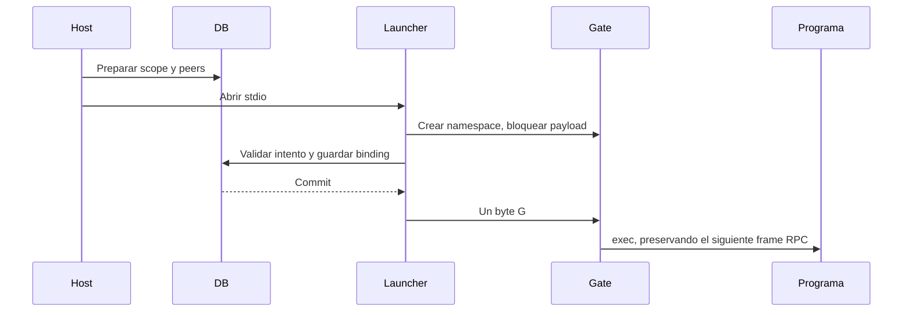

# Cierre comprobable y recuperación sin replay

Estado: integrado en el recorrido nativo de investigación. Comandos, consumidores
antiguos, transferencia entre despliegues y aceptación visual siguen pendientes.

## Autoridad, ejecución y resultado son hechos distintos

Revocar herramientas no deshace escrituras anteriores. Un líder terminado no
demuestra que acabaron sus hijos: `setsid()` puede sacarlos del grupo. El resultado
y consumo remoto pueden seguir desconocidos después del cierre local.

Una revisión independiente con contexto limpio contrastó esas diferencias con el
engine. Se eligió un namespace PID por peer para conservar los adaptadores RPC/MCP
sin añadir otro motor. Esta frontera controla duración; **no reemplaza** los perfiles
de archivos/red, el aislamiento de Ken ni la separación de credenciales.

La migración 25 registra scope, peers y operaciones de recuperación. En producción,
claim, scope y peers nativo/de negocio se registran en una sola transacción. El launcher conserva el
payload bloqueado mientras registra PID del init visto desde el host, inicio del
proceso, kernel y namespaces privado/observador. Verifica PID 1, padre perteneciente al launcher y coincidencia con
la información de Bubblewrap; el PID 2 interior no sirve para señalizar desde el host.

El bootstrap lee un byte sin buffering y con plazo. EOF, otro byte o falta de
confirmación no ejecutan el payload. `prepared` significa gate no liberado, no
ausencia de procesos. Su cierre compite transaccionalmente con bind. Supervisor
y Bubblewrap se ligan al padre; los helpers son inertes al importarlos.

Al cerrar, se abre pidfd antes de revalidar identidad; una discrepancia no se
señaliza. La terminación del init privado utiliza la barrera del kernel que vacía
su namespace, incluyendo hijos que cambiaron de sesión. Fuentes primarias:
[pidfd_open](https://man7.org/linux/man-pages/man2/pidfd_open.2.html),
[namespaces PID](https://man7.org/linux/man-pages/man7/pid_namespaces.7.html) y
[`zap_pid_ns_processes`](https://raw.githubusercontent.com/torvalds/linux/master/kernel/pid_namespace.c).
Sólo una identidad completamente validada se conserva como destino de cierre.
Permisos insuficientes o falta de prueba conservan incertidumbre.

## El origen del registro también necesita evidencia

Un boot ID distinto puede ser otra máquina; no se interpreta como prueba de que
reinició el host original. Cambiar el namespace observador tampoco autoriza usar
los números de proceso guardados.

La migración 26 fija para registros nuevos un hash de ruta canónica, dispositivo
e inode de la base. Los históricos quedan NULL. Una copia o traslado no puede
controlar actores del original: se probó con un proceso real que permaneció vivo
al rechazar el control desde otra base. La web distingue falta de prueba, otra
base, otro entorno y herramientas pendientes, sin exponer PIDs, rutas ni tokens.

Esto no identifica despliegues distribuidos ni detecta un rewind sobre el mismo
archivo. Backup/restore requiere handoff comprobado y generación de despliegue;
falta también exclusión de workspace entre bases distintas. No sustituir esas
pruebas pendientes por una afirmación humana de cierre.

## Un control humano recuperable

`GET /api/projects/{p}/runs/{id}/recovery` muestra pruebas, efectos vinculados al
intento y consumo conocido/desconocido. Señala truncado y no atribuye recibos sin
asociación conservada. Leer no inicia actividad y funciona sin generar modelos.

`POST` exige propietario/CSRF, intento, fence observado y clave de operación.
Valida primero mediante lectura; después retira autoridad volátil y ejecuta cierre
físico e intención durable en paralelo. SQLite ocupado no mantiene vivo al peer.
El servicio conserva el control si se pierde el cliente, espera todos los resultados
y permite reconsultar la misma intención. Un fallo transitorio se vuelve a comprobar.

Sólo tras demostrar cierre de todos los peers y ausencia de jobs inciertos se
confirman estado, evento y recibo. Stop prevalece como `cancelled`; una corrección,
como `superseded`; una pregunta vigente vuelve a `waiting_input`; el resto queda
`failed`, conservando datos y propuestas. No se inventan éxito, exit code, consumo
final ni aceptación. La inferencia desconocida conserva su reserva. Continuar requiere
otra instrucción explícita, no reenviar automáticamente el prompt anterior.

Finalización normal y espera humana verifican la misma prueba durable. Al terminar
o fallar `session.run`, la autoridad de negocio se retira **antes** de esperar teardown;
un scope previo vuelve a validarse al confirmar su escritura. Borrar por cascada
historial con peers pendientes se rechaza para no perder su identidad de cierre.

## Evidencia y trabajo pendiente

`recovery-evidence.json` separa pruebas offline de ensayos reales. Incluye hijos
con `setsid()`, muerte de supervisor, otro peer intacto, PID reutilizado, procfs
inaccesible, SQLite ocupado, origen de DB/kernel, rollback de recibo, cliente
desconectado, fallo transitorio y pregunta recuperada. Los tests de API doblan
la inferencia; no prueban calidad de sus explicaciones.

Codex/Ken/MCP reales se probaron sin generación: metadatos, restricciones y cierre;
después, SIGKILL del holder, apertura de la misma base y recuperación HTTP sin ningún
despacho. Un recorrido por suscripción produjo fuente, cita e informe: tres POST,
un despacho y corrección sin replay. Este ensayo precede al ajuste de origen y
retirada anticipada durante teardown; las pruebas posteriores cubren esos cambios.

`recovery-results.json` enumera toda la suite y sus fallos heredados; no está verde.
Una copia de versión 25 actualizada a 26 conserva 108 tablas originales y FK válidas,
sin inferir orígenes históricos. No se migró una base del usuario.

El formulario funcional conserva intenciones y no reintenta mutaciones por su cuenta.
Tests Node y TypeScript/Vite no sustituyen presentación, teclado, accesibilidad ni
comprensión humana: no hubo navegador. El rediseño mediante conceptos sigue pendiente.

Falta incorporar comandos al protocolo, separando quiescencia de exit code para
jobs `unknown`, que todavía bloquean. También faltan borrado tipado, retención de
presupuesto ante eliminación, reconciliación externa y transferencia de registros
antiguos/snapshots. Los flows y herramientas heredados no reciben estas garantías
por analogía.
