# Continuar una entrega interrumpida

Una entrega fallida o detenida conserva su identidad. El propietario puede
consultar el cierre y los efectos anteriores y autorizar **un turno sucesor**.
Reanudar el despacho sigue siendo una decisión distinta. Una respuesta perdida
recupera el mismo recibo, incluso después de reiniciar el servicio.

Por ejemplo, si una investigación guardó una fuente antes de detenerse, la fuente
sigue registrada. La sucesora recibe ese recibo como evidencia histórica. No debe
repetir una acción sólo porque su resultado sea incierto. Tampoco trata lo escrito
por el agente anterior como una instrucción literal del propietario.

```mermaid
flowchart LR
    A[Entrega interrumpida] --> C[Comprobar cierre y efectos]
    C --> O[Propietario autoriza esa evidencia exacta]
    O --> S[Nueva entrega ligada a la anterior]
    S --> D[El mismo dispatcher comprueba contexto y capacidad]
    D --> R[Codex y Ken en un intento nuevo]
    R --> P[Resultado propuesto]
    P --> U[Revisión y aceptación existentes]
    U --> H[Prerrequisito disponible para la siguiente tarea]
```

## Contrato

`PlanContinuations` reutiliza `PlanExecutions` y su transacción del journal. No
mantiene workers, sesiones nativas ni otro coordinador. La migración50 permite
una raíz por tarea/ejecución y una sucesora por predecesora, sin bifurcaciones.
Las identidades, decisiones y paquetes originales permanecen inmutables.

La consulta incluye ejecución, manifiesto, entrega y run anteriores, intentos,
recibos de efectos, comandos y reserva/consumo de inferencia. Identifica también
el candidato parcial, cuando exista, y declara sus límites. Un proceso cerrado
no demuestra el resultado de un comando. Las listas se entregan completas; el
límite de entrada nativo existente impide consumir material excesivo sin omitir
evidencia silenciosamente.

Antes de autorizar se comprueban el grafo vigente, la tarea abierta y la ausencia
de otro trabajo activo para esa tarea. El run anterior debe ser fallido, cancelado
o sustituido; un run en reconciliación todavía no basta. Todos sus intentos deben
tener protocolo de peers conocido, origen de DB válido y cierre registrado de
los peers requeridos. Un comando sin proceso propio cerrado requiere primero
reconciliación. Una entrega en cola sin intento conserva su despacho original.

El comando identifica el hash de la evidencia ofrecida al propietario. La misma
clave con otro contenido se rechaza. La misma clave y contenido devuelven el
recibo original antes de comprobar si la entrega ya avanzó. Otra clave no puede
crear una segunda sucesora de la misma entrega.

Preparación, admisión y fronteras de autoridad existentes revalidan el manifiesto
y las observaciones de la predecesora. Una observación tardía diferente bloquea
la sucesora; no se incorpora silenciosamente a una autorización anterior.
El input conserva material original del plan, prerrequisitos aceptados y la
continuación atribuida. Se crea otro run/intento, sin reutilizar la sesión nativa
ni borrar consumo anterior. Los recibos permiten inspección y reconciliación;
no conceden permiso automático para repetir sus efectos.

La aceptación del resultado sucesor usa la frontera humana existente. Un
dependiente recibe la identidad del nuevo autor y su resultado aceptado.
Terminar el turno, agradecer o enviar un mensaje entre agentes no lo acepta,
publica ni activa sus dependientes.

## Controles

- `GET /api/projects/{proyecto}/plan-executions/{ejecución}/deliveries/{entrega}/continuation`
  consulta evidencia sin inferencia, también sin runtime activo.
- `POST` en esa ruta admite sólo `operation_key` y `snapshot_sha256`, con owner y
  CSRF. No admite prompts, actores ni tareas arbitrarias.
- Tareas muestra consumo/efectos/límites y permite autorizar una sucesora. Guarda
  el paquete antes de enviarlo, lo recupera al recargar y rechaza recibos ajenos.
  El historial distingue entregas anteriores y sucesoras.
- Terminal: `/continuation EJECUCION ENTREGA`, después
  `/continue-delivery EJECUCION ENTREGA`. El journal privado conserva solicitud y
  endpoint original; `/retry` recupera el recibo.

El recibo afirma que se registró permiso sin iniciar inferencia dentro de esa
transacción. El dispatcher puede iniciar el trabajo después si el plan está
activo. Un plan pausado permanece pausado.

## Migración, evidencia y límites

La migración50 reconstruye entregas y handoffs en una transacción, conserva sus
bytes originales y recrea restricciones. Una prueba sobre esquema49 provoca un
fallo al registrar50: se recuperan las tablas anteriores intactas. El upgrade
posterior conserva identidades, paquetes, inmutabilidad y claves foráneas. No
modifica los recursos históricos47–49.

Los tests de almacenamiento usan witnesses sintéticos. Otra prueba atraviesa
broker/kernel/Git reales, con generación y Ken controlados: fallo del proceso
nativo al arrancar → cierre → reinicio del servicio → decisión de sucesora →
investigación → aceptación → desarrollo privado dependiente. Comprueba fuente137
intacta, dos runs de autor de la misma tarea, cierre de peers y ninguna aceptación
de código. No es una llamada al modelo ni una evaluación de calidad de prompting
o comprensión humana.

[Resultados](../modernization/plan-continuation-results.json),
[paquete](../modernization/plan-continuation-packaging.json),
[docstrings](../modernization/plan-continuation-docstrings.json) y
[recorrido visual](../design/audits/2026-11-05-plan-continuation/report.md).

**Reautorizar un grafo corregido** es el siguiente bloque principal; la continuación
exige el manifiesto original vigente. Siguen pendientes adopción explícita de runs
manuales, archivos de candidatos entre tareas/sucesoras, migración real de
consumidores legacy y exclusión física global de sus escritores, inversas43–50 y
aceptación global del producto. No iniciar otra pasada de pulido de este panel:
los detalles se registran en la lista diferida y se conserva el alcance completo.
