# Exact historical branch input

An owner can select a registered historical branch and a full40/64-character
commit identity as input to a fresh development task, even without an old worktree.
Tasks and Conversation share the same strict `PriorBranchSelection` contract.
The owner does not supply replacement bytes, source paths, approval or execution
credentials. Project, task and repository membership come from actual records.

The name of a branch can move. The selected commit identifies the precise version
requested; a stored `last_commit_hash` is only a historical suggestion. The UI
requires explicit full commit input and explains that no bytes have yet been
acquired or work started by selecting it. An unrecorded branch is not silently
associated with an unrelated record. Existing owner history readers remain
available; automatic discovery/adoption of unrecorded branch metadata is outside
this input contract.

Admission freezes selection metadata and its source binding in its original
immutable command receipt. It does not run Git. During the existing original
owned Git preparation, the same trusted `OwnedGitExecutor` reads the selected
ref/commit/tree and complete binary tree diff against the actual prepared current
base. Source mounts are read-only; the ordinary fixed Git policy disables hooks,
external diff/textconv, credentials, network and replacement objects. The ref must
match the selected commit both before and after acquisition. A changed/missing
ref, incomplete output or unconfirmed process closure prevents model dispatch.

The diff preserves binary data, executable modes, symlink targets, new files and
deletions. It compares complete trees; it does not reconstruct ancestry, the old
author's original patch or intention. Reserved execution/Git metadata paths,
invalid UTF-8 names, more than128changed paths, more than400000diff bytes or a
complete snapshot above600000bytes are refused without silently omitting material.
The existing total frozen-input budget still applies. Empty tree differences are
explicitly empty; no artificial change or approval is manufactured.

```mermaid
flowchart LR
    S[Owner selects branch record + full commit] --> A[Immutable admission selection]
    A --> G[Existing owned readonly Git preparation]
    G --> T[Ready copy + capture receipt in one transaction]
    T --> F[Original frozen input before model turn]
    F --> D[Fresh author inspects and adapts old changes]
    D --> C[Captured new candidate + host checks]
    C --> R[Distinct exact-candidate reviewer]
    R --> O[Explicit owner acceptance]
    O --> P[Native publication of accepted new version]
```

The original service already enters runtime preparation **before** calling
`reserve_input`. Acquired data therefore reaches the original frozen prompt
without another execution controller, preview runner, model loop or persistence
table. `DevelopmentWorkspaces.complete` commits its ready view and the acquired
packet atomically under the current owner/fence/context. A distinct existing
command receipt binds packet to run, attempt, fence, context and admitted
selection; the original admission receipt is never rewritten. Key collisions or
late completion after context correction fail safely and preserve the copy.
Retries of the original admission read its receipt rather than reacquiring a
moving branch or restarting work.

`CodeCarryovers.input` refuses pending selection as model input and resolves only
the completed original acquisition. Captured bytes, hashes and the original
selection then remain available independently of later branch movement. The
packet is data only: original context/input/native authorship are unknown, old
task/status labels do not confer acceptance, and the complete tree difference
must be adapted under current requirements. Developer instructions state this
distinction explicitly; no earlier approval, checks, role or budget carries over.

The controlled physical scenario starts with current137and an old branch999. Its
fresh author consumes the actual delivered diff, applies it privately and adapts
to200under current requirements. Independent host checks, a distinct reviewer,
owner acceptance and native local publication follow. Current137and old999are
retained; the accepted new ref contains200. Repeating publication returns the
original receipt without another effect or inference dispatch. The installed
receipt records exact final execution and environment evidence.

This does not prove model understanding, real Ken ranking, quality of every
prompt, remote server integration or all graph successor handoffs. Controlled
generation/Ken are explicit fixtures, not real model quality measurements. It
does not complete whole-project acceptance, global verification, UI acceptance,
host provisioning or restore. Automatic selection of predecessor code material
for graph successors remains a separate principal capability.
