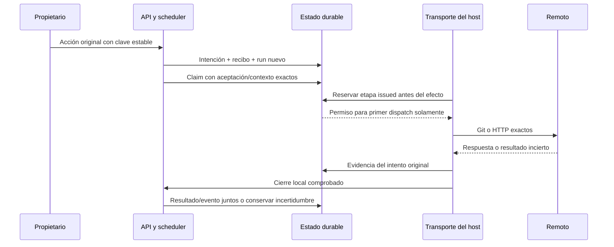

# Autoridad y etapas durables de publicación remota

La migración 45 y `RemotePublications` conectan las solicitudes de push, PR y merge
con intentos nuevos del host, recibos y etapas durables. La API y el scheduler
reconocen esas solicitudes. **El runtime predeterminado todavía no dispone del
perfil remoto de red/credenciales**: rechaza su admisión en lugar de ejecutar el
adaptador de pruebas o un subprocess libre. La publicación remota del producto
sigue en curso; los controles web y la recuperación remota aún faltan.

## Una decisión explícita por acción

| Acción | Origen requerido | Datos que fija el propietario | Datos derivados por el host |
| --- | --- | --- | --- |
| Push | Publicación local comprobada | Servidor/ID/clone observados, destino y SHA previo | Candidato/base exactos, aceptación, origen físico, nuevo ID global del efecto |
| PR | Push remoto original completado | Base observada, título y descripción | Repositorio, rama/head exactos y marcador de la solicitud original |
| Merge | PR original completado con candidato vigente | Decisión separada sobre ese PR | Base/head, ID del PR y dos efectos: Git CAS y registro en Forgejo |

No se deducen permisos de merge de la aceptación del código ni de la creación del
PR. La clave de la acción del usuario conserva ámbito de proyecto/tarea; los
recibos remotos usan el nuevo ID durable global del host. Dos proyectos no
comparten por accidente una identidad remota porque sus claves locales coincidan.
La solicitud original es inmutable y la repetición devuelve su run anterior.

La publicación local debe tener evidencia positiva y su aceptación exacta debe
seguir vigente. Cada gate comprueba la identidad y metadatos del origen/candidato
y que el remote coincida con el registro original del repositorio. Las exclusiones
de bloqueos sólo alcanzan descendientes de esa aceptación local exacta. No se
excluye cualquier run por llamarse `remote_publication`.

## Intentos y efectos

El run remoto conserva contexto y origen, usa un lease/fence nuevo y mantiene la
tarea aceptada en `done`. No reserva inferencia ni prepara peers de modelo/MCP
ficticios. Los efectos Git requieren cierre del dominio y comandos reales; el
PR servido por HTTP del host tiene un scope registrado sin proceso ficticio y
exige cierre del cliente HTTP. Merge exige ambos cierres.

El transporte de esa secuencia aún debe implementarse con su perfil de red y
credenciales. La reserva `issue` no es por sí sola un permiso de red. El broker
actual rechaza el nuevo tipo hasta disponer del perfil específico; no le concede
el perfil de análisis o Git local como fallback.

Una segunda reserva de la misma etapa devuelve `dispatch=false`. El controlador
no debe abrir otra petición al ver ese resultado. La API repetida tampoco vuelve
a agendar el run. Una interrupción conserva la etapa emitida como incierta.
El servidor puede terminar después de cerrar el cliente: una consulta remota
vacía no permite marcar «no ocurrió» ni repetir la escritura.

`observe` conserva hechos del intento original incluso después de retirar su
autoridad viva; esa capacidad de registrar historia no concede una nueva
escritura. Se conserva el historial de observaciones inciertas. Un resultado
positivo conocido no se reemplaza por otra versión, repositorio o interpretación.
Resultado/evento se confirman juntos después del cierre local correspondiente;
contexto retirado o PR que cambió se conservan como historia.

Merge tiene `merge_git` y `merge_record`. La segunda no se reserva hasta tener el
recibo positivo del CAS Git exacto. Su registro no se convierte en otra llamada al
endpoint de merge con base móvil. El [protocolo remoto](remote-publication.md)
conserva sus precondiciones y límites del proveedor.

## API y disponibilidad

- `POST /api/projects/{project}/runs/{origin}/remote-publications`, cuerpo
  discriminado por `stage`: `push`, `pull` o `merge`.
- `GET /api/projects/{project}/remote-publications/{run}` inspecciona solicitud,
  protocolo y etapas guardadas; no conecta al servidor ni inicia un efecto.

Los cuerpos son estrictos, con pairing/CSRF y ámbito existentes. No admiten actor,
lease, paths locales, credenciales, proof, resultado ni protocolo construido por
el cliente. La capacidad del runtime se comprueba antes de crear el run. El valor
observado de ID remoto sigue requiriendo validación efectiva por el transporte;
la admisión no inventa que ya habló con Forgejo.

La prueba de API usa scheduling retenido y la del scheduler un transporte
controlado con testigos explícitamente sintéticos. Prueban SQL/owner/lease/etapas,
no efectos de red o cierre físico remoto. Dos integraciones físicas del recorrido
local anterior se repitieron por los cambios compartidos de claim/scheduler.
No se les atribuye cobertura del nuevo transporte remoto.

## Verificación y siguientes capacidades

[Resultados](../modernization/remote-runtime-results.json),
[paquete](../modernization/remote-runtime-packaging.json) y
[docstrings](../modernization/remote-runtime-docstrings.json). Las inversas de
esquemas 43/44/45 y fixtures antiguos quedan registradas; no se afirma una suite
global actual verde.

Siguiente entrega principal: perfil y executor Git/HTTP remoto con credencial del
host, autoridad real y pruebas HTTPS/Stop/cierre; luego recuperación con nuevos
observadores y controles de Tareas. Debe conservar la distinción entre cierre del
cliente y trabajo remoto y verificar identidad del repositorio durante el efecto.
El resultado positivo de un intento retirado requiere una política explícita de
adopción: la admisión actual exige que el prerrequisito esté `accepted`.
Nada de esto se elimina del alcance por haber cerrado este bloque de persistencia.
