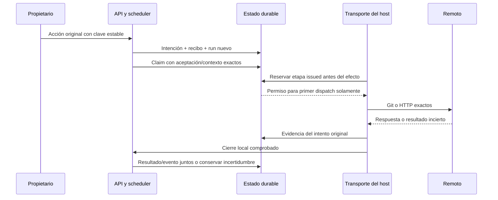

# Autoridad y etapas durables de publicación remota

La migración 45 y `RemotePublications` conectan push, PR y merge con intentos,
recibos y etapas durables. El runtime con configuración remota usa ahora Git y
HTTP propios del host. Sin esa configuración rechaza la admisión. La integración
HTTPS comprueba el recorrido completo con Git real y una API Forgejo controlada;
la recuperación remota y los controles de Tareas siguen pendientes.

## Una decisión explícita por acción

| Acción | Origen requerido | Datos que fija el propietario | Datos derivados por el host |
| --- | --- | --- | --- |
| Push | Publicación local comprobada | Servidor/ID/clone observados, destino y SHA previo | Candidato/base exactos, aceptación, origen físico, nuevo ID global del efecto |
| PR | Push remoto original completado | Base observada, título y descripción | Repositorio, rama/head exactos y marcador de la solicitud original |
| Merge | PR original completado con candidato vigente | Decisión separada sobre ese PR | Base/head, ID del PR y dos efectos: Git CAS y registro en Forgejo |

No se deducen permisos de merge de la aceptación del código ni de la creación del
PR. La clave de la acción del usuario conserva ámbito de proyecto/tarea; los
recibos remotos usan el nuevo ID durable global del host. Dos proyectos no
comparten por accidente una identidad remota porque sus claves locales coincidan.
La solicitud original es inmutable y la repetición devuelve su run anterior.

La publicación local debe tener evidencia positiva y su aceptación exacta debe
seguir vigente. Cada gate comprueba la identidad y metadatos del origen/candidato
y que el remote coincida con el registro original del repositorio. Las exclusiones
de bloqueos sólo alcanzan descendientes de esa aceptación local exacta. No se
excluye cualquier run por llamarse `remote_publication`.

## Intentos y efectos

El run remoto conserva contexto y origen, usa un lease/fence nuevo y mantiene la
tarea aceptada en `done`. No reserva inferencia ni prepara peers de modelo/MCP
ficticios. Los efectos Git requieren cierre del dominio y comandos reales; el
PR servido por HTTP del host tiene un scope registrado sin proceso ficticio y
exige cierre del cliente HTTP. Merge exige ambos cierres.



El transporte usa un broker/dominio nuevo para los comandos Git y un cliente
HTTP acotado para la API. La reserva `issue` ocurre inmediatamente antes de la
escritura original. El broker comprueba protocolo, configuración y efecto emitido;
una reserva global por efecto impide abrirlo otra vez con otro ID de comando.
El PR HTTP no necesita un proceso Git ficticio.

Una segunda reserva de la misma etapa devuelve `dispatch=false`. El controlador
no debe abrir otra petición al ver ese resultado. La API repetida tampoco vuelve
a agendar el run. Una interrupción conserva la etapa emitida como incierta.
El servidor puede terminar después de cerrar el cliente: una consulta remota
vacía no permite marcar «no ocurrió» ni repetir la escritura.

`observe` conserva hechos del intento original incluso después de retirar su
autoridad viva; esa capacidad de registrar historia no concede una nueva
escritura. Se conserva el historial de observaciones inciertas. Un resultado
positivo conocido no se reemplaza por otra versión, repositorio o interpretación.
Resultado/evento se confirman juntos después del cierre local correspondiente;
contexto retirado o PR que cambió se conservan como historia.

Merge tiene `merge_git` y `merge_record`. La segunda no se reserva hasta tener el
recibo positivo del CAS Git exacto. Su registro no se convierte en otra llamada al
endpoint de merge con base móvil. El [protocolo remoto](remote-publication.md)
conserva sus precondiciones y límites del proveedor.

## API y disponibilidad

- `POST /api/projects/{project}/runs/{origin}/remote-publications`, cuerpo
  discriminado por `stage`: `push`, `pull` o `merge`.
- `GET /api/projects/{project}/remote-publications/{run}` inspecciona solicitud,
  protocolo y etapas guardadas; no conecta al servidor ni inicia un efecto.

Los cuerpos son estrictos, con pairing/CSRF y ámbito existentes. No admiten actor,
lease, paths locales, credenciales, proof, resultado ni protocolo construido por
el cliente. La capacidad del runtime se comprueba antes de crear el run. El valor
observado de ID remoto sigue requiriendo validación efectiva por el transporte;
la admisión no inventa que ya habló con Forgejo.

## Configuración del operador y credenciales

Añadir al JSON de configuración del runtime y reiniciar el servicio:

```json
{
  "remote_publication": {
    "api_base": "https://forgejo.example/api/v1",
    "username": "usuario-del-token",
    "token_file": "/ruta-del-host/privada/forgejo.pat"
  }
}
```

Es un fragmento del JSON existente, no una configuración completa. El archivo del
PAT debe ser regular, propiedad del usuario del servicio, privado (por ejemplo
`0600`) y estar fuera del workspace gestionado. No incluir el PAT en el JSON.
`ca_bundle` y `resolver` son opcionales; heredan los valores del runtime y sus
predeterminados del sistema. La CA, el resolver y la credencial deben estar fuera
de las fuentes gestionadas. El origen HTTPS configurado debe coincidir exactamente
con el de la solicitud admitida. La identidad numérica del repositorio se consulta
antes y después del efecto; una URL no demuestra identidad permanente del servidor.
El [manual de Forgejo](https://forgejo.org/docs/v17.0/user/getting-started/first-repository/)
describe el uso de nombre de usuario y PAT para Git HTTPS.

Git recibe la credencial desde un FD sellado privado; el wrapper confiable la
inyecta en un header limitado a la URL. El PAT no entra en argv, manifiestos,
fuentes ni contexto del modelo. HTTP usa su cliente autenticado al origen fijo.
Se mantienen verificación TLS y de hostname, sin redirects ni proxy del entorno.
Los permisos de la cuenta y las protecciones de rama siguen siendo del servidor.

Los únicos comandos Git de red autorizados son consultas de referencias fijas y
el push atómico exacto. El proceso confiable comparte la red del host para esos
comandos: **no es una ACL de destinos impuesta por el kernel**. La frontera depende
del programa fijado, argv exactos, origen HTTPS y configuración Git sellada. El
perfil de red de los agentes de modelo no cambia. Origen/candidato y sus metadatos
se montan en lectura; una configuración segura superpuesta impide `url.insteadOf`
y helpers del repositorio sin modificar el archivo original.

## Verificación y siguientes capacidades

[Transporte](../modernization/remote-transport-results.json),
[paquete](../modernization/remote-transport-packaging.json) y
[docstrings](../modernization/remote-transport-docstrings.json). Pasan 82 casos
dirigidos y una integración TLS real de push → PR → merge. Esta última usa Git
smart HTTP real y una API Forgejo controlada, no un binario Forgejo ni un servidor
del usuario. Prueba además Stop durante receive-pack: cierre local comprobado,
etapa incierta y run en reconciliación, sin afirmar que se detuvo el servidor.
Comprueba que repetir la acción no abre otro efecto y que el journal no contiene
el PAT. No consume inferencia para publicar.

Las [pruebas previas de admisión](../modernization/remote-runtime-results.json)
usan testigos de transporte sintéticos y se conservan como evidencia histórica.
No se afirma suite global actual verde ni compatibilidad ensayada con una instancia
Forgejo real. Las inversas 43/44/45 y fixtures antiguos siguen registrados.

Siguiente capacidad principal: observadores de recuperación de sólo lectura con
autoridad nueva y cierre original comprobado; después controles de Tareas que
conserven la solicitud ante respuesta perdida. Ausencia remota sigue siendo
incierta y nunca autoriza repetir el push o POST. El resultado positivo de un
intento retirado requiere una política explícita de adopción: la admisión actual
exige prerrequisitos `accepted`. Estas tareas y el cutover legacy siguen en alcance.
