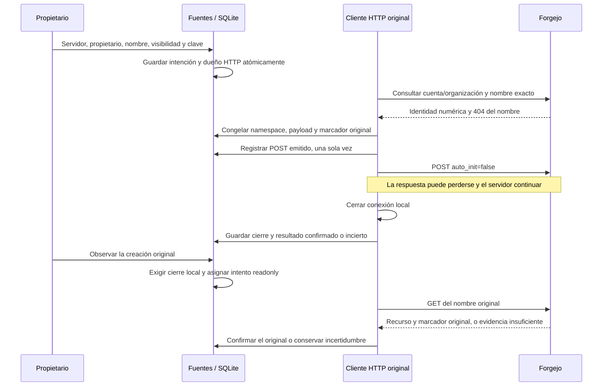

# Creación explícita de un remoto vacío

El propietario puede elegir **Crear un remoto vacío en el servidor** desde la
preparación de fuentes. Debe seleccionar el servidor configurado, escribir la
cuenta u organización y elegir Privado o Público. La operación conserva esas
cuatro decisiones antes de contactar Forgejo. No inicializa una carpeta, no cambia
`origin`, no hace push ni crea una tarea o un registro de fuente local. Una
clonación posterior es otra decisión explícita.

## Contrato y procedencia

`SourceRequest.remote_server` debe coincidir exactamente con
`RemoteTransportConfig.api_base`. El GET de opciones revela únicamente servidor y
nombre de cuenta; no token, archivo de credenciales ni manifiesto interno. El
servidor sigue siendo configuración del host: el formulario no puede dirigir la
credencial a una URL arbitraria. Las rutas usan el acceso owner y la protección
CSRF existentes.

El cliente usa el transporte HTTPS de `ForgejoPublicationClient`: sin redirecciones,
proxy de entorno ni reintentos HTTP; confianza TLS y PAT se leen de la configuración
original del host. El límite completo de JSON es 1 MiB, con codificación identity;
HTTPX conserva sus límites de conexión de 5 s e inactividad de 20 s. Esto todavía
no constituye un presupuesto total de tiempo del flujo frente a respuestas que
avanzan muy lentamente; debe incluirse en la evaluación integral de límites.

La [documentación oficial de Forgejo](https://forgejo.org/docs/latest/user/api/usage/)
publica la ubicación del contrato OpenAPI. Se contrastaron los endpoints y campos
contra el [Swagger de Forgejo 17.0.1](https://codeberg.org/forgejo/forgejo/raw/tag/v17.0.1/templates/swagger/v1_json.tmpl):
`GET /user`, `GET /orgs/{org}`, `POST /user/repos`, `POST /orgs/{org}/repos`,
`GET /repos/{owner}/{repo}` y `CreateRepoOption`.

Primero se comprueba la identidad numérica y el login de la cuenta autenticada.
Si el propietario elegido es esa cuenta, se usa el endpoint de usuario. En otro
caso se consulta la organización elegida y se congela su identidad numérica y
nombre. Un error en la organización termina la preconsulta; nunca cambia el
propietario a la cuenta personal. Sólo un 404 de la consulta del repositorio se
considera ausencia. Un nombre existente, un 403 o un error del servidor no
autorizan creación ni adopción de ese recurso.

## Una escritura original y observación de sólo lectura

El marcador `researcher-source:<sha256>` queda en la descripción del repositorio.
Se deriva de operación, solicitud, configuración y namespace originales. Antes
del POST se conserva el payload exacto, ausencia observada, identidad numérica,
intento emisor y momento de emisión. Su registro es irreversible: una respuesta
perdida, un reenvío de la misma solicitud o una nueva observación nunca lo pone de
nuevo en estado no emitido.

La respuesta o consulta sólo confirma la creación cuando coinciden ID numérico
positivo del repositorio, nombre completo, ID del propietario, visibilidad,
marcador y URL de clonación canónica del servidor elegido. El marcador es evidencia
aportada por ese servidor y sus permisos administrativos; no es una firma que
resista a un administrador hostil. Si se borra o cambia, se mantiene la
incertidumbre: el nombre por sí solo no demuestra que el recurso sea nuestro.

El recibo contiene `remote` y fecha de observación. `repository_id` y la observación
Git local siguen vacíos. La web permite consultar el mismo resultado o preparar
otra operación; distingue ese recibo de una fuente local lista para el motor.
Las solicitudes locales guardadas antes del nuevo campo siguen siendo legibles,
con `remote_server=null`. No se infiere un servidor para una intención remota vieja
que no lo seleccionó explícitamente.

## Propiedad, Stop y recuperación

`RemoteSourceRecords` reutiliza las transacciones, límites y lease administrativos
de `SourceOperations`; no adapta un `AttemptLease` nativo ficticio. La admisión y
el registro del cliente se escriben en una sola transacción. La identidad incluye
base de datos original, intento/fence, PID/start ticks, boot y namespace observador.
La cancelación durante el retorno de esa transacción drena la entrega del lease y
cierra su registro antes de terminar, incluso si todavía no se abrió un cliente.

`SourceHTTPControl` conserva el cliente real. La retirada síncrona impide nuevas
peticiones e inicia su cierre antes de esperar SQLite, usando los mismos controles
individuales, de proyecto y de cierre de aplicación. La captura original ocurre
antes de la primera petición. El registro de cierre se escribe después de que
`aclose` termina y sólo por su proceso original. Tras morir ese proceso, la
recuperación exige la misma visibilidad de host y ausencia de su identidad original;
un proceso vivo sin recibo no se da por cerrado por suposición.

**Cerrar nuestro cliente no cancela necesariamente el POST en Forgejo.** Si ya se
registró emisión, Stop conserva `needs_reconciliation`, aunque el servidor todavía
no muestre el recurso. Observar crea otro intento estrictamente readonly, con
historia limitada a ocho observaciones; no repite el POST. Una coincidencia positiva
posterior puede completar el recibo con `completed_after_withdrawal=true`. Si no
se emitió ninguna creación, se puede rechazar la preparación o detenerla sin
atribuir una creación remota.

| Qué pasaría si… | Comportamiento comprobado |
| --- | --- |
| El PAT pertenece a otra cuenta | Se rechaza la preconsulta, sin POST |
| La organización falla o el nombre ya existe | No se crea ni se cambia a usuario personal |
| Se elige otro servidor o se modifica visibilidad reutilizando la clave | Conflicto; no se envían credenciales ni otro POST |
| El servidor crea y pierde su respuesta | Se conserva emisión; una consulta puede reconocer el original |
| Stop llega con POST pendiente | Se cierra el cliente; el servidor puede terminar después |
| SQLite está ocupado cuando llega Stop | El cliente real se cierra antes de liberar el escritor SQLite |
| El GET posterior devuelve 404 o un marcador ajeno | Sigue incierto, sin POST adicional |
| Se cancela justo después de admitir el dueño HTTP | Se drena la entrega y cierra el registro; cero peticiones |

## Evidencia y límites

[Resultados](../modernization/remote-source-results.json),
[paquete instalado](../modernization/remote-source-packaging.json),
[docstrings](../modernization/remote-source-docstrings.json) y
[recorrido web](../design/audits/2026-11-06-remote-source/report.md).
Los ensayos usan un servidor TLS controlado y credenciales sintéticas; no se creó
un remoto del usuario ni se consumió un turno de modelo para esta funcionalidad.
El namespace de organización y API fueron contrastados con documentación oficial;
no hay todavía un ensayo contra una instalación completa de Forgejo del usuario.

Reparar Git local incompleto, recuperar intenciones desde otro navegador,
restore/inversas y admisiones nativas mixtas siguen siendo capacidades principales
pendientes. La matriz de tiempo total/red, compatibilidad de versiones de Forgejo
y cambios de configuración/host durante restore necesita aceptación integral.
No se declara completa la página ni el plan de modernización.
