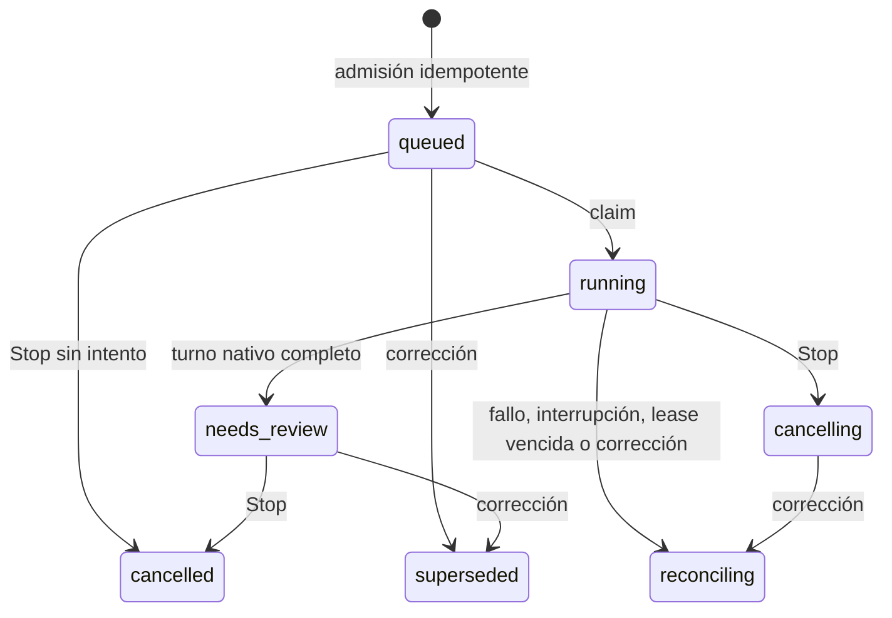

# Coordinación durable: primera implementación

`backend/runtime/contracts.py` define datos y reglas neutrales;
`backend/runtime/sqlite_runs.py` implementa persistencia y fencing. No importa
CrewAI, FastAPI ni un proveedor de inferencia. El producto todavía no está
conectado a este adaptador: faltan el servicio de ejecución, reconciliación de
jobs, controles HTTP/WS y migración de consumidores. Ninguna operación de esta
API interna inicia un modelo, acepta una tarea ni publica cambios.

## Qué queda guardado

La migración **19** agrega runs, intentos, revisiones de contexto, receipts de
comandos y receipts de observaciones nativas. Usa `events_log` como historial
durable existente, sin crear otro bus ni otro log de hechos. El resultado nativo
es canónico en el intento; la vista del run lo recupera mediante su intento
actual, sin una segunda copia editable.

Un run fija proyecto, tarea, actor, versión de contexto, prompt y runtime. Su
clave de operación identifica una intención: reintentar la misma devuelve el
mismo run; cambiar la intención produce conflicto. La exclusión de trabajo
activo se sostiene tanto en la transacción `BEGIN IMMEDIATE` como en un índice
único por proyecto/tarea. Un trabajo en reconciliación también ocupa ese lugar.

`claim` crea un intento con dueño, fence y lease. Identidad, estado y evento se
confirman juntos. `heartbeat` renueva sólo la autoridad actual: no resucita una
lease vencida ni permite cambiar de dueño. La lease usa el reloj del host; un
salto de reloj puede provocar una expiración anticipada, pero no autoriza otro
intento automáticamente. El siguiente dueño debe reconciliar primero.

## Transiciones implementadas

`failed` y `accepted` son estados reservados para decisiones posteriores del
producto. Un fallo nativo no entra directamente en `failed`: podría haber jobs
o efectos en curso y no habilita repetir el trabajo. Un turno completo queda
en `needs_review`, conserva una propuesta y no cambia la tarea a `done`.

Todavía no existe la salida productiva de `reconciling`. Antes de habilitarla,
el servicio debe comprobar estado del thread, jobs propios y receipts de
negocio; no bastará con recibir un booleano del modelo. No se debe desplegar
este subconjunto como si ya fuera el motor completo.

## Permisos ligados al intento

El host emite un grant de negocio, lo liga con `bind_grant` y sólo después lo
entrega al MCP del intento. La vinculación comprueba proyecto, tarea, actor,
contexto y vigencia. Emitir el grant y fallar al vincularlo requiere revocarlo
sin entregarlo; esta composición es responsabilidad del servicio todavía
pendiente. El modelo no puede emitir ni vincular grants.

La autorización del MCP vuelve a comprobar el intento dentro de cada lectura
o escritura. Compara estado del run/intento, fence, lease y contexto, además de
los permisos originales. Así, una lease vencida no permite nuevas escrituras
aunque aún no haya corrido el barrido `expire`. Un scope obtenido antes tampoco
evita esta comprobación al confirmar una captura después.

La DB conserva `runtime_bound=1` aunque se borre el intento y su FK quede NULL.
Esa credencial queda inválida: no se convierte accidentalmente en un grant
independiente. Los grants independientes siguen existiendo para el slice y las
operaciones explícitas del host; el servicio productivo debe entregar a los
workers exclusivamente grants vinculados.

Stop revoca la autoridad de **ese intento**. Cancelar un run histórico no puede
revocar permisos de otro run posterior de la misma tarea. Una corrección de
contexto sí invalida los grants de la tarea ligados a la versión anterior y
guarda una revisión nueva. Su fuente distingue mensaje, ejemplo, evidencia y
suposición; esa etiqueta expresa procedencia, no prueba verdad ni autorización.

## Identidad nativa y hechos tardíos

`bind_thread` permite guardar la identidad del thread antes de enviar el turno.
`bind_native` agrega después el turn id sin permitir cambiar silenciosamente de
thread. Si se pierde el recibo de `turn/start`, la recuperación puede consultar
el thread conocido; no debe reenviar el prompt por no haber recibido un turn id.

Tras Stop, expiración o corrección, `finish` rechaza resultados con autoridad
vieja. `observe_native` tiene otro propósito: conserva el hecho tardío, incluso
después de perder autoridad, con identidad original, clave idempotente y evento
durable. No modifica la tarea ni acepta el resultado. Un payload que diga DONE
o pida cambiar estado sigue siendo datos. El host debe correlacionar el evento
nativo con el intento y seleccionar/redactar el payload antes de persistirlo;
la API no acepta cualquier tipo de evento ni payloads mayores a 32 KB.

Los receipts de observación conservan el id histórico aunque en el futuro se
retenga menos log; borrar eventos no debe permitir reinsertar el mismo hecho.
La política de retención y la detección de cursores vencidos todavía faltan.

## Eventos y concurrencia

Admisión, claim, corrección, finalización y Stop guardan su evento en la misma
transacción que el estado. Un error insertando el evento revierte también el
estado, la revisión y la revocación. Las notificaciones en vivo deberán salir
de esos commits; esta implementación todavía no sustituye el bus/WebSocket.

`events(project_id, after_id, limit)` devuelve historial por id ascendente,
incluidos hechos previos de otras fuentes, con página adicional para detectar
si hay más. No depende del timestamp, que puede repetirse. Los DTO conservan
tipo/id de entidad y fuente: un evento de proyecto no se presenta como si fuera
una tarea. Sigue pendiente conectar esta lectura al endpoint público, a la
autorización del usuario y al catch-up del canal vivo.

## Evidencia y límites

`backend/tests/runtime/test_coordination.py` usa SQLite real, conexiones de
workers concurrentes y fallos de escritura inyectados mediante triggers. Cubre
admisión/retry/reapertura, proyectos, doble claim, cancelación contra resultado,
contextos obsoletos, grants vencidos, historial paginado, observaciones tardías
y migración/rollback. No inicia modelos ni servicios externos. No demuestra
durabilidad frente a corte eléctrico, rendimiento de producción, terminación
de todos los jobs, aislamiento del sistema operativo o uso de esta API por los
flows antiguos.

La migración es aditiva y conserva filas anteriores. El ejecutor de recursos
SQL ahora es compartido con la migración 18 y revierte su propia transacción
ante fallos. No moverlo a `executescript`, que puede introducir un commit fuera
de ese contrato. El wheel contiene los tres recursos SQL y los módulos nuevos.

No se ha validado un rollback operativo a un binario anterior. Un binario que
ignore `runtime_bound` no aplica este contrato: antes de una vuelta atrás habría
que detener/reconciliar los intentos y revocar sus credenciales, además de
preservar las escrituras nuevas. Restaurar una DB vieja perdería esas escrituras.

El próximo entregable debe componer estas operaciones con el runtime, permisos,
presupuestos durables y jobs verificables; cerrar auth/isolation antes de exponer
la admisión; después migrar los recorridos y retirar los dueños antiguos. No
tratar la aprobación de estas pruebas como aceptación de los 43 escenarios.

## Extensión: jobs con conexión propia

La migración 20 añade reserva de despacho, deduplicación y recibos canónicos de
comandos a este mismo contrato. Ver [owned-commands.md](owned-commands.md).
`supervise_attempt` persiste el vencimiento observado; `finish_job` con resultado
incierto retira autoridad y revoca grants de forma atómica. Los hechos tardíos
conservan procedencia y no autorizan nuevos efectos. La composición con el
servicio del producto y su control HTTP/WS sigue pendiente.
