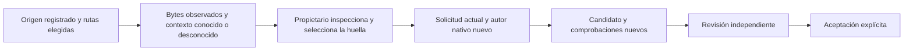

# Importar archivos anteriores sin inventar su contexto

## Resultado para el usuario

Tareas permite elegir un origen registrado y rutas individuales, inspeccionar sus
bytes y usarlos como material de la próxima solicitud. Puede ser un worktree de
un agente antiguo o una copia privada que quedó sin candidato capturado. El
origen permanece intacto. La consulta y la selección no arrancan una ejecución.

Por ejemplo: un worktree anterior contiene `src/calculo.py`, pero no hay registro
de la petición que recibió su autor. El propietario puede seleccionar ese archivo
y pedir que se adapte a los requisitos actuales. El autor nuevo recibe los bytes
y la declaración de contexto desconocido. El nombre del agente anterior no se
convierte en prueba de autoría, relación con la tarea o comprensión compartida.

Un worktree antiguo se registra por proyecto/repositorio/agente; la tabla no
incluye una asociación histórica fiable con una tarea. Elegirlo para la tarea
actual es una decisión explícita del propietario. En una copia privada sí se
conserva la tarea registrada, pero una entrada nativa sólo se incluye si existe
realmente y su hash coincide. Cuando no existe, `original_input` es `null`.
No se reconstruye desde los requisitos actuales ni se simula un autor nativo.

## Lo que se conserva y lo que se afirma

La selección contiene hasta128rutas relativas individuales. Conserva bytes
regulares y bit ejecutable, destinos literales de enlaces sin seguirlos, y
observaciones de ausencia. Una ruta ausente no demuestra intención de borrado:
el autor nuevo debe decidir según la solicitud actual, no replicar ciegamente
el árbol anterior. Los archivos no seleccionados quedan fuera del material.
No se ejecuta Git ni se leen configuraciones/credenciales del worktree al exportar.

Las rutas provienen de registros del host, no de un directorio arbitrario enviado
por el cliente. Un worktree debe corresponder a su proyecto/repositorio y a la
ubicación antigua `.worktrees/<agente>`. Una copia privada debe corresponder a su
tarea, registro original y asignación inmutable. Cada directorio se abre mediante
FD y sin seguir enlaces. Se rechazan metadatos `.git`/`.ken`/`.worktrees`, padres
redirigidos, rutas ambiguas, directorios y archivos especiales como FIFO.

Se hacen dos observaciones iguales de las rutas elegidas, comprobando identidad,
modo, tamaño y cambios durante las lecturas. Esto no demuestra un árbol Git
atómico, cierre físico de todos los productores ni autoría histórica. El paquete
lo declara. La exportación admite400000bytes de archivos y600000bytes de paquete
completo, con hasta32componentes por ruta. Si no cabe, se rechaza completo sin
recortar archivos o contexto para ocultar el límite.

## De los datos antiguos al trabajo nuevo

La previsualización devuelve una huella del paquete observado. Al iniciar, se
comprueban otra vez el origen real, los datos y el repositorio actual; un archivo
que cambió invalida esa selección. El recibo de admisión existente conserva el
paquete junto a la ejecución nueva, en una transacción. Reenviar la misma clave
recupera esa ejecución y esos bytes aunque el origen haya desaparecido; otra
selección con la misma clave entra en conflicto. No hay otra tabla ni planificador.

`prior_code` conserva su compatibilidad con candidatos nativos capturados y ahora
admite también `PriorFilesTarget(source_kind,source_id,paths,snapshot_sha256)`.
La entrada inicial mantiene por separado la solicitud y el contexto actuales,
el origen anterior y sus datos conocidos/desconocidos. Tareas y Conversación usan
la misma admisión. El cliente congela también las rutas de la solicitud original;
una respuesta tardía de previsualización pertenece a su propio origen/rutas.

El autor nuevo trabaja en una copia independiente del commit actual. La carpeta
raíz `.worktrees` no indexada se preserva como almacenamiento antiguo y queda
fuera de esa copia, sin editar `.gitignore`. El resto de cambios sin guardar o
nombres parecidos siguen bloqueando la preparación. Se rechaza una fuente cuyo commit o índice incluya esa
carpeta reservada, y un candidato nuevo tampoco puede publicarla como
código. Las fuentes enlazadas o sucias fuera de esa excepción explícita conservan
sus restricciones; no se adopta su metadata Git como autoridad.

Después hacen falta candidato nuevo, comprobaciones, revisión independiente y
aceptación explícita, usando el recorrido existente. No se trasladan permisos,
roles, sesiones, revisión, aceptación o publicación del trabajo anterior.

## Interfaces y límites pendientes

GET `.../tasks/{task_id}/prior-files/sources` lista registros sin inferir relación
histórica con la tarea. POST `.../prior-files/preview` recibe origen, rutas y
repositorio registrado; no crea trabajos. Las admisiones de runs/instructions
reciben la selección observada mediante `prior_code`.

Esta entrega importa rutas seleccionadas; no descubre automáticamente toda la
historia de cambios, renames, reglas de ignorado o intención de eliminación. Los
archivos originales quedan disponibles para otra selección. Sigue pendiente
conectar este material al despacho de sucesoras de planes y retirar realmente
DevelopmentFlow/CodeReviewFlow y otros productores antiguos, con exclusión global.
Tampoco completa publicación del cambio, aceptación integral de Tareas, evaluación
humana o de modelos, instalación/restauración ni los demás requisitos del plan.
[Resultados y alcance de pruebas](../modernization/file-import-results.json),
[paquete](../modernization/file-import-packaging.json).
