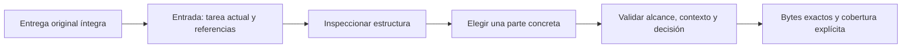

# Contexto original y evidencia por partes verificables

Las entregas nuevas usan esquema5. La tarea actual, sus correcciones y los
criterios de aceptación siguen presentes en la entrada nativa. Cuando una
sección histórica `plan_context`, `continuation` o `reauthorization` supera32768
bytes, se envía una referencia con herramienta, sección, hash y tamaño. El
paquete original permanece íntegro e inmutable en SQLite, con su identidad
propia. Los esquemas2–4 conservan su representación anterior.

`researcher_work_context` consulta esas secciones. El lector documental
`researcher_prerequisite_research`, con sección `packet`, admite la misma
selección. `path` contiene claves JSON e índices de listas; nunca rutas de
archivos, atributos Python ni identificadores de otro proyecto. Por ejemplo:

- `['original_material', 'owner_request']` recupera la solicitud original del plan.
- `['limitations']` recupera las limitaciones de un resultado documental aceptado.
- `['findings', 0]` recupera una afirmación y sus referencias; `['sources', 0]`
  recupera una fuente. El receptor debe comprobar que los identificadores y
  citas se corresponden; compartir posición en una lista no demuestra la relación.

`inspect` devuelve tipo, hash, tamaño y hasta25descriptores de hijos; se continúa
con `next_child_offset`. No devuelve los cuerpos ni afirma haberlos leído. `read`
devuelve el JSON canónico de la parte elegida en ventanas base64 de hasta16384
bytes. `next_offset` permite continuar la misma parte. `complete_material`
describe esa ventana/material seleccionado; `selection.whole_section_read`
distingue explícitamente leer una parte de leer toda la sección. Una cola de un
texto grande no afirma haber leído su prefijo.

El lector reutiliza la entrega del consumidor o del autor exacto revisado,
el lease vigente y las comprobaciones actuales de planificación/continuidad.
La evidencia documental además revalida aceptación, contexto, fuentes y revisión.
Una cancelación retira el acceso; no se concede otro proyecto, aceptación,
publicación ni repetición de efectos anteriores.

## Ejemplo y límites

Un plan puede contener muchos antecedentes y terminar con «no modificar el
repositorio de origen». El receptor puede consultar el objetivo original y esa
restricción, después leer la limitación de una afirmación y su fuente sin copiar
un informe de400KB. Eso prueba acceso a esos bytes. No prueba que la selección
sea suficiente ni que un humano o un modelo haya comprendido el problema.

El ensayo nativo controlado registra11solicitudes del autor y12del desarrollador,
con límite configurado25. Ambos leen665bytes de contexto seleccionado; el
desarrollador añade3072bytes de evidencia frente a399538bytes de informes.
Las entradas pesan4262 y5326bytes. [Observaciones exactas](../modernization/work-material-native-observations.json).

La política común8 distingue índice, contenido, evidencia y comprensión, y
conserva identidades históricas2–7. La generación/Ken de este ensayo son
controlados. No acredita selección correcta de cualquier modelo ni comprensión
humana. Tampoco acredita el límite de herramientas ante ausencia de avisos de
inicio; esa comprobación queda como siguiente trabajo funcional del engine.

Las tareas, correcciones e historial actual siguen con sus límites explícitos.
No hay truncamiento oculto ni garantía de que cualquier volumen de información
pueda analizarse en un intento. [Validación del bloque](../modernization/work-material-review.md).
