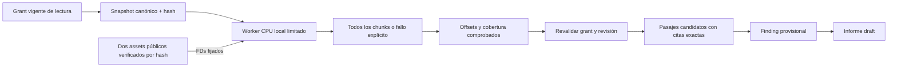

# Recuperación semántica de fuentes capturadas

`researcher_source_query` busca paráfrasis dentro de una fuente guardada del proyecto
del grant. Devuelve pasajes exactos, offsets, hash de fuente y páginas del PDF cuando
corresponde. La búsqueda literal `researcher_source_search` sigue siendo distinta.
El catálogo nativo incluye trece herramientas de negocio;
[schema y anotaciones](semantic-tool-schema.json).



`full_coverage:true` significa que el recuperador consideró todos los chunks de esa
revisión acotada. No demuestra que el agente haya leído todo, entendido el problema,
encontrado toda la evidencia pertinente o validado un estudio. Una puntuación coseno
es similitud de vectores, no probabilidad de verdad ni confianza científica. Incluso
el primer resultado puede ser irrelevante. Se conserva acceso al texto y su procedencia
para contrastar contexto y contraevidencia.

## Preparación explícita y modelo

Se utiliza `sentence-transformers/paraphrase-multilingual-MiniLM-L12-v2`, revisión
`e8f8c211226b894fcb81acc59f3b34ba3efd5f42`, variante ONNX `model_quint8_avx2.onnx`,
con licencia Apache-2.0. La [ficha oficial](https://huggingface.co/sentence-transformers/paraphrase-multilingual-MiniLM-L12-v2)
describe embeddings multilingües de384 dimensiones. No prueba por sí sola la calidad
de recuperación del producto. La evidencia de esta entrega se limita a fixtures,
incluida consulta española sobre texto inglés, no a un benchmark representativo.

La aplicación fija dos archivos: modelo118.453.870 bytes y tokenizer9.081.518 bytes,
con SHA-256 conocidos en `retrieval_assets.py`. El contexto de este modelo se limita
a128 tokens; el propio código de consulta no trunca silenciosamente entradas.
La preparación usa revisión inmutable, `token=False`, endpoint público fijo y verificación
de tamaño/hash. Sigue el patrón de assets públicos verificados de Ken, sin reutilizar
sus modelos específicos de código ni el singleton de Chroma anterior.

```bash
researcher-bootstrap prepare-retrieval \
  --directory /ruta/existente/modelo-semantico \
  --cache-dir /ruta/existente/cache-publica

export INFINIBAY_RETRIEVAL_ASSET_DIR=/ruta/existente/modelo-semantico
```

El padre del directorio debe existir. Un directorio de destino existente sólo se acepta
si contiene los archivos exactos; no se sobrescribe un estado desconocido. `--offline`
utiliza exclusivamente una caché preparada. La preparación no ejecuta el encoder.
La descarga sólo ocurre en este comando explícito; servir, listar fuentes y consultar
no descargan pesos, no hacen login y no activan una API remota de embeddings.

El arranque construye un controlador barato y no carga el modelo. El listado de fuentes
informa `not_configured` o `verification_required`: tener una ruta configurada no prueba
que esté preparada. Sin assets válidos, la consulta responde503 `retrieval_unavailable`.
La búsqueda literal permanece disponible, pero no se sustituye silenciosamente por ella.
El modelo semántico es este asset fijado; su configuración es independiente del modelo
LLM del runtime y no interpreta la suscripción de OpenAI como acceso a embeddings API.

## Revisión, chunks y resultados

La fuente debe conservar su hash de texto. Se rechaza una revisión inconsistente antes
de trabajo pesado; al terminar se releen fuente y grant antes de devolver resultados.
Una referencia de otro proyecto se rechaza antes de inspeccionar disponibilidad del
modelo. Un permiso de lectura basta; consultar no escribe fuentes, findings, informes
ni índices en la DB. Los permisos de captura/escritura no se amplían.

Cada consulta reconstruye la recuperación a partir del snapshot canónico. No se reutiliza
una colección Chroma, BLOBs sin identidad, vectores de otro proyecto o un caché global.
No hay vector DB persistente: un reinicio simplemente necesita reconstruir la siguiente
consulta, sin adoptar índices antiguos. Un fallo no deja un índice parcial que después
parezca completo. Un futuro caché requerirá claves de proyecto/fuente/hash/modelo,
política del encoder/chunk y pruebas propias de invalidación y cobertura.

El worker procesa ventanas de hasta1.200 caracteres y96 tokens de contenido, con hasta
96 caracteres de solapamiento limitado al cuarto de la ventana. Máximo2.048 chunks y
128 tokens con especiales por entrada al modelo. Un exceso de tokens de consulta,
chunks, bytes o ejecución falla explícitamente; no omite la cola. El encoder CPU
calcula media enmascarada por atención y normalización L2, con batches de hasta8.

La respuesta conserva identidad/dimensión/revisión y hashes de los assets, versión del
runtime ONNX, política `masked-mean-l2-v1`, política de chunk y contadores de vectores/
batches locales. No mezcla esos contadores con tokens LLM o facturación de proveedor.
El padre comprueba rangos/cobertura y reconstruye cada pasaje desde el texto autorizado;
no acepta citas arbitrarias emitidas por el worker. El mapping de PDF usa los offsets
reales `text_start_offset`/`end_offset`; puede abarcar más de una página.

`next_rank` se sigue mediante `after_rank`, conservando fuente, consulta y modelo. Los
empates se ordenan por offset. La paginación se probó con la misma revisión/configuración;
no se promete continuidad entre despliegues/modelos distintos. Para recuperar contexto,
se usa `researcher_source_read` con el offset del pasaje. El hash identifica la captura,
no demuestra que el documento original siga actualizado.

## Propiedad y límites de ejecución

PDF y semántica comparten `worker_transport.exchange`: programa fijo, pipes acotados,
señales por pidfd propio y espera del exit real. El nuevo worker reutiliza también el
bootstrap Linux de límites/parent-death. Recibe datos por stdin y sólo dos FDs públicos
de assets; no recibe credenciales, código del modelo, rutas arbitrarias o conexiones
SQLite del host. Verifica de nuevo los bytes que usa antes de cargarlos para evitar
carreras con modificaciones de los assets. Numpy/ONNX se importan después de los límites.

Por worker:15 segundos CPU (hard16),2GiB de espacio de direcciones,300.000 bytes IPC
de entrada y512.000 de salida. El plazo de consulta es30 segundos, incluyendo la
verificación de assets. Hay límites adicionales de FD/procesos/escritura y muerte al morir el padre.
El proceso usa sólo CPU y un thread de ejecución por pool. Los máximos son validables
por configuración de host; los argumentos MCP no pueden ampliarlos.

La aplicación admite un worker semántico concurrente; la saturación retorna429
`retrieval_busy`, sin lanzar otro ni formar una cola oculta. Stop/corrección retira
la autoridad y conserva el registro hasta reap físico. Retirada de permisos después
del cálculo también impide divulgar la respuesta. Se registra pico RSS/CPU observados
por hijo, no memoria total del proyecto ni cuota global. Los límites de AS no son un
límite agregado de RSS, y este worker fijo no es un sandbox general de filesystem/red.
La inscripción completa de actores/cgroups y presupuestos globales mantiene su trabajo
pendiente en el plan. Un I/O bloqueado de kernel puede conservar reconciliación; no se
promete cierre físico instantáneo.

## Evidencia y límites de esta entrega

[Ensayo retenido](../modernization/semantic-product-evidence.json): PDF sintético con
contraevidencia después de los12.000 caracteres iniciales → consulta española → pasaje
exacto que abarca páginas1/2 → lectura del contexto → finding provisional → informe draft.
Se consideraron38 chunks y39 vectores locales; pico de proceso736.316KiB, CPU observada
2,90s en esa ejecución. Son observaciones de un fixture, no objetivos de rendimiento.
El informe de prueba tiene texto fijo: no es síntesis ni comprensión evaluada de un LLM.
La tarea permanece `in_progress`.

[Pruebas y regresión](../modernization/semantic-results.json),
[paquete](../modernization/semantic-packaging.json). Se ejercitan modelo real offline,
cola del documento, offsets/páginas, paginación, ausencia/corrupción/symlinks/crecimiento
de assets, saturación, cancelación, CPU/salida/IPC y revocación antes de respuesta.
No hubo llamadas adicionales a la suscripción ni a un servicio de embeddings.

La capacidad semántica queda disponible en el backend nativo para fuentes capturadas.
Esto todavía no retira `PDFSearchTool`: faltan roles/flows heredados, otros formatos,
recuperación/knowledge a mayor escala, evaluación representativa y revisión científica.
No hay cambios de interfaz o nuevas rutas aceptadas:4 pilotos,0/12 aceptadas completamente.
El objetivo completo de modernización sigue activo.
