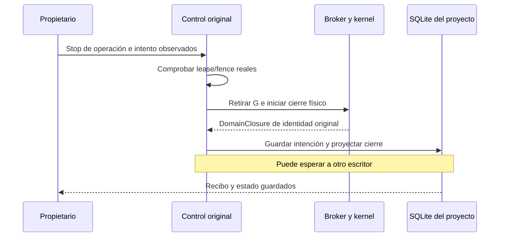

# Stop de fuentes antes de esperar SQLite

El control de un proceso y el recibo persistido son hechos separados. Una
escritura ocupada en SQLite puede retrasar el recibo; no debe mantener Git activo.
La implementación anterior esperaba esa escritura antes de cancelar el trabajador.
Un clone HTTPS retenido en su servidor reprodujo el problema.

`AsyncPeerBroker.withdraw()` retira G inmediatamente y devuelve el único futuro
de cierre del broker existente. `aclose()` espera ese mismo futuro protegido de
cancelación. Se conservan los pools reservados de Stop y las comprobaciones de
identidad, namespaces, dominio y journal; no hay otro ejecutor de procesos.

El ejecutor de fuentes ofrece un callback **síncrono y de confianza** dentro de su
scope antes del primer G. `SourceControl` conserva el `SourceLease`, ID de operación
y `AsyncPeerBroker` reales en un objeto inmutable. No se acepta un grant, PID o
namespace elegido por HTTP. Un fence incompatible con el dueño capturado se
rechaza antes de SQLite y antes de retirar ese dueño.

Si todavía no llegó el dueño, la solicitud local de Stop queda condicionada a que
el callback entregue exactamente el ID/fence solicitados. Esa condición no concede
autoridad ni afirma que exista un actor. Hasta32identidades condicionales distintas,
con referencias compartidas para reintentos simultáneos. Las condiciones se drenan
al terminar la persistencia, también ante desconexión del cliente.

## Proyecto y aplicación

El Stop observado del proyecto valida primero una lectura completa. Conserva su
intención y alcance serializados e inmutables en `PreparedProjectStop`, un valor
interno que HTTP no puede suministrar. Si ya existe el recibo exacto, lo devuelve
antes de retirar cualquier dueño actual. Para una solicitud nueva se validan los
handles capturados, se retiran los originales y luego se escribe el recibo. La
transacción comprueba nuevamente las identidades de intento y las revisiones de
autorización: un cambio de fase del mismo intento no lo convierte en otro, pero un
fence, contexto, intento o autorización posterior no hereda la orden antigua.

La ruta mantiene ese scope durante la escritura mediante `_settled`; cancelar
la espera HTTP no abandona el escritor con las condiciones locales ya retiradas.
El recibo sigue reconociendo intención, con `closure=unconfirmed`; no promete que
todos los efectos remotos o todo el proyecto hayan terminado.

El Stop general sin cuerpo retira los dueños capturados del proyecto antes de
pausar grafos en SQLite. Una barrera temporal cubre las admisiones administrativas
en curso y rechaza nuevas preparaciones durante esa orden. La selección del fence
actual se hace bajo el write lock para esa modalidad general; no se aplica al
paquete observado, cuyo fence permanece exacto.

El cierre de aplicación activa su barrera y retira primero los dueños ya
capturados, después drena admisión y toma el snapshot final de handles. Un dueño
entregado tarde encuentra la barrera antes de G. Se mantiene la corrección anterior
que impide encolar un trabajador después de liberar el dueño exclusivo del store.

## Evidencia y límites

- Clone TLS real retenido en el servidor y `BEGIN IMMEDIATE` en SQLite. Stop
  individual, proyecto observado, proyecto general y aplicación obtienen el
  `DomainClosure` del kernel para la identidad original antes de liberar SQLite.
  El recibo aún espera y el servidor remoto continúa retenido.
- Fence incorrecto bajo ese mismo bloqueo: rechazo sin retirar el broker; su
  dominio permanece poblado. Reintento de un recibo antiguo: lectura inmediata y
  otro clone posterior continúa activo, sin heredar el Stop.
- Después de liberar SQLite se verifican el journal original retirado y la
  proyección de todos los peers. Ningún push o POST remoto en estas pruebas.
- Regresiones de fuente/control/store:70pasan61.14s; caso de proyecto con proceso
  nativo real controlado:1pasa2.18s. Su generador y Ken son fixtures controladas,
  no una evaluación de modelos reales.

El primer observador de pruebas consultaba repetidamente el mutex de mutación del
journal y podía retrasar su sellado. La prueba final observa el `DomainClosure`
real devuelto por el broker y comprueba el journal después de drenar persistencia.
No deduce cierre de una ruta ausente ni de un booleano suministrado por un cliente.

Esta evidencia no completa los43escenarios ni el producto. Quedan recuperación
sin concesión original, reparación de escrituras parciales, restore, creación
remota separada e integración/evaluación global de admisiones nativas tardías y
mezclas de trabajos. No se declara terminación del servidor remoto ni aceptación
semántica a partir del cierre local. [Resultados](../modernization/source-control-results.json)
y [paquete](../modernization/source-control-packaging.json).
