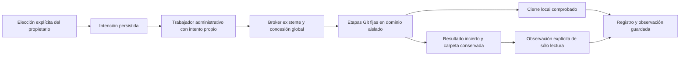

# Preparación explícita de fuentes

Crear Git local, adoptar un Git existente y clonar HTTPS son operaciones del
propietario, separadas de registrar una carpeta y de publicar código aceptado.
No requieren inventar una tarea de inferencia ni un repositorio que aún no existe.
La preparación no consume un turno de Codex ni concede herramientas a un modelo.

`SourceRequest` congela modo, nombre, destino y elecciones de rama, origen y
autenticación. `SourceOperations` conserva intención, dueño, intento y fence en
`projects.metadata_json.owner_repository_operations_v1`, usando la transacción de
admisión existente. Mantiene otros metadatos, incluidas las identidades de creación.
Límites completos:64operaciones,2MiB de metadata,32comandos por intento y8observaciones
conservadas; excederlos rechaza la operación en lugar de omitir historia.

La recuperación de este diagrama sólo puede registrar una fuente que ya terminó
correctamente. No completa una inicialización, commit o checkout que haya quedado
a medias. Si falta evidencia original o una revisión Git usable, conserva el
estado pendiente. El cierre local nunca demuestra que un servidor remoto detuvo
una solicitud.

## Autoridad y efectos

`SourceLease` y `SourceView` representan la operación y el directorio reales;
no contienen un ID de tarea o repositorio ficticio. `SourcePeerRegistry` adapta
el protocolo existente con `source_kind=repository_setup` y `task_id=None`.
`OwnedGitExecutor`, `PeerBroker`, `AsyncPeerBroker`, `ExecutionDomain` y el journal
con testigo conservan reserva, identidad de namespace, gate, revocación y cierre.
La proyección verifica origen, intento, fence, solicitud, vistas y namespaces;
una concesión nativa no puede convertirse en concesión administrativa.

- Crear necesita un directorio nuevo y una rama elegida. Usa template vacío e
  identidad transitoria; genera un commit inicial vacío identificado por la
  operación. No configura origin, credenciales persistentes ni un remoto.
- Adoptar exige un Git con revisión y rama comprobables. La vista es de sólo
  lectura; conserva archivos sucios, configuración, historial y origin. Puede
  reconocer el registro existente exactamente coincidente.
- Clonar exige HTTPS sin credenciales en URL y un destino nuevo. Usa etapas fijas
  de clone sin checkout, read-tree y checkout-index sin force. No ejecuta
  submódulos, hooks ni comandos recibidos de un modelo.
- La autenticación de clone es explícita. La credencial y la confianza TLS/DNS
  pertenecen al origen configurado en `RemoteTransportConfig`, independientemente
  de la red del modelo. El secreto viaja por memoria sellada al namespace privado;
  no se guarda en argv, manifiestos, metadata o `.git/config`. Redirecciones
  deshabilitadas. Git confiable comparte red durante clone: esto es confinamiento
  del programa, **no** una ACL de destino impuesta por el kernel.

`RepositoryManager.init_repo`, `clone_repo`, configuración de identidad y helper
de PAT ahora rechazan antes de cualquier efecto. El endpoint de alta antiguo
responde409 y el tool antiguo explica el reemplazo. No hay creación remota pública,
cambio de origin ni force push por configuración ambiental.

## Controles y comunicación

`SourceService` conserva handles reales de hasta dos trabajadores. El lifespan
los retira y drena antes de soltar el dueño exclusivo del store. Un fallo al
guardar recibos de fuentes no puede impedir el cierre independiente de los
trabajadores nativos. Detener apunta al ID y fence observados, nunca a un PID
suministrado por el navegador. El Stop del proyecto, con o sin cuerpo histórico,
incluye estas operaciones; el recibo del proyecto reconoce intención y no afirma
cierre físico. Los proyectos sin tareas conservan ese recibo administrativo en
metadata, sin insertar una orden nativa ficticia.

Endpoints del propietario, bajo el acceso local/CSRF existente:

| Solicitud | Resultado |
| --- | --- |
| `POST /api/projects/{id}/source-operations` | Guarda la selección original y programa su trabajador; devuelve202 |
| `GET /api/projects/{id}/source-operations/{key}` | Lee intención, fase y handle observado; no ejecuta Git |
| `POST .../{key}/stop` | Retira exactamente `operation_id` y `fence` observados |
| `POST .../{key}/observe` | Reconciliación explícita de sólo lectura, sin repetir escrituras |

La web conserva el paquete antes de POST. Una respuesta perdida permite consultar
la misma operación al recargar; no genera otra clave ni reenvía automáticamente
clone. La fase guardada, el trabajador activo, el cierre local y la revisión
observada son hechos distintos. Los errores conservados usan mensajes acotados,
sin excepciones crudas o secretos. Una observación registrada no prueba el estado
actual de Git, éxito semántico ni aceptación del trabajo.

El borrado del proyecto protege también esta historia bajo el write lock.
Registrar una carpeta por la ruta ordinaria no puede saltarse una reserva de
preparación pendiente o una carpeta parcial detenida. El informe de cierre incluye
las operaciones guardadas; las pendientes o parciales impiden cerrar el proyecto.
Los informes sin historia administrativa conservan su formato anterior y los
recibos históricos nunca vuelven a cerrar un alcance cambiado.

## Integración principal que falta

- La [prioridad física de Stop](source-control.md) ya se ensayó y corrigió para
  fuente, proyecto observado/general y aplicación bajo SQLite ocupado. Quedan
  evaluación global de admisiones nativas tardías, mezclas de trabajos y los
  escenarios de fallo/restore completos; esos cuatro controles no constituyen
  aceptación de todo el engine.
- Crear un remoto como decisión separada, con namespace/visibilidad explícitos,
  identidad original y reconciliación de respuesta perdida; actualmente se rechaza.
- Reparar etapas locales incompletas, dominios sin concesión registrada y crashes
  adicionales. Observar un Git ya terminado no prueba esos casos.
- Seleccionar/reconciliar historia desde otro navegador sin el paquete local,
  recuperación tras restore y migración de metadatos/configuración antiguos.
- Lectores grandes, presupuestos/concurrencia, submódulos, identidad de anotaciones
  remotas y aceptación completa de la página, comunicación y producto.

Pruebas y límites: [resultados](../modernization/source-setup-results.json),
[paquete](../modernization/source-setup-packaging.json),
[interfaz](../design/audits/2026-11-06-source-setup/report.md).

## Extensiones posteriores del ciclo de vida

La [creación remota separada](remote-source-creation.md) incorpora servidor,
namespace/visibilidad y observación original sin repetir POST. La
[reparación local explícita](source-repair.md) continúa etapas interrumpidas,
conserva archivos y distingue evidencia previa al dominio/sin concesión/cierre
físico. Estas extensiones reemplazan las limitaciones anteriores de esos casos;
no declaran aceptación de toda la página ni de restore/historia entre navegadores.
