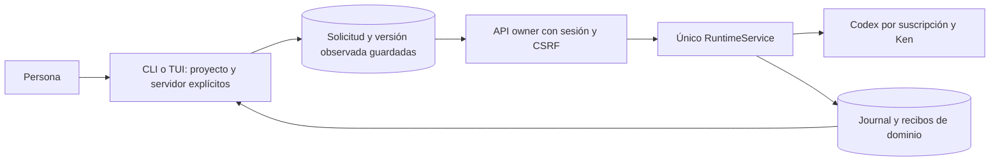

# Terminal y conversación sobre el mismo servicio

CLI, TUI y `ProjectOrchestrator` usan ahora la API owner del servidor existente.
Ya no crean equipos, otro motor, contextos globales de herramientas, worktrees ni
una base local. El retorno de un agente no marca `done`, una palabra como
«APPROVED» no acepta código y cerrar la terminal no hace merge ni detiene el
trabajo del servidor.

La terminal conserva la solicitud y proyecta resultados. El servidor conserva la
autoridad de ejecución, grants, límites, aislamiento, cierre y aceptación. No hay
fallback a LoopEngine, Ollama ni API keys. Los consumidores restantes de flows,
autonomía, herramientas y listeners aún requieren migración y exclusión física.

## Conversar, observar y decidir

Una nota como «gracias» sólo se guarda. `POST /api/chat/{proyecto}` ya no crea
`agent_events` ni emite el evento antiguo que iniciaba agentes. La migración49
retiene recibos originales de notas. El cliente nuevo envía clave de operación;
la compatibilidad sin clave añade una nota cada vez. Las instrucciones y
correcciones tienen endpoints tipados distintos. Los mensajes históricos siguen
consultables.

El historial nativo distingue una nota registrada por una sesión owner de un
registro antiguo que sólo dice `from_agent=user`. La primera acredita autoría,
sin acreditar verdad ni autorizar trabajo. Su input indica `kind=owner_note` y
`work_authorized=false`. No se aplica automáticamente como corrección.

La secuencia de un plan es explícita:

1. `/plan OBJETIVO` admite planificación y devuelve su identidad.
2. `/proposal RUN` ofrece bases, origen, supuestos, tareas y hash exacto.
3. `/accept-plan RUN` acepta esa versión guardada; crea pendientes.
4. `/execution RUN` muestra manifiesto y entregas.
5. `/execute-plan RUN` autoriza el manifiesto observado.

«Investigar → corregir» inicia investigación y espera su aceptación antes de
corregir. `/result`, `/accept-result --ack-limits`, `/code`, `/review-code` y
`/accept-code --ack-limits` conservan las decisiones de investigación, revisión
independiente y aceptación. Reconocer límites requiere escribir la opción cuando
corresponde. Aceptar código sigue separado de publicar.

La terminal usa la versión mostrada previamente, incluso después de reiniciar;
no consulta otra y la acepta silenciosamente. Esto registra qué material se
ofreció, sin demostrar que una persona lo leyera o entendiera. El servidor rechaza
un contexto obsoleto. `/task ID` precede a `/run ID OBJETIVO`; no se infiere el
repositorio desde el cwd de la terminal.

## Reintentos e identidad real

`OwnerClient` acepta un origen HTTP loopback explícito, desactiva proxies ambientales
y redirects y usa clave privada, sesión owner y CSRF. La clave de emparejamiento
se indica mediante fichero privado, nunca texto en argv ni URL. No se guarda en
el journal ni se lee el token de la suscripción desde la terminal.

Una misma URL y los mismos IDs no prueban continuidad de base. El servicio
proporciona identidad de instalación más identidad física de la DB. La terminal
la conserva y envía `X-Researcher-Endpoint`; el servidor rechaza un cambio antes
de entrar en la ruta. Incluso una copia con la misma identidad de instalación
tiene otra identidad física. Una restauración/reubicación necesita inspección
explícita de la operación original; no se reenvía a la copia automáticamente.
Esto presupone el servicio local owner confiable; no es un protocolo de identidad
para servidores remotos.

El servidor también declara sus raíces de workspace. El cliente comprueba que
estado y clave queden fuera de ellas. El cwd de la terminal no se supone igual a
su repositorio: puede ejecutarse desde el directorio personal.

El estado privado por origen/proyecto usa bloqueo entre procesos, escritura
atómica y `fsync`. Antes del POST guarda tipo, ruta, cuerpo, contexto observado,
identidad del endpoint y campos esperados del recibo. Una respuesta perdida,
ilegible, incompleta o de otro alcance conserva el pendiente. No admite otra
mutación que lo sobreescriba. `/retry` recupera esa misma solicitud. Cada reenvío
vuelve a marcar el resultado como incierto antes de salir a la red: un rechazo
anterior no permite descartar un éxito posterior cuya respuesta se perdió.

`/dismiss-rejected` sólo retira un rechazo definitivo después de inspección. Una
respuesta incierta no se convierte en rechazo por agotarse un plazo. Los recibos
de pausa acreditan intención, no cierre físico; `/execution` muestra los intentos.
Cambiar origen/alias no migra implícitamente el journal de otra configuración.

## Procedencia en desarrollo delegado

Las entregas nuevas `work.request` versión2 incluyen material original del plan,
su origen `owner_message`/`host_default`, propuesta aceptada y supuestos, además
de evidencia de prerrequisitos. Un revisor distingue `owner_admission` de
`coordinated_owner_execution`: una instrucción compuesta por el host no es una
cita literal del propietario. Lee el input congelado y sus límites.

No se reescriben inputs ni recibos históricos. Un paquete ya preparado con otra
forma no puede ganar material nuevo silenciosamente; requiere reconciliación.
La corrección de procedencia cambia el sujeto derivado de revisiones coordinadas
anteriores; sus registros se conservan, y los efectos futuros requieren revisar
la versión actual. Los sujetos de admisiones directas conservan su forma.

## Alcance comprobado y pendiente

[Resultados](../modernization/terminal-owner-results.json): entrada CLI real sobre
HTTP/SQLite/broker/kernel/Git, con generación/Ken controlados; cuatro turnos
originales de planificación, investigación, desarrollo y revisión. Recupera la
respuesta perdida de ejecución tras cerrar/reabrir cliente, acepta resultados y
conserva la fuente137 sin merge automático. No es evaluación de un modelo real.
La [TUI real](../design/audits/2026-11-05-terminal-owner/report.md) usa HTTP/owner/DB
con nota guardada y cero activaciones; se comprobó aparte sin runtime de inferencia.

Faltan recuperación/adopción de sucesores, reautorización de grafos corregidos,
lectura/adopción completa de candidatos entre tareas de código y paridad terminal
de preguntas, revisión científica, publicación/remoto y recuperación avanzada.
Los controles web existentes siguen disponibles. También faltan migración de
otros consumidores, binding persistido de endpoint en los clientes web, selector
multirrepositorio, proyección viva de notas, lifecycle e inversas. La nueva ruta
terminal no demuestra retirada global del engine ni aceptación integral del plan.
