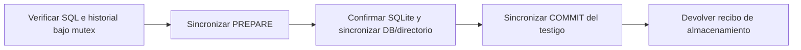

# Registro durable de autoridad: almacenamiento implementado

`backend/runtime/authority_journal.py` implementa el almacenamiento del protocolo
propuesto en [bootstrap de autoridad](workspace-authority-bootstrap.md). Todavía
no constituye un broker, una inscripción del host ni una autorización para editar.
La API productiva y `PeerRegistry` aún no lo utilizan automáticamente.

## Responsabilidades y origen

`WitnessedAuthorityJournal` abre tres archivos **existentes**: SQLite, testigo y
mutex. Exige un identificador de autoridad obtenido del aprovisionamiento externo.
No crea archivos, tablas ni una génesis si falta estado. La fixture de pruebas
escribe el formato directamente; no demuestra un dominio completo de actores ni
ofrece una puerta de bootstrap en producción.

Los archivos deben ser regulares, privados, del usuario actual, con un solo enlace
y sin symlink final. La inscripción une sus dispositivos/inodes, boot ID y namespace
PID del observador. Sustituir también el mutex no permite crear otro dominio de
coordinación con una copia de la DB. Cada operación vuelve a comprobar identidades.
Un handle heredado por fork no puede operar; el nuevo proceso debe abrir sus handles.

La fuente canónica es el estado SQL confirmado junto con su historial testificado.
Se vuelve a calcular el hash sobre **todos los valores reales**, no sólo sobre
el contador o hash de metadatos. El hash encadenado detecta inconsistencias; no
autentica frente a un escritor arbitrario con acceso a ambos archivos.

## Confirmación y recuperación

SQLite usa rollback journal `DELETE` y `synchronous=EXTRA`, independientemente de
la política WAL/NORMAL de la DB del proyecto. Se sincroniza también el testigo.
Las mutaciones usan comparación del estado esperado e identidad de transición.
Se reserva espacio para PREPARE **y** COMMIT antes de escribir el primero.

`load()` puede completar una delta preparada hacia delante o confirmar su SQL
ya aplicado. No ejecuta procesos, no reenvía `G` y no repite efectos externos.
Sólo se retira una cola incompleta después de comprobar acuerdo entre almacenes;
una línea completa corrupta o un rewind conserva la evidencia y se rechaza.

| Situación | Resultado observable |
| --- | --- |
| SQL anterior a un PREPARE válido | Aplicar su delta determinista y completar COMMIT. |
| SQL coincide con el PREPARE pendiente | Completar COMMIT sin volver a aplicar efectos. |
| Reintento de la misma intención, incluso después de otras transiciones | Recibo original con `fresh=False`; no rebobina el estado. |
| Misma identidad de transición con otra intención o estado esperado obsoleto | `AuthorityConflict`. |
| Mutex o SQL ocupado | `AuthorityBusy`; no se interpreta como instalación vacía. |
| Falta un archivo, rewind, sustitución o estado inconsistente | `AuthorityUncertain`; no reinicializar. |
| Capacidad agotada | `AuthorityCapacity`; conservar historial. |
| Fallo de sincronización después de escribir COMMIT | Resultado incierto; `load` también exige sincronizar antes de declarar verificado. |

Un recibo confirma datos. **Nunca concede autoridad para lanzar un actor**, aunque
su campo `fresh` sea verdadero. El futuro módulo de autoridad debe decidir grants,
revocación, generaciones, cierre completo y permisos sobre esos datos.

## Evidencia y alcance de las pruebas

Los tests usan SQLite y archivos reales, dos escritores en procesos independientes
y SIGKILL antes/después de PREPARE, durante SQL, después del commit SQL, durante
COMMIT y después de COMMIT. Comprueban filas, secuencias, deduplicación y ausencia
de la fila SQL no confirmada. También cubren rewind sobre el mismo inode, pérdida
o reemplazo de archivos, contención y metadatos malformados.

Dos pruebas de integración crean un namespace PID real con payload bloqueado,
publican su identidad en el registro separado antes del bind local y de `G`,
eliminan la DB sintética original y cierran el namespace desde otro proceso.
Incluyen un hijo `setsid()` y pérdida del monitor. El hijo no produce su efecto
tardío después del cierre; un heartbeat demuestra que sigue vivo inmediatamente
antes de recuperar. Se corrigió una espera del test que podía aguardar EOF de
pipes heredados y dejar expirar el hijo antes de comprobar el cierre.
**El orden lo orquesta el test**: no equivale a que
PeerRegistry, el broker o el despliegue productivo ya apliquen ese protocolo.

La suite completa expuso además un caso de cierre existente: `ns/pid` devolvió
EACCES durante la salida de un peer rápido. Una captura diagnóstica privada
conserva el traceback real; el mensaje productivo sigue redactado. Ahora se
espera el pidfd fijado sin señalar un proceso cuya identidad no puede leerse.
Si no llega a terminal, el resultado sigue incierto. Hay pruebas separadas de
denegación seguida de salida y denegación sobre un init que continúa vivo y
responde después. La prueba de salida usa la notificación del descriptor,
coherente con [pidfd_open(2)](https://man7.org/linux/man-pages/man2/pidfd_open.2.html).

Resultados, límites y hashes: [evidencia](../modernization/authority-journal-evidence.json).

## Capacidad y coste observados

Límites iniciales: 256 KiB por valor, 8 MiB de estado, 100.000 registros,
1 MiB por línea y 128 MiB para DB y testigo por separado. No hay rotación,
checkpoint, poda de recibos ni expansión automática; necesitan otro protocolo
aprovisionado que conserve la identidad y las garantías contra rollback.

El [microbenchmark local](../modernization/authority-journal-benchmark.json) usó
0/1.000/10.000 registros iniciales, 30 commits y cinco muestras de cada lectura.
Con 10.000 registros, la mediana observada de commit fue unos 214 ms. No es una
aceptación de rendimiento de producción: verifica todo el estado e historial
en cada operación, y la medición corresponde a un solo host/filesystem.

## Obligaciones que siguen abiertas

- Aprovisionar génesis con gate cerrado y dominio completo de actores demostrado;
  los archivos ausentes nunca son esa prueba.
- Implementar operaciones semánticas, autenticación del broker, publicación global
  antes de `G`, revocación, generaciones y liberación sólo tras cierre completo.
- Migrar escritores heredados y probar carreras reales de publicación/revocación,
  handoff, aliases y dos despliegues con bases diferentes.
- Mantener el testigo fuera del dominio de restore de SQLite. Si SQL y testigo
  vuelven juntos al mismo prefijo, estos archivos no pueden detectar ese rollback;
  restauración conjunta del host requiere referencia monotónica externa.
- Demostrar backup/restore y política de capacidad bajo carga de producto.

Estas obligaciones conservan su aceptación en el plan completo. La existencia
del módulo no habilita edición ni cierra la fase de autoridad global.

## Actualización: prefijo validado por bytes (6 de noviembre)

La integración posterior utiliza este registro en el broker real. El cierre de
[operaciones de código](native-code-operations.md) elimina la reinterpretación
repetida del prefijo idéntico: lectura efectiva de bytes en cada operación,
inscripción viva, validación de cada append y verificación SQL/acuerdo entre
almacenes conservadas. Buffer acotado a8MiB, sin confiar en stat/mtime y sin
cambiar formato, fsync, recuperación ni límites del historial. Las nuevas
pruebas de reutilización y las anteriores de corrupción/SIGKILL pasan.
