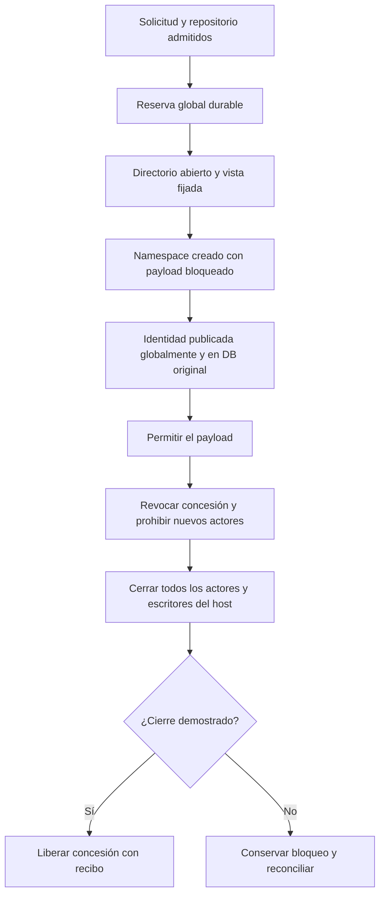

# Propiedad de workspaces: revisión independiente y protocolo pendiente

Revisión de `review_workspace_ownership_design`, con contexto limpio, sobre
`ae749ae`. Es análisis de fuentes, **no evidencia de un protocolo ya implementado**.
El plan completo conserva la exclusión entre DBs, los actores heredados y la
transferencia/restauración comprobada. La edición sigue sin habilitarse.

## Hechos observados

- `WorkspaceRegistry.bind` compara rutas canónicas y anidamiento entre proyectos
  de una misma DB. No coordina otra DB ni descubre todos los bind mounts/hardlinks.
- El vínculo admitido conserva dispositivo/inode, pero `validate` devuelve un
  `Path`; no entrega una vista fijada durante todo su uso a todos los ejecutores.
- El lock del propietario deriva de la ruta canónica de la DB. Un hardlink de la
  DB o un sidecar sustituido puede crear otro dominio de coordinación.
- Los peers publican su identidad en la DB original antes de liberar `G`. Controlar
  esos peers exige esa misma identidad de DB; una copia no obtiene autoridad.
- `peer_guard` administra duración y usa una vista amplia del host. El confinamiento
  de fuente/red lo imponen después el perfil nativo y el worker de Ken. No se deben
  atribuir al guard garantías de filesystem que no tiene.

Fuentes: [workspaces](../../backend/runtime/workspaces.py),
[coordinador](../../backend/runtime/service.py),
[registro de peers](../../backend/runtime/peer_registry.py),
[gate](../../backend/runtime/peer_guard.py) y
[cierre del kernel](../../backend/runtime/peer_process.py).

## Por qué un lock libre no es prueba de cierre

Ejemplo: el servidor muere y su descriptor de flock se cierra. Un hijo desacoplado
puede seguir vivo mientras el kernel termina su namespace. Otro servidor que vea
el lock libre no puede deducir que el primero ya dejó de actuar. El heartbeat, un
PID ausente o un timeout tampoco sustituyen la barrera de cierre de todos los actores.

Además, un registro global que conserve sólo `DB path + peer_id` pierde información
esencial si desaparece esa DB. La autoridad compartida debe conservar identidad
mínima suficiente para cerrar el namespace original sin reconstruirla desde un PID.

## Alternativas y decisión que falta implementar

| Alternativa | Evidencia que aporta y límite |
| --- | --- |
| Sólo rutas o DB por proyecto | No coordina otra DB ni demuestra ausencia de alias. |
| Sólo flock de directorios | Puede identificar el mismo inode, pero no prueba cierre tras morir su tenedor ni resuelve todos los solapamientos. |
| Shared locks en ancestros y exclusivo en raíz | Permite hermanos concurrentes en árboles estables; requiere resolver bind mounts, movimientos y archivos hardlinkeados fuera del árbol. |
| Guardian de locks | Alarga su propiedad; el guardian también puede morir. Sigue haciendo falta journal y recuperación. |
| Autoridad local durable con concesión mutable única | Evita escritores participantes simultáneos incluso con alias desconocidos. Reduce concurrencia y necesita bootstrap, identidad física y cierre completos. |
| Dominios de filesystem con escritura paralela | Conserva más concurrencia, a cambio de demostrar disjunción/alias/topología y fijar las vistas de todos los actores. |

El revisor recomienda la concesión mutable única como primera versión. Es una
propuesta con coste de producto, no una optimización de tests ni una declaración
de que la concurrencia por workspace ya esté resuelta. Antes de adoptarla se debe
definir qué actores son mutables —Ken escribe su estado— y reflejar la espera en
la UI. Las lecturas del propietario deben seguir disponibles. El plan permite
serialización explícita en su evaluación de runtimes; no permite ocultarla.

## Protocolo de destino

Este diagrama describe obligaciones pendientes de integración, no el estado actual:

1. Una autoridad privada por cuenta/host debe tener ubicación y generación
   verificables, independientes de `control_root` y de cada backup de proyecto.
   Todos los despliegues participantes deben compartir esa autoridad/observador;
   otro namespace o visibilidad insuficiente produce incompatibilidad explícita.
2. La reserva vincula generación, intento y fence global. El mutex serializa
   transacciones; la concesión durable conserva el bloqueo después de un crash.
3. Cada namespace se crea bloqueado. Su identidad validada se publica globalmente
   antes del registro local y antes de `G`. Una caída entre commits debe dejar un
   actor conocido, bloqueado o recuperable; nunca uno liberado sin registro durable.
4. Revocar impide nuevos binds/acciones del host. El cierre no espera una escritura
   SQLite para detener primero actores conocidos; la concesión no se libera por
   ese cierre parcial. Los actores que hayan entrado en carrera también se concilian.
5. Sólo se libera después de comprobar todos los peers y escritores. Un resultado
   perdido mantiene unknown/NULL y presupuesto conservado; no se repite el trabajo.

`WorkspaceAuthority` debería ser un módulo dueño de estas operaciones semánticas.
`PeerRegistry` publicaría antes de `G`; `peer_process` seguiría cerrando identidades
del kernel; el coordinador no debería reconstruir un orden de commits distribuido.
Los escritores heredados/host que no viven en namespaces requieren migración o un
rechazo efectivo antes de habilitar la capacidad mutable.

## Bootstrap, pérdida de autoridad y transferencia

La ausencia del registro global no demuestra que sea una instalación nueva. No
se debe recrear vacío si pudo haber actores anteriores. Un UUID dentro de la DB
restaurada tampoco detecta rewind. El bootstrap necesita una condición verificable
de quiescencia/origen y una identidad externa a los snapshots restaurados; una
casilla del usuario afirmando que cerró todo no es prueba técnica.

El handoff necesita cierre demostrado, generación de origen retirada, manifiesto
de transferencia unido al snapshot consistente de DB/adjuntos/repositorios y nueva
generación de destino. El origen conserva un tombstone que impida su reactivación.
Presupuestos desconocidos y efectos posteriores al backup no desaparecen al restaurar.
Otro boot ID no demuestra cierre en otro host.

El protocolo coordina despliegues participantes. No aísla de un administrador o
proceso arbitrario con las mismas credenciales que altera archivos/borra registros.
Un FD fija el objeto abierto, no congela su contenido ni elimina todos los alias
de sus hijos o cambios externos de topología. Esas fronteras deben ser explícitas.

## Pruebas que aún deben demostrar la autoridad completa

- Dos DBs/control roots sobre la misma carpeta, ancestro/hijo, symlink, bind mount
  y árboles aparentemente separados con hardlinks.
- SIGKILL del padre/launcher/guardian entre reserva, publicaciones y `G`, con hijos
  `setsid()` y G tardío concurrente con revocación.
- DB original perdida/movida/copiada; registro global perdido/sustituido/restaurado;
  identidad PID reutilizada, observador cambiado y `/proc` inaccesible.
- Directorio sustituido o renombrado antes/después de abrir y montar, sin actuar
  sobre el sustituto. El worker de Ken tiene una prueba acotada de este caso;
  no sustituye la vista de comandos/desarrollo ni el resto del protocolo.
- SQLite global ocupado/fallo de commit; ningún payload sin registro recuperable.
- Restauración vieja sobre el mismo inode, dos destinos y respuesta perdida de
  handoff, sin duplicar generaciones ni restaurar presupuesto perdido.
- Consumidor heredado que intenta escribir sin concesión: rechazo real.

La implementación de la autoridad global, su bootstrap y estas pruebas siguen
pendientes. Este análisis cambia el diseño requerido; no habilita herramientas de edición.
