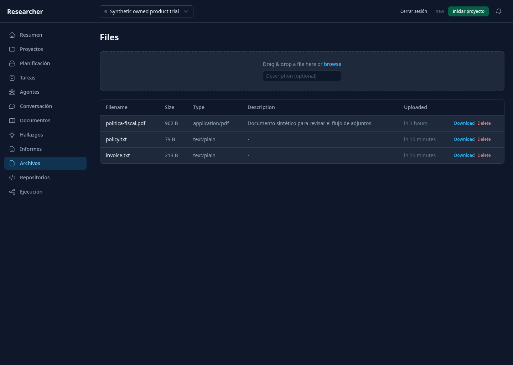
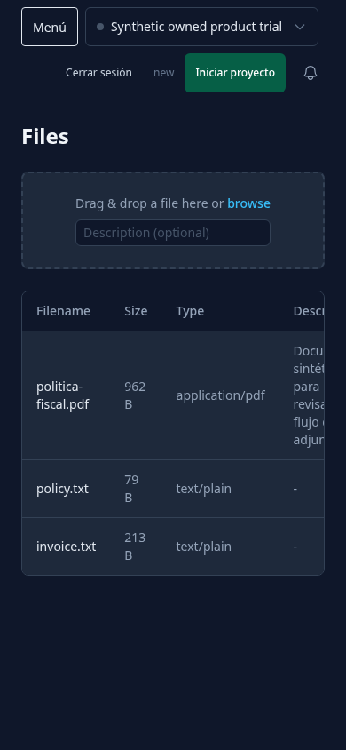
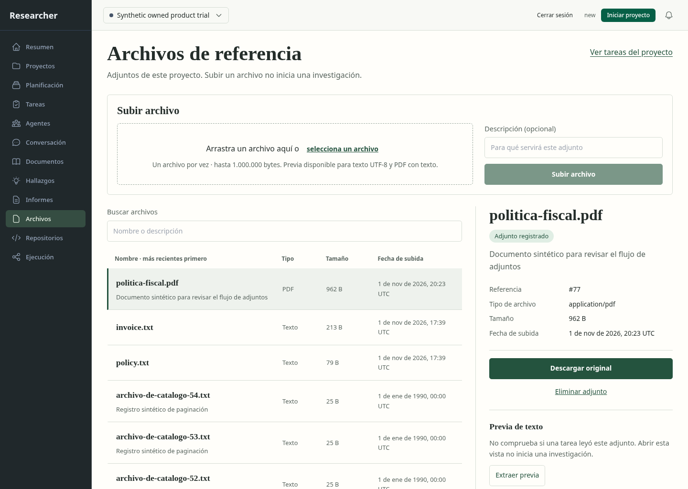
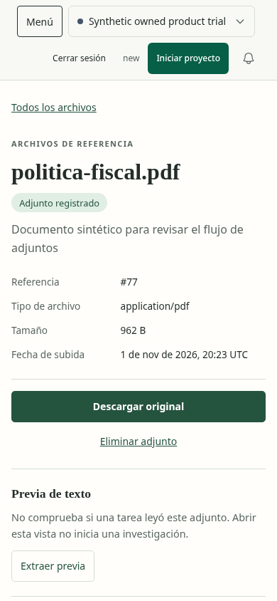
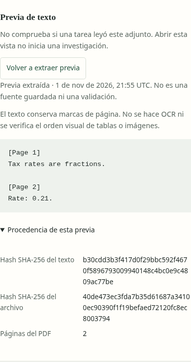
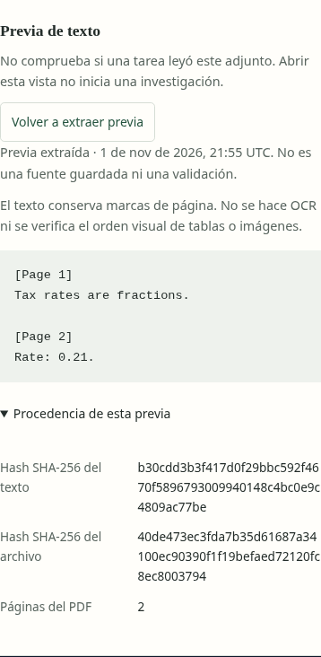

# Archivos: punto de partida del rediseño

Base de frontend:312dd7b, sin cambios posteriores en FilesPage. Backend del corte:
7a72fe9. Chromium156 con sandbox, app/API reales y sesión de propietario sintética.
Copia del ensayo de producto retenido más un PDF generado de dos páginas; ninguna
base del usuario, captura nueva de fuente ni inferencia. Se consultó solamente la
lista: no se pulsaron upload, descarga, borrado ni inicio de proyecto.

La captura de escritorio1440×1024 muestra mezcla de navegación española con Files,
Filename, Download/Delete y fechas relativas futuras. El listado conserva
el archivo, tamaño, MIME y descripción, pero no explica la diferencia entre subir
un adjunto, extraer su texto y usarlo como evidencia en una investigación.

En390×844 la tabla mide631px: el nombre queda partido, el tipo técnico ocupa varias
líneas y las acciones quedan fuera de la zona visible. No hay una composición móvil
con acciones por archivo. La descripción del upload sólo aparece como placeholder;
los estados de teclado/formulario/error todavía necesitan evaluación específica.
No se atribuye comprensión, accesibilidad o fallo de una operación a estas dos
capturas. No hubo errores JavaScript no controlados.

El PDF está subido pero no capturado por un agente. No se puede mostrar «leído»,
«analizado» o «listo para citar» a partir de su nombre/MIME. El contador durable de
inferencia permaneció1 y el informe anterior conservó su cuerpo. El servidor de
fixture se cerró con PID/cmdline/cwd verificados; sesión46831 terminó0.

[Evidencia y hashes](before-evidence.json). El [brief](../../concepts/files/brief.md)
guía las alternativas pendientes. Estas capturas no son conceptos generados, piloto
implementado ni aceptación de la ruta. Inventario visual permanece3 pilotos,
9/36 conceptos de escritorio,3/12 móviles y0/12 rutas aceptadas completamente.

## Después: archivo con inspector implementado

Base de entrega6930d79. La imagen elegida se implementó como catálogo con búsqueda,
subida explícita y detalle lateral. En móvil se alternan lista y detalle; no se
reduce una tabla ancha. Se conservan nombre/proyecto/fecha reales del fixture y el
shell compartido de doce rutas. Los conceptos no prueban lectura por un agente:
se sustituyó ese supuesto por una previa explícita, con límites y procedencia.

Se compararon juntas referencia y captura en1440×1024 y390×844. Las imágenes de
referencia son1487×1058 y853×1844; se interpretaron según sus objetivos1440×1024 y
390×844, comparando regiones de contenido y proporciones, sin atribuir diferencias
de densidad a defectos del producto. Las capturas reales usan deviceScaleFactor1.
No se generaron nuevos activos: el concepto contiene controles y texto editable,
sin fotos/miniaturas que deban añadirse. Los nombres/fechas ilustrativos se sustituyen
por registros reales y el orden se declara por fecha, no alfabético.

La comparación de detalle corrigió márgenes oscuros móviles y el foco rectangular
del título. Las pruebas detectaron y corrigieron el nombre accesible del selector,
un encabezado principal oculto en móvil y Tab inverso saliendo del ciclo del diálogo
hacia el límite de navegador. La restauración de foco se comprueba esperando el
efecto de React, sin asumir que ya ocurrió al resolver el clic de Playwright.

El recorrido real (API/SQLite/worker PDF, Chromium156 con sandbox) comprueba:

- Previa PDF con las dos páginas y sin inferencia/captura de fuente; procedencia y
  hashes consultables. Descarga con nombre y bytes exactos del PDF generado.
- Subida confirmada de texto con `` literal, previa escapada sin ejecución
  de HTML, selección por URL y borrado del adjunto correcto.
- Catálogo de58 referencias en dos páginas, búsqueda y regreso al registro elegido
  con foco. Proyecto distinto no habilita acciones sobre el archivo ajeno.
- Diálogo con foco inicial en conservar, ciclo Tab/Shift-Tab y Escape con retorno al
  botón; confirmación de borrado devuelve al catálogo.
- Límite de tamaño visible y aplicado por servidor. Fallos de detalle, extracción y
  descarga diferenciados, con recuperación; no pasan por lista vacía o éxito ficticio.

Son11 estados del recorrido y3 comprobaciones adicionales: detalle a320px y regiones
legibles de previa/procedencia en escritorio/móvil. Catorce estados sin desbordamiento
horizontal ni infracciones detectadas por axe. La revisión de las regiones muestra
marcas de página, texto literal y hashes con ajuste de línea, sin recortes. No equivale
a probar zoom real, lector de pantalla o comprensión con una persona.

[Estados, acciones y hashes](after-evidence.json),
[regiones y320px](detail-evidence.json),
[invariantes del fixture](fixture-invariants.json),
[pruebas de backend/frontend](../../../modernization/files-results.json).
El contador de inferencias sigue1; el informe anterior mantiene su contenido. La
prueba API de captura→finding→informe→borrado demuestra conservación de fuentes e
informes. Las pruebas de navegador no llaman a un modelo ni aceptan resultados.

**QA de esta comparación: passed.** No quedan P0/P1/P2 observados en el alcance
probado. P3: escala del título móvil y densidad del shell respecto a la maqueta;
se revisarán con el sistema visual compartido. Eliminar es discreto y requiere
confirmación; no copia el peso excesivo del concepto. El ejemplo diferencia adjunto,
previa y captura sin presentar la extracción como validación científica.

**Aceptación completa pendiente:** evaluación humana, lector de pantalla, zoom real,
resto de estados (incluidos fallos de subida/borrado y cambios de proyecto durante
operaciones), migración de consumidores heredados y formatos adicionales. El piloto
no cierra esos requisitos. Inventario actual:4 pilotos,12/36 conceptos de escritorio,
4/12 móviles,0/12 rutas plenamente aceptadas.
