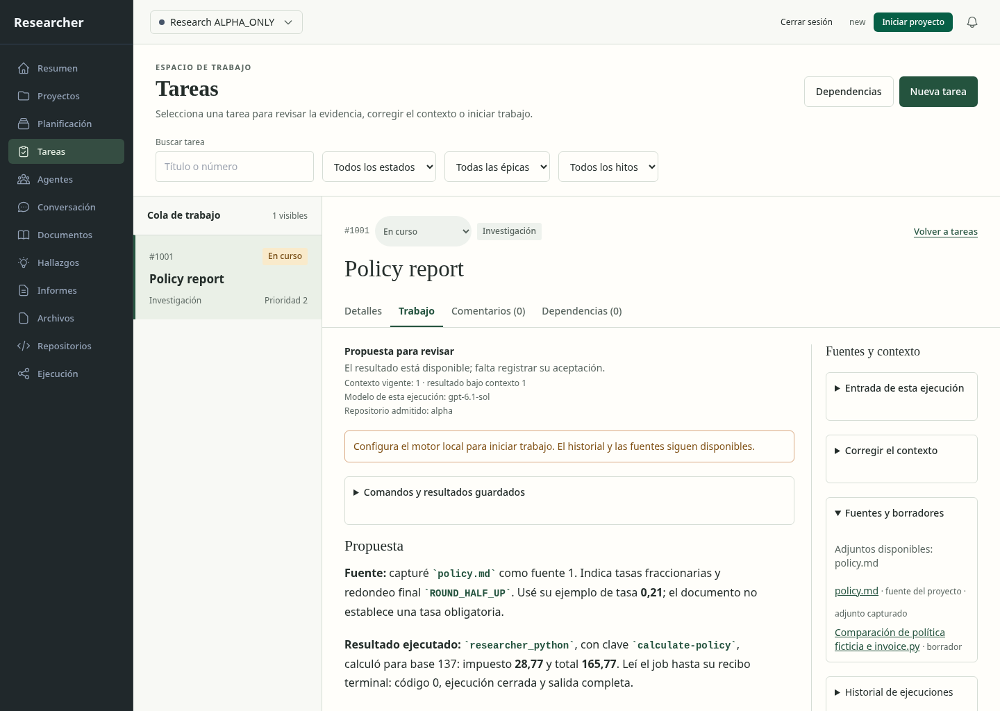
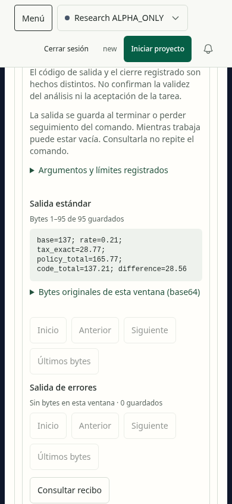

# Tareas, conversación y resultados guardados: primer recorrido en navegador

Fecha: 2026-11-01. Resultado: **recorrido comprobado; aceptación completa pendiente**.
Se ejecutó Chromium con sandbox sobre dos copias nuevas de un ensayo sintético.
No se abrió una base del usuario, se solicitó generación ni se repitió el cálculo.
El acceso se preparó mediante el emparejamiento HTTP real; no se probó su formulario.

## Recorrido e imágenes

Las imágenes son capturas del producto ejecutado. Se inspeccionaron los archivos
guardados; los hashes están en [evidence.json](evidence.json). Escritorio:
1440 × 1024; móvil: 390 × 844. El contenido usa un contenedor con desplazamiento:
cada imagen muestra su posición visible, no toda una página larga a la vez.

| Paso | Estado y salud observada | Escritorio | Móvil |
| --- | --- | --- | --- |
| 1 | Sin proyecto: explica cómo comenzar; carga y salto al contenido correctos | [Captura](desktop/01-tasks-initial.png) | [Captura](mobile/01-tasks-initial.png) |
| 2 | Selector abierto: opciones legibles, sin tapar los controles de la cabecera | [Captura](desktop/02-project-menu.png) | [Captura](mobile/02-project-menu.png) |
| 3 | Proyecto elegido: cola y filtros disponibles; elegir no inicia trabajo | [Captura](desktop/03-tasks-selected.png) | [Captura](mobile/03-tasks-selected.png) |
| 4 | Tarea abierta: propuesta, contexto, modelo y fuentes reales del ensayo | [Captura](desktop/04-task-inspector.png) | [Captura](mobile/04-task-inspector.png) |
| 5 | Lista de comandos: recibo y control para consultar salida guardada | [Captura](desktop/05-commands-open.png) | [Captura](mobile/05-commands-open.png) |
| 6 | Salida: se leen los 95 bytes; código de salida, cierre y aceptación se distinguen | [Captura](desktop/06-command-output.png) | [Captura](mobile/06-command-output.png) |
| 7 | Navegación móvil abierta: destinos accesibles y cierre disponible | No aplica | [Captura](mobile/07-mobile-navigation.png) |
| 8 | Conversación del proyecto: título visible tras navegar y foco en el contenido | [Captura](desktop/07-chat-selected.png) | [Captura](mobile/08-chat-selected.png) |
| 9 | Conversación de la tarea: solicitud y propuesta conservan su procedencia | [Captura](desktop/08-chat-task.png) | [Captura](mobile/09-chat-task.png) |

Ejemplo del inspector ejecutado y su salida móvil:

## Problemas encontrados y corregidos

1. **Aplicación vacía en un puerto local dinámico.** El middleware rechazaba el
   Origin de sus propios módulos JS/CSS. Se acepta el origen exacto del Host
   loopback validado, conservando sesión, CSRF, rechazo de otro puerto, cross-site
   y Host no permitido. Cinco casos nuevos fallaron antes y pasaron después;
   el archivo de acceso completo suma 30 casos aprobados.
2. **Contraste de «Iniciar proyecto».** Axe midió 2,89:1 sobre el fondo claro.
   El botón usa un verde más oscuro; el control de detener usa la misma jerarquía
   de contraste. No se ejecutó ninguno de esos controles durante el recorrido.
3. **Cabecera móvil recortada.** La regla utilitaria fijaba 64 px aunque las
   acciones ocupaban dos filas. Se corrigió la precedencia CSS y se ancló el
   selector debajo de toda la cabecera. Las comprobaciones de límites y de
   tamaño/obstrucción de objetivos fallaron antes y pasan en los estados finales.
4. **Salto de teclado tardío.** «Ir al contenido» estaba después de los doce
   destinos de navegación. Ahora es el primer enlace; Tab y Enter llevan el foco
   al contenido tanto en escritorio como en móvil.
5. **Desplazamiento y foco de la sección anterior.** Navegar desde la salida de
   comandos podía ocultar el título de Conversación en móvil. Al cambiar pathname
   se reinicia el desplazamiento del contenido y se mueve su foco. La selección
   dentro de una sección conserva su manejo específico. La prueba observó el
   fallo de foco y el título fuera del viewport antes de la corrección.
6. **Dependencia visual de un CDN.** KaTeX se carga desde la dependencia ya
   declarada y sus archivos locales. El documento declara idioma español y título
   Researcher. Los recorridos finales no solicitaron orígenes externos.

El primer intento produjo capturas vacías; se rechazaron. Otras capturas
intermedias mostraban estados de carga y también se descartaron como evidencia
del estado final. El driver espera contenido concreto, guarda ARIA y rechaza una
raíz vacía. Un error de instrumentación que confundía las dos cabeceras de Chat
se corrigió usando el landmark banner; no fue un fallo del producto.

## Comparación con los conceptos seleccionados

Se compararon los archivos del producto con las referencias de
[Tareas](../../concepts/tasks/editorial-inspector.png),
[Conversación](../../concepts/chat/conversation-with-evidence.png) y sus variantes
móviles. Conservan papel claro, títulos editoriales, separadores, índice lateral,
lectura principal y fuentes que se apilan cuando falta ancho. La selección móvil
reemplaza la lista por la tarea y ofrece regreso. Se muestran los datos guardados,
sin importar la hipótesis ficticia del concepto ni completar fuentes inexistentes.

La composición todavía necesita trabajo: el bloque de estado y la explicación de
historia desplazan bastante la conversación en móvil; el menú móvil mantiene
colores heredados; la cabecera muestra `new` sin traducir y conserva el inicio del
engine antiguo. La separación entre propuesta y aceptación ya es visible, pero
falta probar si personas la comprenden y si identifican cómo corregir el contexto.
Los ejemplos y diagramas estructurados siguen pendientes.

## Alcance probado y siguiente trabajo

- Diecisiete estados sin infracciones de axe para los tags WCAG 2 A/AA, 2.1 AA y
  2.2 AA seleccionados. No es una certificación de accesibilidad.
- Sin errores JavaScript, assets fallidos, orígenes externos ni solicitudes de
  mutación del producto en ambos recorridos. Emparejar la sesión ocurrió antes.
- La lista y las salidas son lecturas. Nueve tablas de runtime conservaron sus
  valores tanto en la fuente como en cada copia; no se afirma comparar toda la DB.
- Sin generación nueva ni llamadas a imágenes. Chromium usó el build fallback de
  Ubuntu 24.04; su lanzamiento con sandbox y estos recorridos se probaron aquí.
- Quedan preguntas/respuestas, correcciones, Stop, errores, recuperación, cambio de
  proyecto con borrador, controles compartidos y diálogos en navegador. También
  navegación completa sólo por teclado, lector de pantalla, zoom 200/400 %, otros
  motores y comprensión humana. **0/12 rutas tienen aceptación final.**
- Las otras diez rutas, sus 30 conceptos de escritorio y 10 adaptaciones móviles
  siguen dentro del plan. Migrar el control de inicio heredado requiere el engine
  nuevo completo; esta revisión no lo habilita ni lo elimina como atajo.

Reproducción y límites del fixture: [evals/ui/README.md](../../../../evals/ui/README.md).
Resultados técnicos: [browser-evidence.json](../../../modernization/browser-evidence.json).
