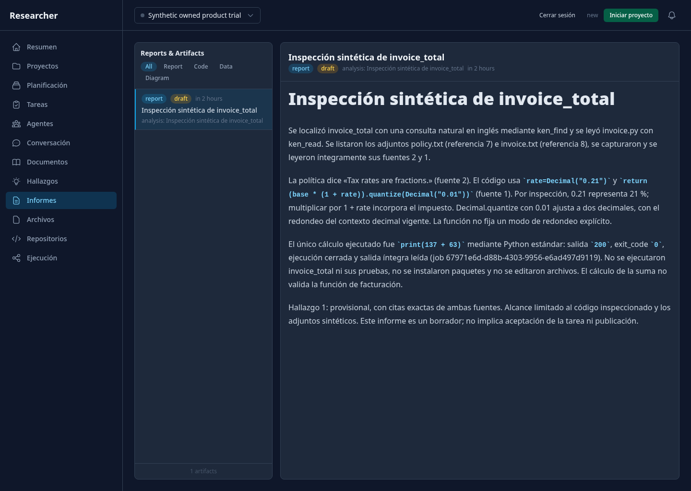
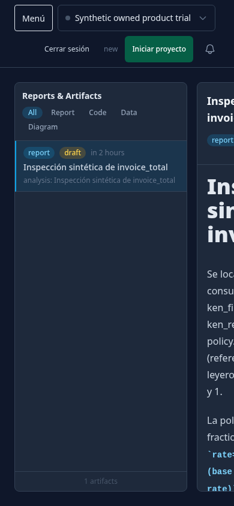
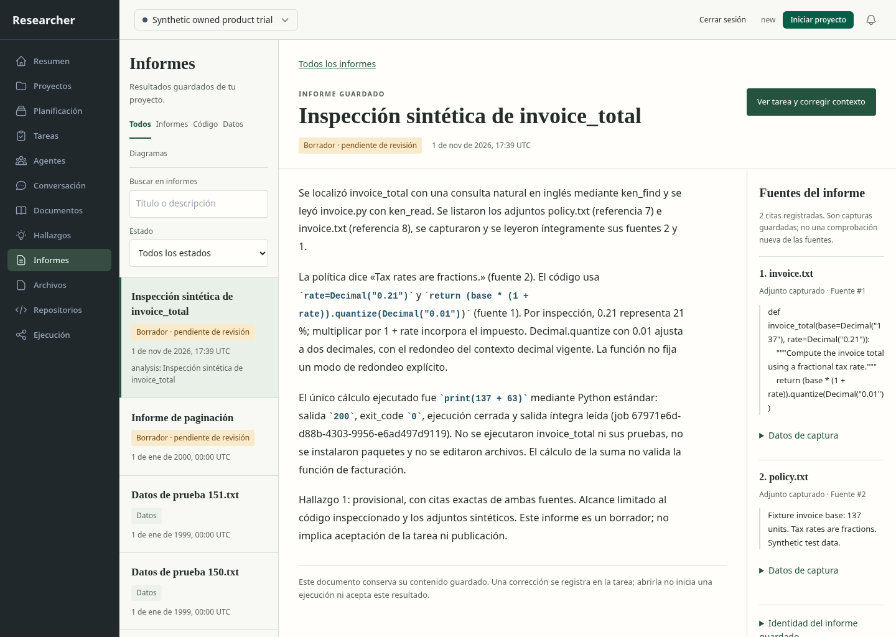
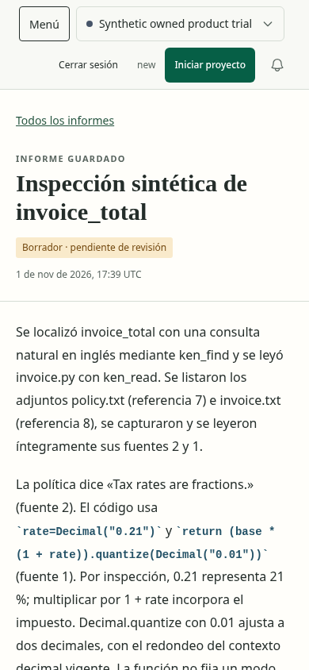
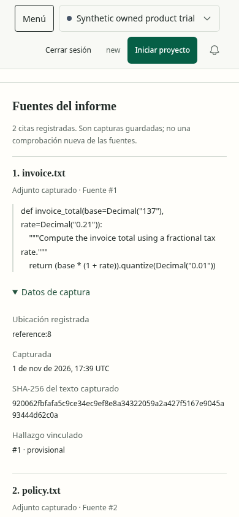
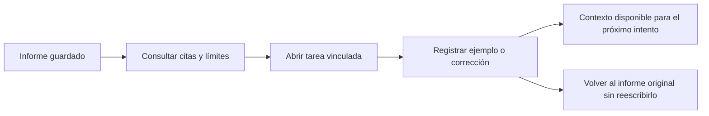

# Informes: estado anterior al rediseño

Fecha:2026-11-01. Base77ca403. Se capturó el API/app real con emparejamiento HTTP
y Chromium156 con sandbox en1440×1024 y390×844. Se usó una copia del ensayo
sintético owned-product-db39481557; no se abrió una base real del usuario ni se
solicitó generación. Scripts y fixture: scratch reports-ui/.

1. Abrir el informe guardado desde su URL y proyecto: el contenido existe y se lee
   en escritorio. Su título se repite en el panel y el Markdown.
2. Leer en móvil: lista y documento permanecen en fila; el documento queda recortado.
   No hay vuelta de lista/lector, y scrollWidth global no revela el recorte.
3. Comprobar procedencia: las referencias aparecen en el cuerpo, sin fuentes
   estructuradas ni vínculo desde el informe a la tarea para corregir contexto.
4. Interpretar estado/fecha: draft no explica aceptación; la fecha relativa aparece
   futura. Revisar el tratamiento de la zona antes de atribuir antigüedad.

No se detectaron errores JavaScript en estas dos capturas. Esto no demuestra
accesibilidad, teclado, paginación ni comprensión humana. No se ejecutaron controles
de inicio/Stop, edición, aceptación ni publicación. La implementación seleccionada
y su evaluación posterior se documentan debajo. [Evidencia anterior](before-evidence.json).

## Después: lectura, procedencia y corrección verificadas

Resultado del alcance: **aprobado funcional y visualmente; aceptación completa pendiente**.
La [evidencia final](evidence.json) contiene20 estados de Chromium156 con sandbox,
layout de elementos, hashes y controles axe seleccionados. Datos de una copia del
ensayo sintético retenido;52 archivos, otro informe con21 citas y otro proyecto
se añadieron sólo para comprobar paginación, texto hostil y aislamiento.

El documento usa el contenido original guardado, sus dos fuentes y citas exactas.
Se compararon referencias y capturas finales en una misma inspección: se mantienen
papel cálido, jerarquía editorial y separación índice/documento/procedencia. En
móvil se alterna lista y lector, las fuentes siguen al texto y la acción de corregir
queda después. Se corrigieron título con borde de foco negro, márgenes oscuros de8px
y aviso de otro proyecto oculto. El foco de controles interactivos permanece visible.
La navegación compartida del producto se conserva; su modernización sigue abierta.

Las líneas, actor y ejemplo numérico de la imagen conceptual eran ilustrativos:
no existen en los metadatos originales y no se incorporaron al informe persistido.
El título sólo se omite del Markdown mostrado si coincide exactamente con el H1;
el cuerpo guardado se conserva. Fechas SQLite se muestran como UTC explícito.

| Comprobación | Resultado observado |
| --- | --- |
| Lista y búsqueda |50→54 archivos, filtros por tipo/estado/título, vacío y error diferenciados |
| Procedencia |20→21 citas, texto exacto escapado; metadatos/hash disponibles; fuente no equivale a comprobación actual |
| Teclado |Título enfocado→volver→fila enfocada→abrir→título enfocado, en ambas vistas |
| Enlaces |Informe→tarea1001 y vuelta al informe; proyecto incorrecto rechaza selección/lectura; tarea ajena404 |
| Corrección |Ejemplo del usuario registrado; `application=recorded_for_next_run`, `inference_started=false` |
| Preservación |Informe original idéntico, sigue `draft`; contador de despachos permanece1; adaptador de generación prohibido no se llamó |
| Fallos |404 y503 controlados en detalle/lista/fuentes; ningún error JavaScript no controlado |
| Layout/axe |20 estados, elementos comprobados dentro del viewport, cero infracciones seleccionadas |

Esto comprueba que el producto expresa y conserva la diferencia entre inspección,
ejecución y corrección registrada. **No es un estudio de comprensión humana**:
falta observar si una persona entiende estas diferencias y puede orientar el
resultado sin ayuda. También faltan zoom200/400%, lector de pantalla, otros motores,
todos los estados de sesión/Stop/recuperación y migrar controles del engine antiguo.
No se declara aceptación completa de ninguna de las12 rutas.

[Pruebas y límites técnicos](../../../modernization/reports-results.json),
[paquete backend](../../../modernization/reports-packaging.json).
El frontend se construyó y sirvió desde fuente; no prueba instalación de producto
completa. El lector mantiene el helper SQLite legado: esta entrega no acredita
protección ante toda pérdida de fuente durante la ejecución del servicio.
