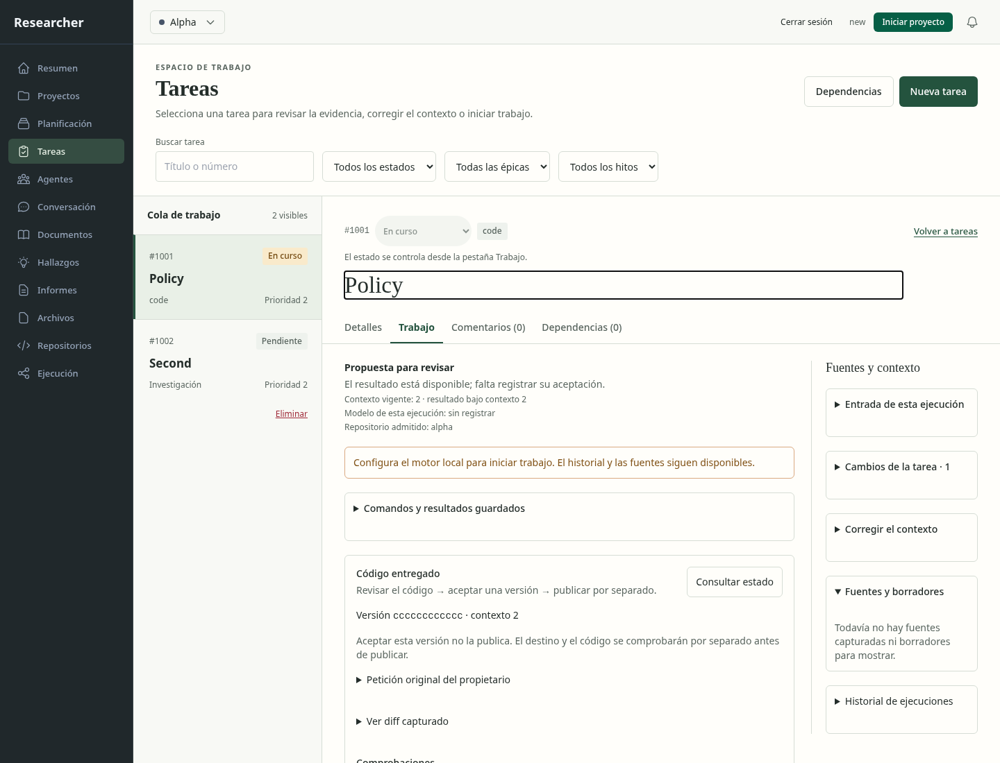
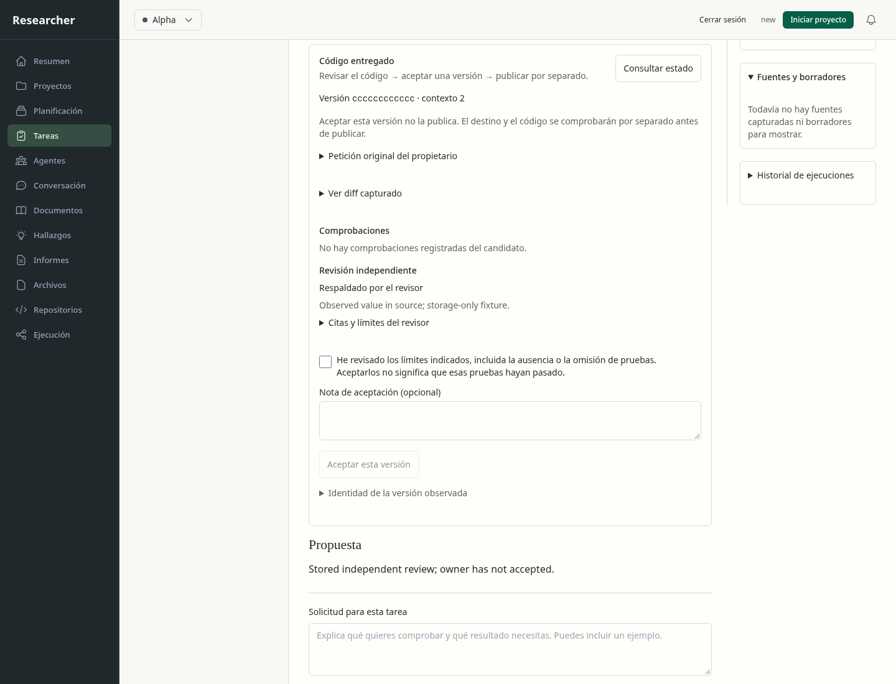
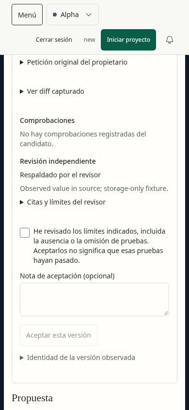
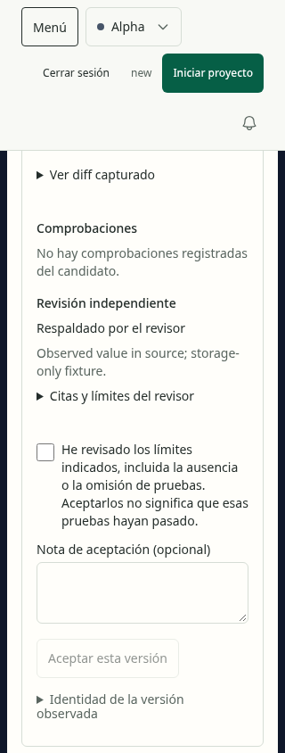
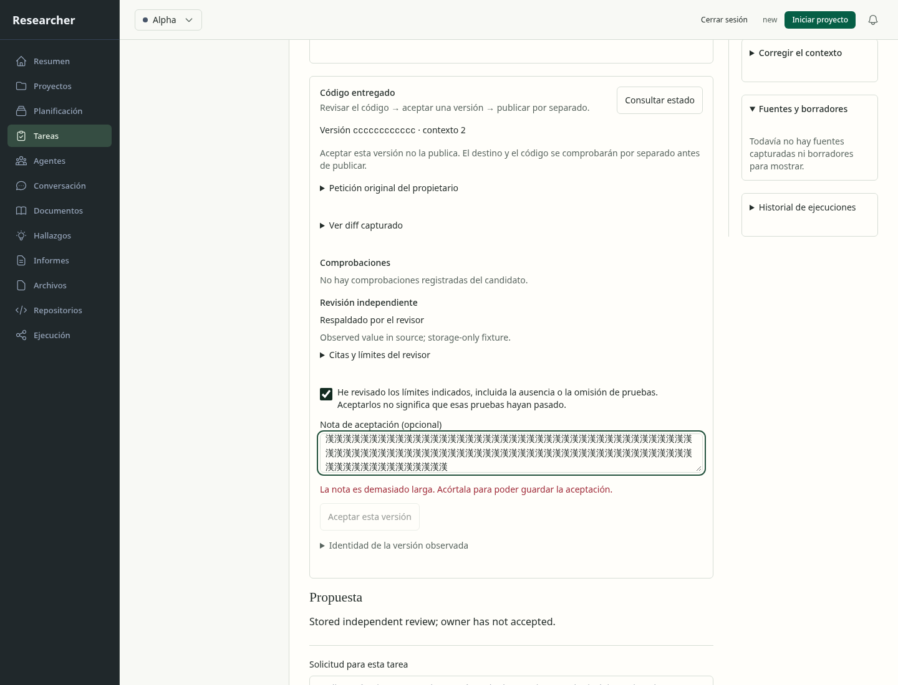
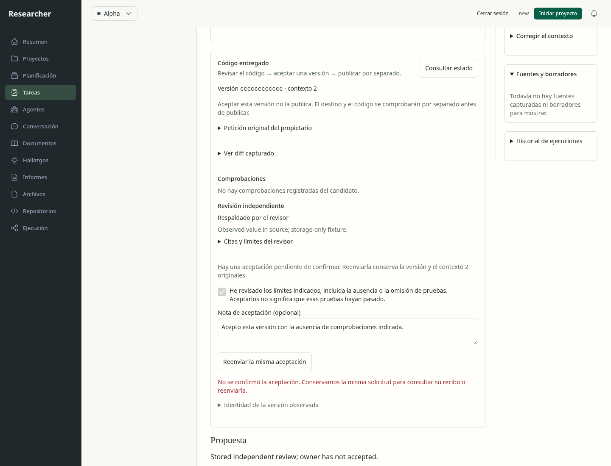
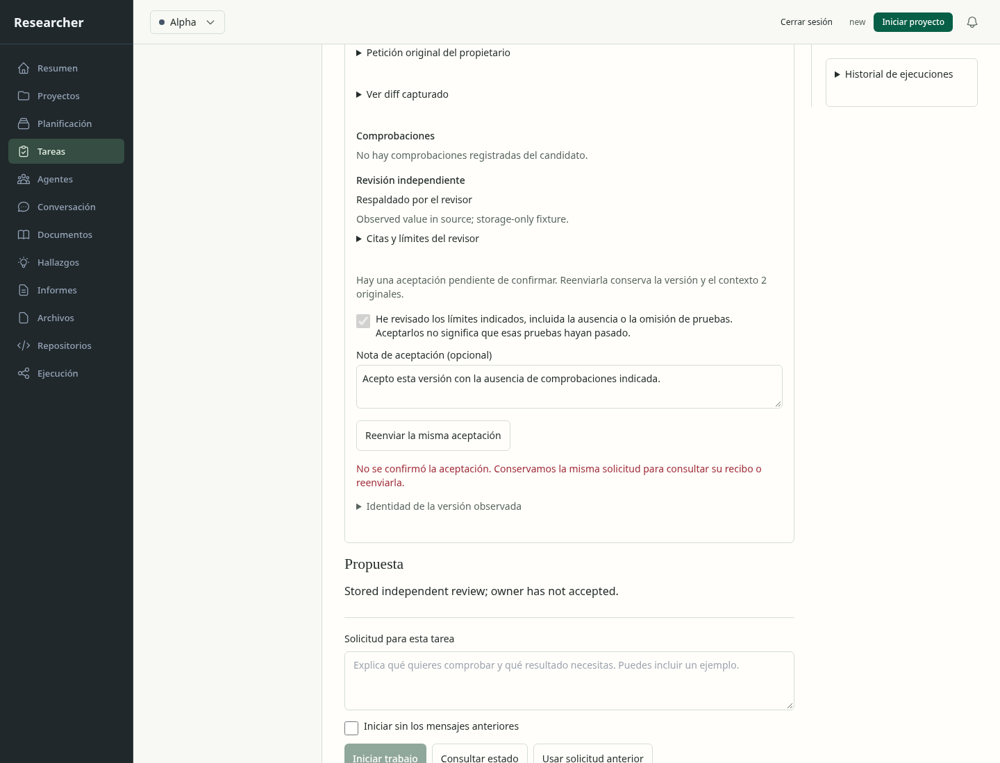
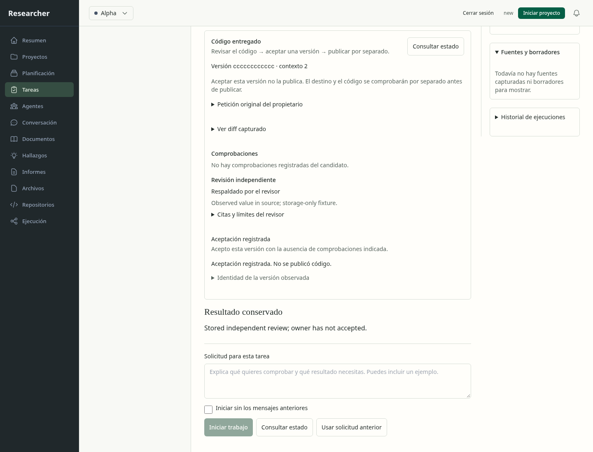
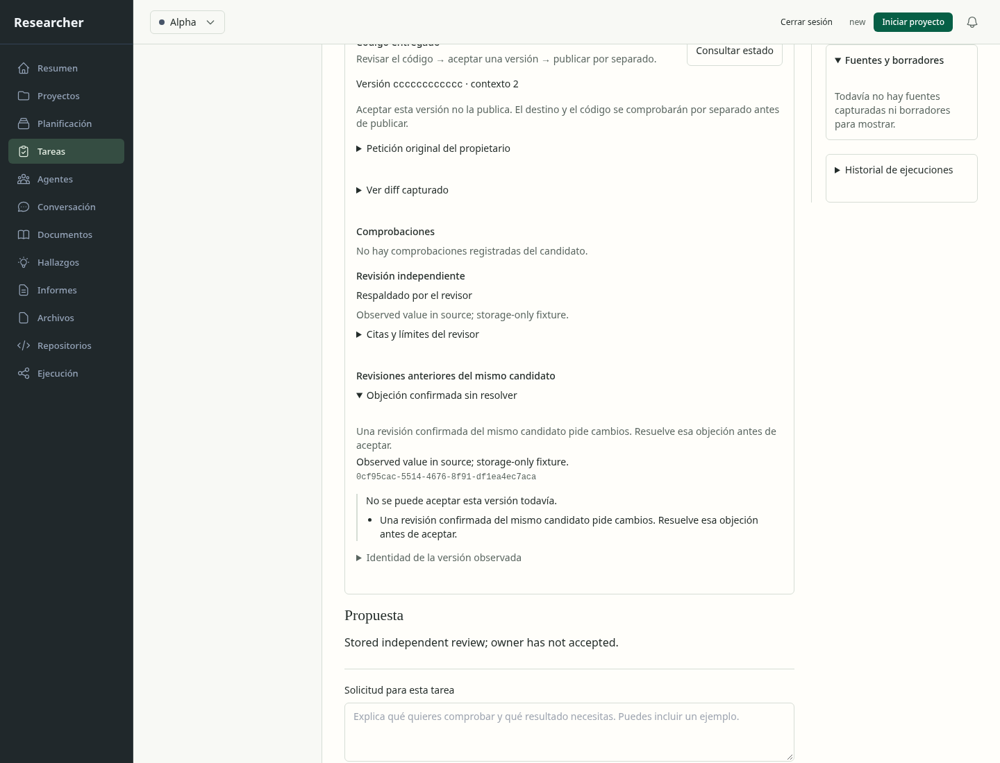

# Inspección del panel de aceptación de código

Se verificó el panel real de Tareas mediante HTTP, sesión del propietario y SQLite,
con procedencia Git/cierre sintética declarada. La integración de procesos/Git
reales tiene evidencia separada en las pruebas del coordinador. No hubo inferencia
ni publicación. El navegador integrado devolvió «browser access host unavailable»;
se utilizó Chromium de las pruebas locales. No hay contexto Product Design guardado.

## Recorrido observado

1. Abrir Tareas y seleccionar el candidato. La vista identifica versión/contexto y
   separa inspección, aceptación y publicación. Contexto de escritorio:
   
2. Leer resultados, revisión y límites. La casilla comienza sin seleccionar y el
   botón permanece deshabilitado. El formulario se adapta a móvil y a 320 píxeles:
   
   
   
3. Abrir diff capturado y citas; comprobar que no se presentan como archivos
   actuales sustituidos. Estas aperturas se probaron mediante DOM y HTTP; no se
   capturó una imagen separada de los detalles abiertos.
4. Introducir una nota Unicode que supera el límite: aparece explicación junto al
   campo, que sigue siendo editable. Acortarla habilita la acción:
   
5. Perder el primer envío antes de alcanzar el servidor. La pantalla conserva la
   solicitud original y ofrece reenviarla:
   
6. Recargar y reenviar explícitamente los mismos valores y clave. El servidor
   guarda una aceptación, pero se pierde su respuesta. Nota y casilla visibles
   coinciden con el cuerpo original guardado:
   
7. Recargar de nuevo. La consulta recupera el recibo coincidente y limpia sólo esa
   solicitud local; no hay un tercer envío ni una segunda decisión:
   

8. Pedir otra opinión después de una objeción confirmada del mismo candidato.
   La revisión favorable posterior aparece junto a la objeción anterior; no se
   ofrece aceptación. Este caso usa otra base sintética y otra sesión:
   

## Hallazgo corregido

La primera ejecución verificó transporte y almacenamiento, pero la inspección de
[su captura posterior a recarga](before-reload-display-fix/08-response-lost-after-commit.png)
mostró campos deshabilitados vacíos que no reflejaban el cuerpo que se reenviaría.
La nueva aserción falló con la casilla sin seleccionar. Se corrigieron ambos
controles para leer directamente de la solicitud guardada; la repetición verificó
casilla, nota y cuerpo exactos. Se conserva el
[resultado rojo](reload-display-regression-red/evidence.json), además del
[resultado final](evidence.json).

La regresión de almacenamiento y esta última captura verifican que una nueva
revisión no borre una objeción anterior del mismo código. La consulta no atribuye
a una propuesta sin confirmar la fuerza de un veredicto confirmado.

La presentación usa los estilos existentes de Tareas, jerarquía tipográfica y
secciones desplegables; no introduce otra dirección visual ni una página nueva.
El estado pendiente explica qué se conoce y qué falta confirmar, sin cambiar de
versión a escondidas. Las capturas iniciales de contexto muestran sólo el comienzo
del panel; las capturas del formulario documentan su continuación mediante scroll.

## Accesibilidad y límites

En las once capturas se ejecutó Axe sobre el panel nuevo: cero incidencias. Se
comprobó ausencia de desbordamiento horizontal a 1440, 390 y 320 píxeles y cero
errores JavaScript de página. Casilla y nota tienen etiquetas; el error de longitud
está asociado al campo y no depende sólo del color. Los límites permanecen visibles
antes de aceptar. Los datos en inglés proceden del fixture y no de texto nuevo de
la interfaz.

Esto no acredita accesibilidad completa, comprensión real del usuario ni aceptación
de toda la página. Falta evaluación manual amplia de teclado/lector de pantalla,
casos representativos y el resto del recorrido de desarrollo/publicación. Las
[mediciones y huellas de capturas](evidence.json) conservan el alcance exacto.
