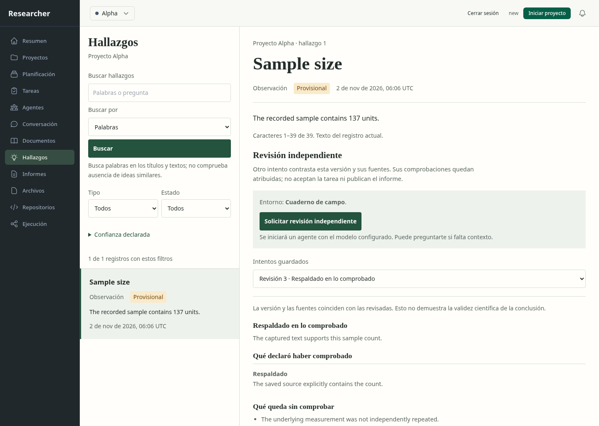
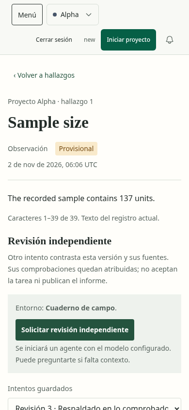

# Hallazgos: revisión independiente y recuperación

Se extendió el concepto seleccionado de registro con evidencia, conservando sus
[tres propuestas y selección](../../concepts/findings/manifest.json). La afirmación
aparece antes de la evaluación extensa. Los datos de origen quedan bajo un detalle
de procedencia; la decisión incluye comprobaciones atribuidas, citas y limitaciones.

El navegador usó SQLite, API, permisos, admisión y coordinador reales en una base
sintética aislada. La generación fue controlada y no usó ningún modelo ni cuenta.
El ensayo separado con un revisor real está documentado en
[native-review-live.json](../../../modernization/native-review-live.json).

Se verificaron nueve estados funcionales: antes de solicitar, decisión guardada,
captura exacta, respuesta perdida reconciliada, decisión móvil, ancho de 320 px,
fuente cambiada, vigencia no verificable y respuesta de otro proyecto bloqueada.
No hubo errores de página, desbordamiento horizontal ni infracciones de axe.
[Registro](interaction-evidence.json).

Una segunda prueba perdió el POST después de admitirlo, hizo fallar las lecturas
de recibo y recargó la página. El propietario reenvió la misma solicitud: ambos
POST conservaron proyecto, tarea, repositorio, contexto, huella y clave; sólo hubo
una generación controlada. [Registro](retry-evidence.json).

Tras inspeccionar las capturas se colocó la afirmación antes de la revisión y se
precisó el mensaje de revisión terminada, separado de la aceptación de la tarea.
La disposición final se comprobó otra vez en 1440, 390 y 320 px, sin infracciones
de axe. [Registro final](final-layout-evidence.json).

Los nueve estados anteriores conservan las capturas del recorrido funcional;
las imágenes `final-*` representan la jerarquía visual final. Las pruebas no
constituyen aceptación integral de la ruta, evaluación con usuarios, validación
científica ni garantía de que el agente haya comprendido todo el contexto.
