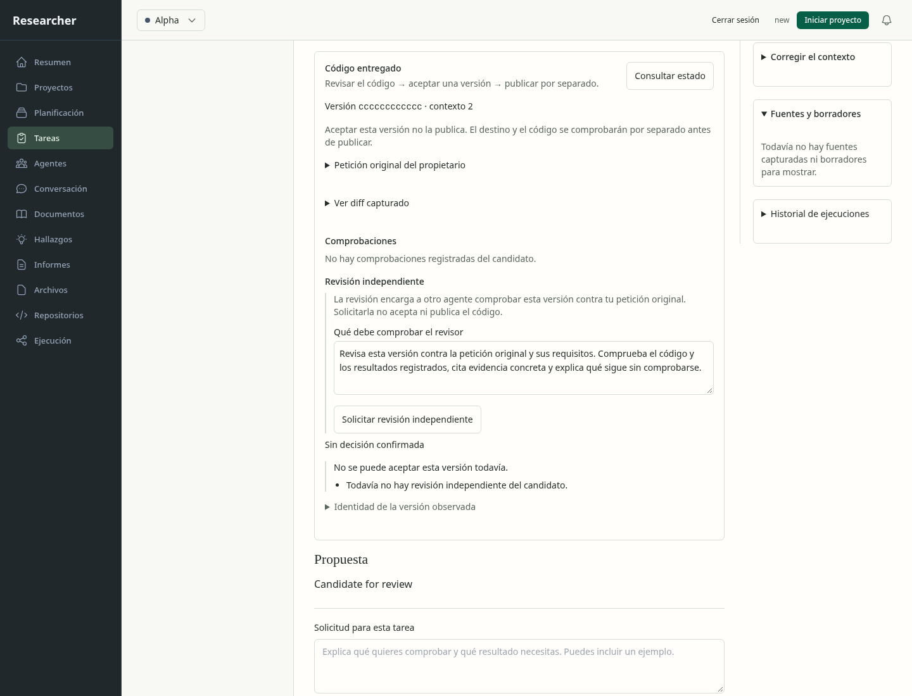
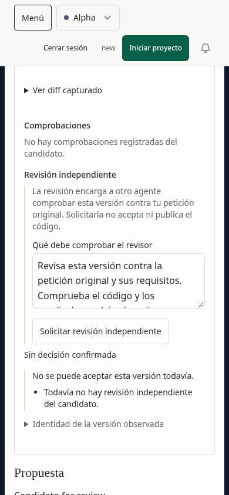
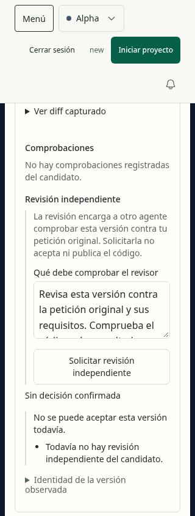
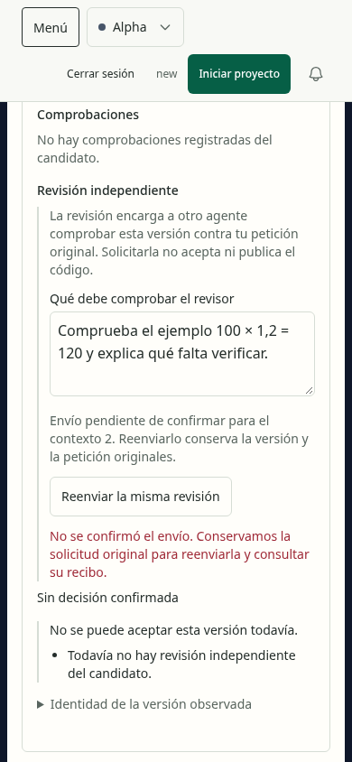
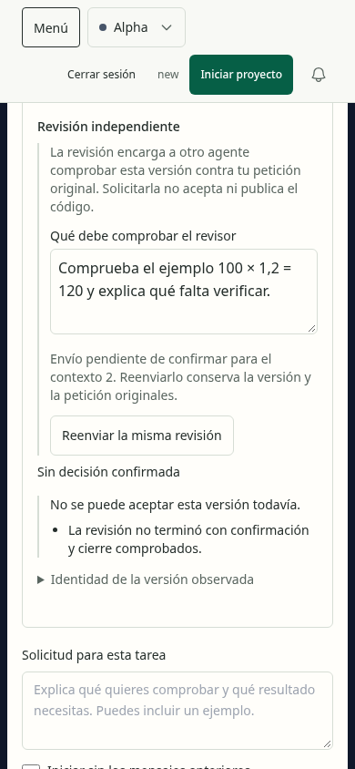
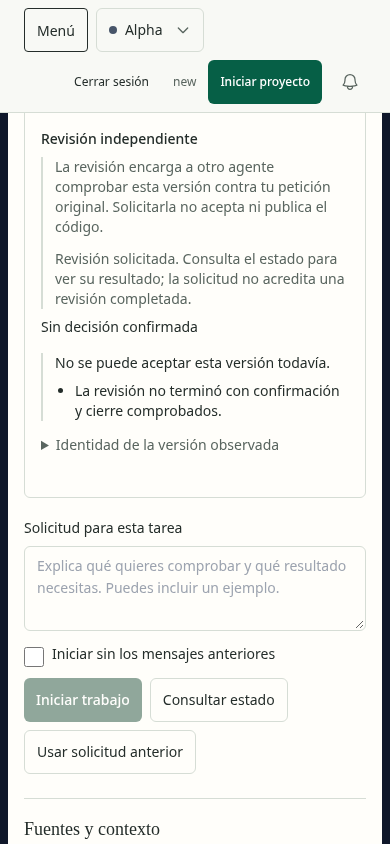

# Revisión visual: solicitud independiente de código

La acción se integra en el piloto de Tareas existente. No introduce otra dirección
visual ni acredita la aceptación completa de esa página. Se inspeccionaron las seis
capturas guardadas de esta ejecución; [evidence.json](evidence.json) conserva hashes,
anchos, peticiones y observaciones del almacenamiento.

1. **Escritorio, correcto:** versión y límites preceden al formulario. La petición
   del revisor es editable y la acción distingue solicitar, aceptar y publicar.
   
2. **Móvil, correcto:** texto, etiqueta y acción se adaptan a 390 px. La petición
   larga dispone de desplazamiento dentro del textarea.
   
3. **Ancho mínimo, correcto dentro del panel:** a 320 px el botón se distribuye en
   dos líneas sin desbordamiento horizontal. El encabezado general ocupa bastante
   espacio; su aceptación completa continúa pendiente.
   
4. **Respuesta perdida, correcto:** el servidor admite la revisión, pero la prueba
   interrumpe su respuesta. El panel conserva la petición, explica la incertidumbre
   y ofrece reenviar la misma revisión.
   
5. **Recarga, correcto:** se recuperan el ejemplo escrito y el contexto originales;
   no se envía otra petición automáticamente.
   
6. **Recibo recuperado, correcto:** el reenvío idéntico obtiene la admisión existente,
   limpia sólo su paquete local y no ofrece crear otra revisión. El texto aclara
   que solicitarla no acredita haberla completado.
   

La DB conserva una solicitud de revisión, cero aceptaciones y sólo el intento del
autor. El revisor queda **deliberadamente en cola** en este fixture, sin inferencia.
La sesión emparejada, CSRF, rutas, recibo, SQLite y frontend son reales; los testigos
Git/cierre del autor son sintéticos. La integración HTTP con ejecución nativa y
cierre físico reales tiene pruebas separadas con generación controlada.

En los seis estados no hubo errores JavaScript, desbordamiento horizontal ni
incidencias Axe dentro de `Código entregado`. Esto no prueba accesibilidad global,
comprensión por personas ni calidad general del modelo. El host de navegador
integrado respondió que no estaba disponible; se usó Chromium local de pruebas,
sin perfil personal ni servicios publicados. El preflight de Product Design no
encontró contexto guardado.
