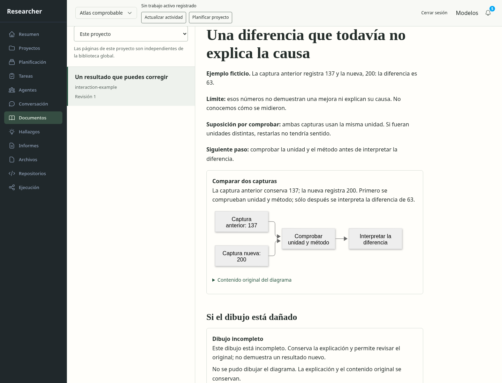
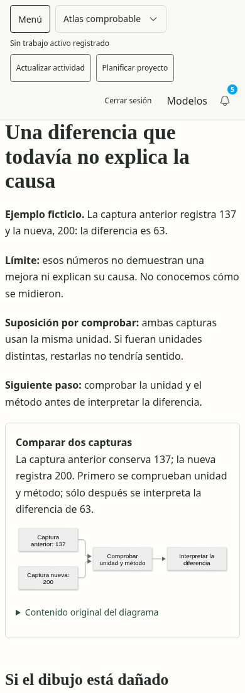
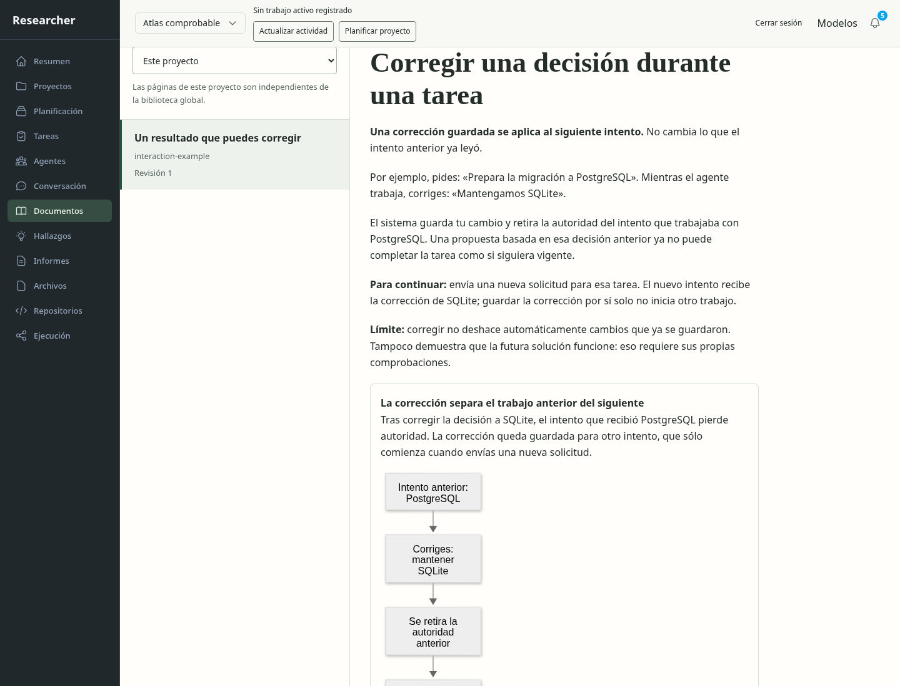
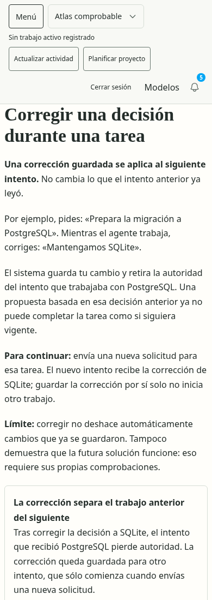

# Comunicación y diagramas: auditoría acotada

Objetivo: poder entender una explicación, identificar qué falta y conservarla
cuando falla el dibujo. Captura de producto real en instalación desechable,
1440 px y390 px; ninguna respuesta HTTP de negocio simulada. No es aceptación de
la página completa ni certificación de accesibilidad.

1. **Resultado y contexto.** El primer ejemplo se dibuja correctamente pero usa
   números sin una situación útil. El usuario lo rechaza expresamente. La
   evaluación humana queda negativa pese a que los controles automáticos pasaron.
2. **Explicación corregida.** El ejemplo nuevo muestra una corrección de
   PostgreSQL a SQLite durante el trabajo. Se distingue el intento anterior del
   siguiente y se explica la acción necesaria para continuar. Sigue pendiente
   aceptación humana y evaluación de contenido realmente generado.
3. **Fallo recuperable.** Un Mermaid inválido conserva descripción y original.
   Las comprobaciones DOM verifican el contenido; las capturas muestran sólo la
   parte visible del panel con desplazamiento, no todo el documento simultáneo.
4. **Contenido no confiable.** Configuración/recursos externos rechazados;
   etiqueta HTML inerte, sin solicitudes al destino de prueba. No prueba ausencia
   de toda vulnerabilidad ni límites duros de tiempo del renderer.

La revisión visual confirma jerarquía de texto y alternativa legible. El diagrama
horizontal inicial reduce demasiado su letra en móvil; ampliar/exportar y ajustar
su presentación quedan en DD121. La versión revisada usa un flujo vertical.
Las observaciones Axe del documento no encontraron infracciones en estos estados;
falta verificación completa de teclado/lectores de pantalla y del resto de rutas.

Las capturas y el recibo revisados se añaden junto a los iniciales para conservar
la crítica, no para sustituirla por una autoevaluación favorable.

