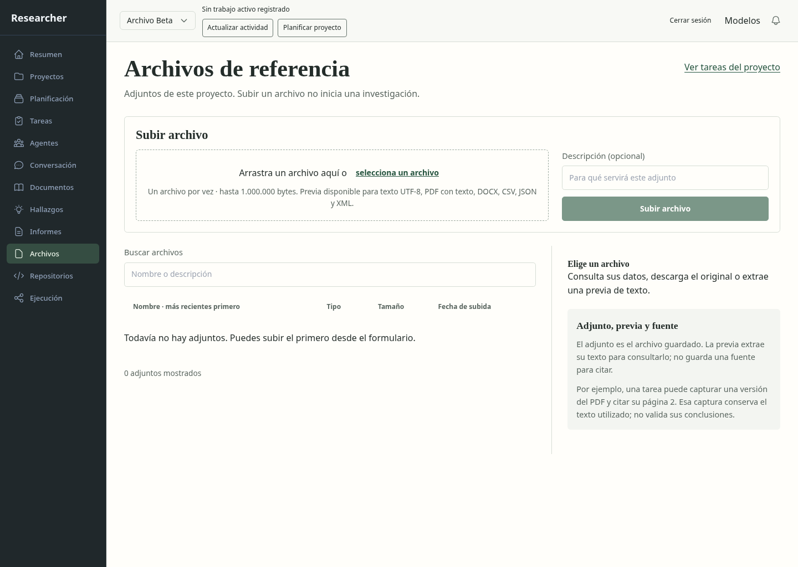
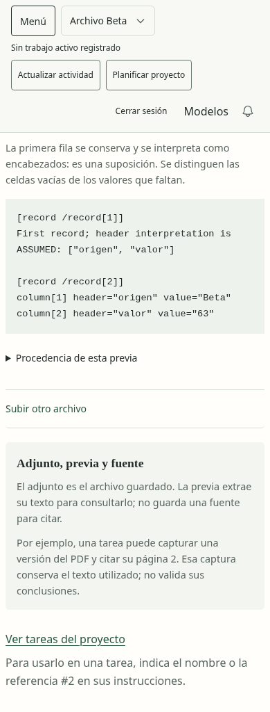
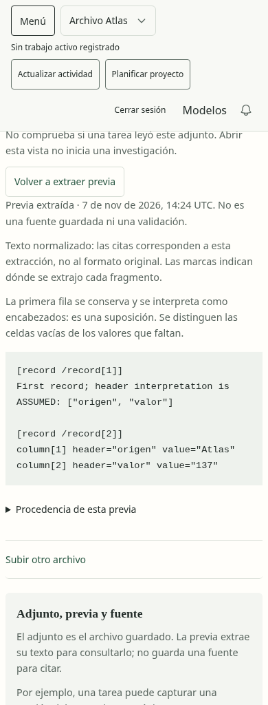
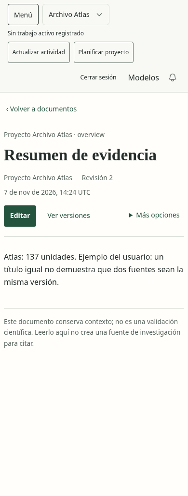
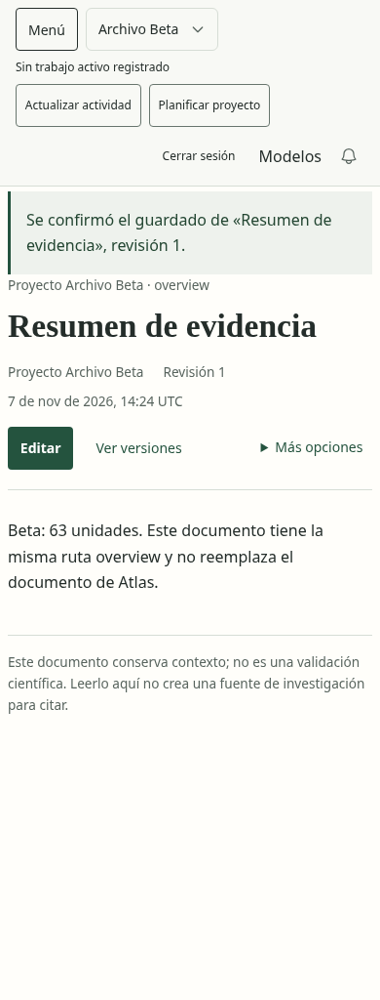
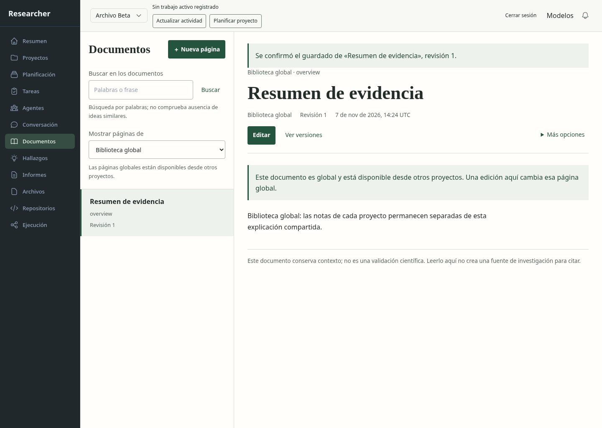

# Archivos y Documentos: recorrido con almacenamiento real

**Pasan los siete controles de este recorrido.** La respuesta de una subida real
se retiene después del commit y se entrega tras cambiar de proyecto: no altera
el proyecto visible. Dos archivos `muestra.csv` conservan bytes distintos; tres
documentos `overview` permanecen separados entre Atlas, Beta y la biblioteca global.

Base `f881653`; bloque 7 noviembre 2026, 14:20:47–14:27:51 UTC: **7 min 4 s**
hasta validar resultados y abrir las seis capturas. Se usó Chromium del repositorio
por la indisponibilidad del host del navegador integrado observada en el bloque previo.
No hubo inferencias, acceso a la cuenta real ni cambios de lógica del producto.

| Paso | Resultado observado | Estado |
| --- | --- | --- |
| Subida tardía | Confirmada en servidor para Atlas; su respuesta llega con Beta abierto y no cambia el ámbito. | Pasa |
| Archivos homónimos | `muestra.csv` contiene Atlas/137 en un proyecto y Beta/63 en el otro. | Pasa |
| Previas CSV | El trabajador instalado extrae el contenido; la interfaz declara la interpretación de encabezados como suposición. | Pasa |
| Descarga | Los bytes descargados coinciden con los originales y con los archivos almacenados. | Pasa |
| Edición de documento | La revisión 2 de Atlas persiste al recargar y en SQLite. | Pasa |
| Ruta homónima | Beta guarda su propio `overview`, sin reemplazar el de Atlas. | Pasa |
| Biblioteca global | Se selecciona explícitamente; muestra su propio contenido y explica el efecto compartido de editarlo. | Pasa |

La base conserva 2 proyectos, 2 archivos, 3 páginas y 4 revisiones; integridad `ok`,
0 tareas, runs y dispatches. Ocho escrituras de producto además del acceso local.
El servicio termina con 143; su recibo queda cerrado y el grupo ya no existe.
[Operación](operation.json), [navegador](evidence.json),
[cierre](service-closure.json), [hashes](../../../modernization/web-knowledge-results.json).

## Capturas inspeccionadas

Las vistas móviles muestran el contenido desplazado dentro de la página; no
representan simultáneamente todo el formulario. Se distinguen proyecto, revisión
y contenido. La explicación de adjunto/previa/fuente incluye un ejemplo concreto.
No se observaron incidencias Axe en las regiones medidas, errores JS ni desborde
horizontal del documento. Esto no acredita toda la accesibilidad ni comprensión humana.

La confirmación del guardado anterior sigue visible al abrir otro documento con
igual título y revisión; puede confundirse con una confirmación de la página actual.
Se registra como DD105 para la pasada final. La altura de cabecera móvil ya figura
en DD041. No se modifican ahora estilos ni mensajes por estos detalles.

El ensayo demora una respuesta auténtica; no fabrica su contenido ni sustituye
la API. No repite la matriz previa de conflictos concurrentes, borrado y errores;
no comprueba generación, consumo posterior por agentes, reinicio abrupto ni todos
los formatos. Se conserva la evidencia anterior sin declararla recién ejecutada.
Se añaden `--journey knowledge` y `test:e2e:knowledge` para reproducirlo.

Siguen abiertos los 43 escenarios amplios y la aceptación integral de las 12
páginas. Este bloque cierra un recorrido de integración, no toda la modernización.
