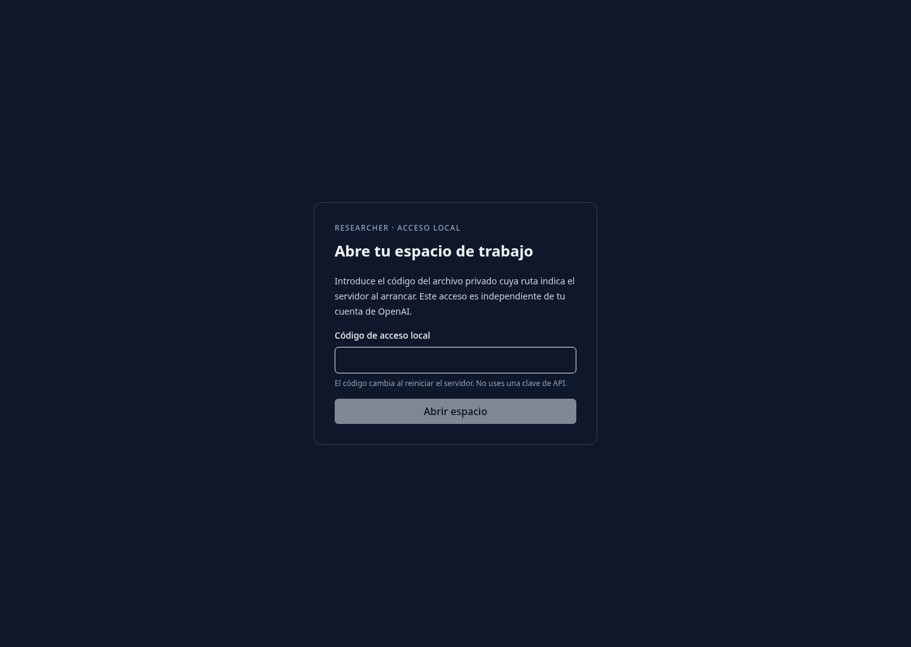
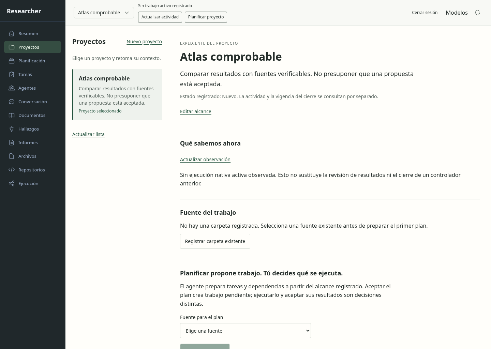
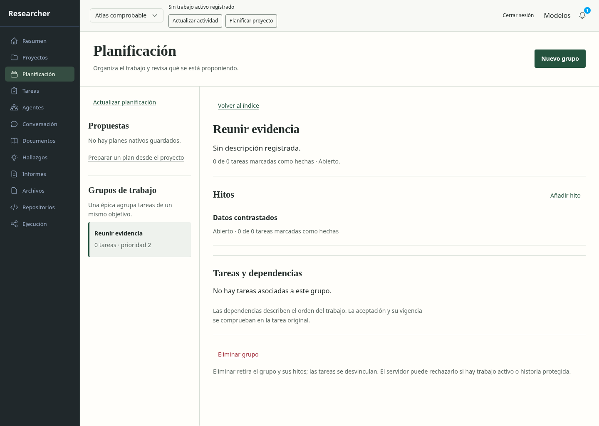
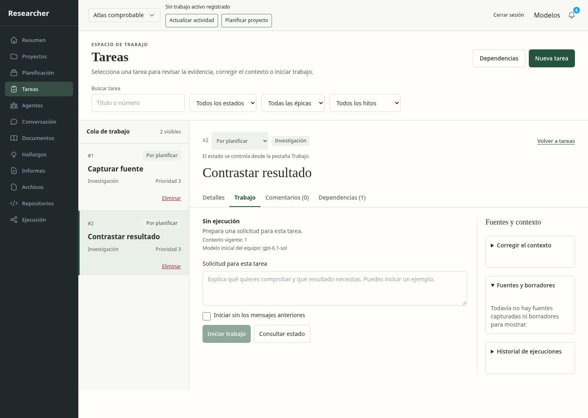
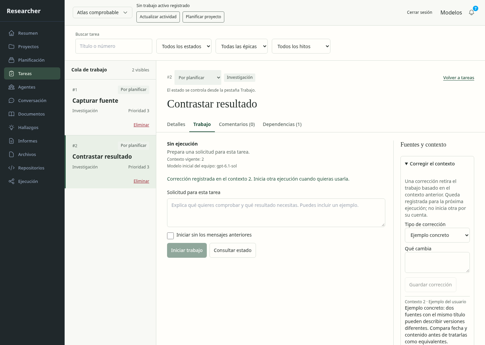
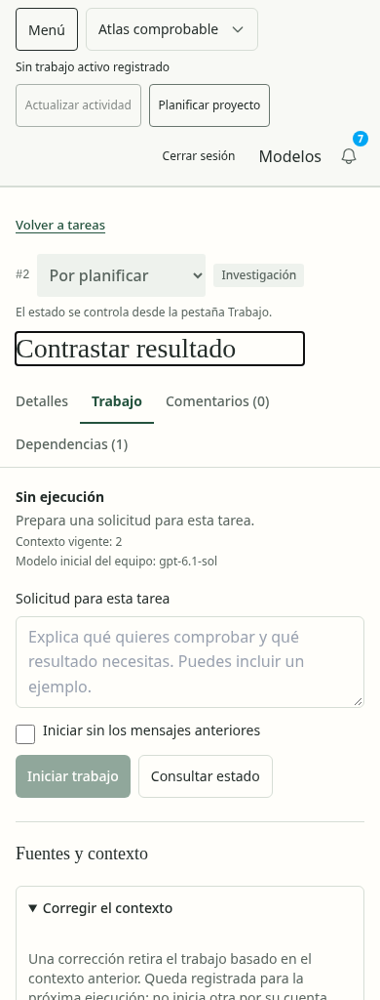
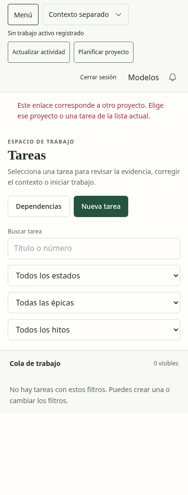
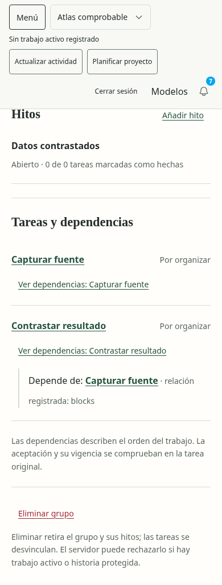

# Proyectos, planificación y corrección: recorrido con datos reales

**El recorrido comprobado funciona.** Se creó todo desde formularios contra el
producto instalado, su API y una base SQLite nueva. No hubo respuestas HTTP
simuladas ni inferencias. Esto amplía la evidencia de integración de los pilotos;
no equivale a aceptación humana de las páginas ni a completar todo el plan.

Fecha7noviembre2026, base`de83659`. Bloque14:09:13–14:16:43UTC: **7 min 30 s**
hasta inspeccionar la evidencia funcional y visual. El navegador integrado no
tenía host disponible; se usó Chromium de las pruebas del repositorio.

## Pasos observados

| Paso | Acción y resultado | Estado |
| --- | --- | --- |
| 1 | Acceso con el código privado de la instalación sintética; se distingue del acceso OpenAI. | Funciona |
| 2 | Crear Atlas y un segundo proyecto desde la web; el alcance queda guardado sin iniciar agentes. | Funciona |
| 3 | Crear un grupo de trabajo y un hito; aparecen en Planificación y SQLite. | Funciona |
| 4 | Crear dos tareas y una dependencia; abrir la tarea original. | Funciona |
| 5 | Guardar la corrección como «Ejemplo concreto»: contexto2 y procedencia `user_example`, sin convertirla en observación del agente. | Funciona |
| 6 | Recargar y cambiar de proyecto en móvil: la tarea/corrección persiste en Atlas y no aparece en el otro proyecto. | Funciona |
| 7 | Volver a Atlas y consultar la dependencia real desde Planificación. | Funciona |

SQLite conserva2proyectos,1grupo,1hito,2tareas,1dependencia y1corrección; integridad
`ok`, cero runs/dispatches. Se observaron7escrituras de producto, además del acceso
local. Servicio143, recibo`closed` y grupo de procesos eliminado. La cuenta usada
es sintética; no se leyó el archivo real de suscripción ni se adoptaron datos.
[Operación](operation.json), [navegador](evidence.json),
[cierre](service-closure.json), [hashes y alcance](../../../modernization/web-workspace-results.json).

## Capturas aceptadas

Las ocho capturas se abrieron e inspeccionaron. Son vistas de1440×1024 y390×1024;
la página tiene áreas de scroll internas, por lo que no representan simultáneamente
todo el documento. En el paso7 se desplazó expresamente hasta la dependencia.

## Lectura del resultado y límites

La jerarquía permite reconocer proyecto, tarea y acción. La corrección aparece
como ejemplo del usuario con su versión; su persistencia se verifica también en
la base. La dependencia conserva un enlace legible a la tarea previa. El aviso
de enlace de otro proyecto evita mostrar la tarea bajo un contexto distinto.

No hubo incidencias Axe en las regiones capturadas, desbordamiento horizontal del
documento ni errores JavaScript. Eso no prueba navegación completa por teclado,
zoom, lector de pantalla, comprensión humana ni toda la accesibilidad del shell.
Tampoco prueba cómo una inferencia posterior utiliza el ejemplo: no se inició una.

Se observa espacio de cabecera móvil considerable y el contorno de foco del título
puede parecer un campo editable. Son ajustes de presentación para la pasada final;
no se modifican ahora. El aviso de enlace ajeno tras cambiar de proyecto puede
explicarse mejor conservando la selección y la prohibición de cruzar contextos.

La primera ejecución pasó las acciones, pero dos capturas mostraban estados de
transición. Se conservaron privadamente, se reforzaron las esperas por contenido
real y se añadió la corrección antes de la segunda ejecución. No se usan aquellas
capturas como evidencia de un estado cargado. El producto no necesitó cambios de
lógica para este recorrido; se añadió su prueba reproducible y `npm run test:e2e`.

Siguiente capacidad: Archivos y Documentos con almacenamiento real. La aceptación
integral continúa0/12 y los43escenarios amplios permanecen abiertos. Los detalles
secundarios se retoman después de todas las capacidades principales.
