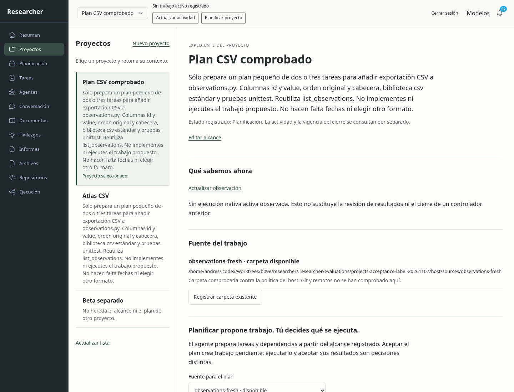
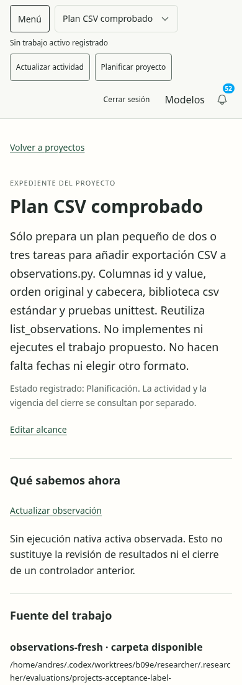

# Proyectos: comparación visual y recorrido de aceptación

Se mantiene el [concepto seleccionado](../../concepts/projects/selection.md):
registro lateral, expediente amplio, papel claro y verde funcional. Se inspeccionó
la referencia junto a las capturas reales. En móvil se alternan registro y lectura,
con retorno y foco comprobados; no se comprimen ambas columnas.

El estado mostrado corresponde a un plan realmente generado y aceptado en una
instalación desechable. La aceptación crea tareas pendientes; no prueba que se
haya construido la exportación CSV ni cerrado el proyecto. El GET cortado conserva
el historial y permite recuperarlo. Las fases y sus límites están en
[la revisión funcional](../../../modernization/projects-page-review.md).

Las capturas del primer registro pueden mostrar estados transitorios justo
después de una mutación; la revisión final espera datos estables y restaura el
principio del panel. No se usan esas imágenes transitorias como comparación final.
No se afirma lectura completa con tecnologías de asistencia o comprensión humana.

La información extensa ocupa demasiado el registro lateral y algunos estados
guardados conservan etiquetas técnicas. Son detalles de presentación para DD123.
La preparación nativa y la generación española aún sin verificar impiden aceptar
la página completa: no se rebajan a detalles visuales.

## Continuación actual

La [lectura del intento original](../2026-11-08-projects-original-recovery/report.md)
completa el alcance técnico/visual junto a la evidencia española/Ken posterior.
Conserva todos los intentos y el incidente de disponibilidad sin afirmar su
corrección causal. La aceptación humana y la pasada completa de accesibilidad
siguen independientes.
