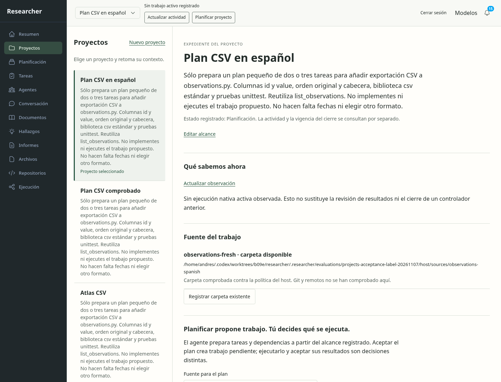
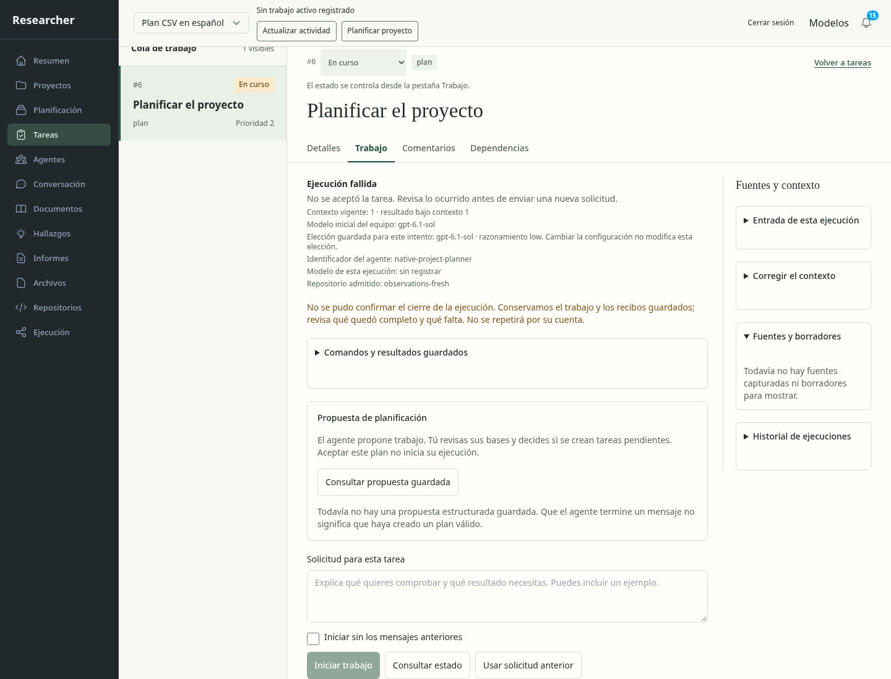
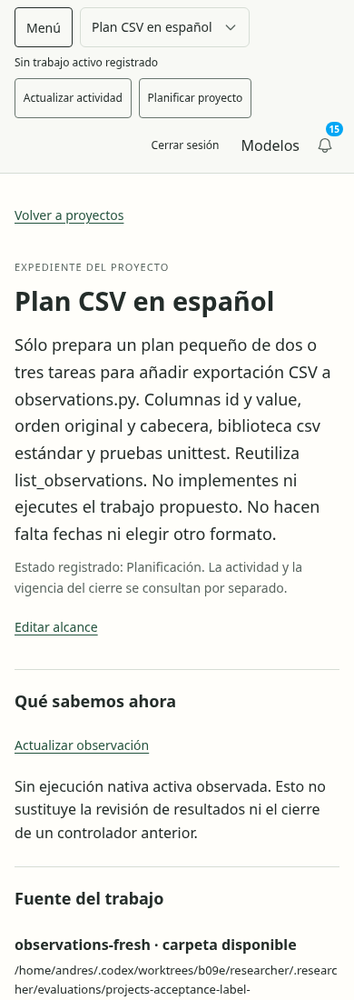
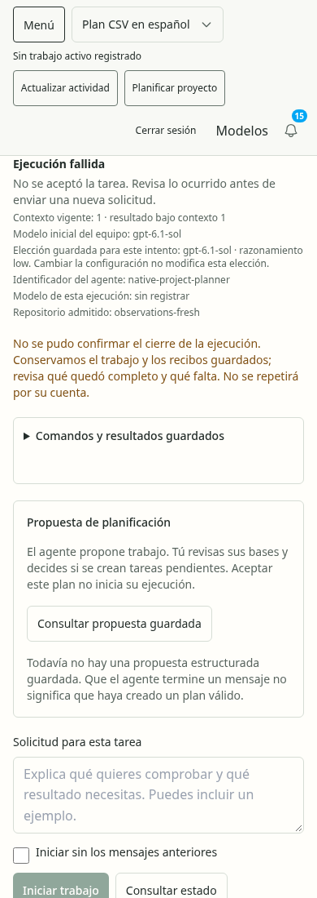

# Proyectos: recuperar el intento fallido original

La recuperación técnica y visual queda aceptada en este alcance. Se inspeccionaron
las cuatro capturas de la continuación actual: conservan la dirección
[Expediente del proyecto](../../concepts/projects/selection.md), jerarquía de lectura,
papel claro y verde funcional. La versión móvil alterna lista y expediente sin
comprimir columnas. No se generaron nuevos conceptos para esta comprobación.

1. **Expediente original — correcto.** Proyecto 5, «Plan CSV en español», mantiene
   alcance, fuente y enlace a tarea 6/run original. El estado registrado se separa
   de la actividad actual. Las descripciones largas del registro siguen ocupando
   demasiado espacio; queda en la pasada fina.

   

2. **Intento fallido — correcto dentro de su historia.** El enlace abre la tarea
   exacta y muestra «Ejecución fallida» junto al mensaje que realmente se guardó.
   Recargar conserva el mismo intento; no se inventa una propuesta ni una nueva
   explicación del fallo. La advertencia antigua de cierre no se presenta como
   una observación nueva del verificador.

   

3. **Expediente móvil — correcto.** El alcance sigue legible y el regreso a la
   lista está disponible. La ruta vuelve al mismo proyecto después de consultar
   el intento.

   

4. **Fallo y recarga en móvil — correcto.** El aviso es legible a 390 px y se
   conserva después de recargar. La densidad de metadatos de ejecución y la
   distinción entre estado de tarea y proceso físico requieren pulido posterior;
   no se certifica comprensión humana.

   

El navegador interceptó 72 peticiones: la única mutación fue emparejar la sesión.
Cuatro GET adicionales verificaron presupuesto y workspace. No hubo admisión,
respuesta, comentario ni cambio de política. Cuatro estados y siete comprobaciones
pasan; sin errores de página, overflow horizontal ni infracciones axe en las
regiones inspeccionadas. El presupuesto anterior y posterior coincide.

La primera lectura consultó presupuesto antes de terminar el emparejamiento y
recibió 401. Se conserva ese fallo del verificador; la continuación espera la
interfaz autenticada y utiliza el mismo host, sin repetir trabajo. El arranque
anterior aplicó 68→71: 162 hashes de tablas originales permanecen idénticos, el
historial añade tres migraciones y las cuatro tablas nuevas siguen vacías. Cuatro
runs/cuatro attempts/un dispatch y las tres fuentes permanecen iguales. Ambos
servicios terminaron 143, sin peers ni grants abiertos.

El Stop tiene evidencia anterior de [recuperación UI](../2026-11-06-projects/report.md)
y una comprobación de kernel/broker instalada separada. No se atribuye ese cierre
físico al navegador de esta continuación. Los [resultados](../../../modernization/projects-original-recovery-results.json)
explicitan sus límites y preservan el fallo original. La causa de AuthorityBusy,
U08, lector de pantalla, zoom, otros motores y revisión final permanecen separados.
