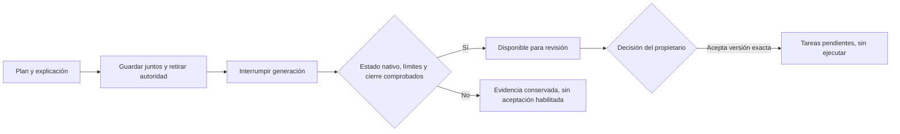

# Entrega atómica del plan y su explicación

La regresión de planificación entrega ahora el resultado dentro del límite anterior:
**81.685 tokens observados de 120.000**, en un único intento real de desarrollo.
El plan contiene tres tareas, sus dependencias y una explicación en español con
un ejemplo de CSV y una definición de DAG. No se aceptó el plan ni se ejecutaron
sus tareas. Esto comprueba este recorrido; no establece eficacia general ni
comprensión humana. [Recibo](atomic-planning-live.json).

## Cambio de contrato

Antes, `plan_propose` guardaba el grafo y exigía otra generación para explicarlo.
En el intento anterior, esa generación elevó el consumo de107804 a137720tokens,
por encima del límite. El aviso temprano de presupuesto no resolvió ese contrato.

`researcher_plan_deliver` guarda ahora el grafo y la explicación en la misma
transacción SQLite, con una identidad y un hash que cubren ambos. Esa transacción
retira la autoridad del intento. Una señal exclusiva del host interrumpe el turno
sin devolver una respuesta de herramienta que provoque otra generación. El engine
recoge el estado nativo real y comprueba el cierre de sus procesos antes de publicar
la explicación como resultado disponible para revisión.

La entrega del producto, la terminación nativa y la aceptación del propietario
son estados distintos. En el ensayo real, el runtime informó **interrupted** y
el producto quedó **needs_review** por una entrega tipada confirmada. No se
reescribió el estado nativo como completed. El recibo incluye el hash de la propuesta;
la aceptación conserva sus comprobaciones de contexto vigente y procesos cerrados.

Los registros históricos sin `delivery.version=1` mantienen su contrato anterior.
No cambia el esquema59 de SQLite: se amplía el objeto JSON de la propuesta con
metadatos versionados; no se reinterpretan borradores viejos. El catálogo6 reconoce
identidades históricas2–5. La interfaz muestra la explicación guardada incluso si
el intento falla, pero no ofrece aceptación mientras falte elegibilidad.

## Fallos y límites

- Un fallo al retirar autoridad revierte también el plan y su explicación.
- Tras perder una respuesta, la misma identidad y contenido recuperan el recibo
  original; cambiar el contenido o la clave no reemplaza la propuesta.
- Stop o una corrección conservan precedencia. Un resultado guardado no restaura
  autoridad ni crea trabajo después de una retirada.
- Un contador tardío que exceda el límite deja el intento fallido y la propuesta
  como evidencia. No se convierte en una entrega aceptable por haber sido guardada.
- Una explicación vacía o superior al límite de almacenamiento se rechaza.
  También se conserva el límite configurado de bytes de respuesta del runtime.
- Si se pierde el estado terminal nativo o no se demuestra cierre, el contenido
  permanece consultable, pero no se habilita aceptación ni se repite inferencia.
  La recuperación existente puede retirar el intento fallido; no inventa un
  recibo terminal ni recupera consumo desconocido.

## Validación y alcance

Primer candidato:128 pruebas dirigidas desde fuente y102 desde el wheel instalado,
sin fallos ni omisiones. Incluyen el almacenamiento real, un proceso hijo de protocolo,
el runtime con procesos aislados y generación controlada, y la prioridad de límites
tardíos. Un caso UI verifica explicación visible y aceptación condicionada;136
contratos web pasan y el build termina. No se afirma una nueva auditoría visual.

El único intento real usa Codex por suscripción, modelo gpt-6.1-sol/low y Ken publicado,
con el límite anterior de120000tokens,180segundos y20herramientas. Duró57,738segundos.
Se comprobaron citas exactas, fuente intacta, propuesta disponible, cero aceptaciones,
integridad SQLite, cuatro peers cerrados, cero grants locales activos y salida del
servicio. El consumo registrado es una observación, no una factura ni una cuota
de la suscripción. [Datos completos del recorrido](atomic-planning-live.json).

Después del ensayo se añadió una regresión que detectó el posible bypass del límite
de bytes de explicación. Se corrigió ese límite y el docstring de elegibilidad:
50 pruebas dirigidas finales pasan desde fuente y50 desde el paquete final.
No se repitió el modelo por ese cambio. Los dos paquetes y sus resultados se
conservan por separado;609 archivos Python/SQL coinciden con la instalación final.
[Paquete ensayado](atomic-planning-packaging.json),
[paquete final](atomic-planning-final-packaging.json),
[resultados](atomic-planning-results.json).

Quedan la evaluación humana y otros perfiles, seguridad y recursos agregados,
datos históricos/recuperación restante y aceptación integral de las12 páginas.
Los43 escenarios amplios continúan abiertos. Los detalles de estilo se posponen;
no hay nueva suite global verde, push ni despliegue.
