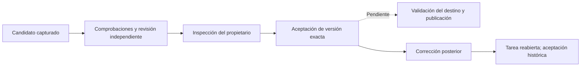

# Aceptación del candidato de código

El propietario puede inspeccionar una entrega de desarrollo y aceptar la versión
exacta que observó, con sus comprobaciones y revisión independiente. La acción
cierra la tarea y conserva un recibo histórico. Publicar sigue siendo una acción
separada y pendiente: requiere comprobar otra vez código, destino y autoridad.
La [entrada pública de desarrollo y revisión](public-development.md) ya conecta
este recorrido con Tareas y mantiene separada la publicación.

## Qué ve y qué acepta el usuario

El panel de Tareas identifica commit y contexto, permite paginar el diff guardado
y muestra petición original, resultados, citas y límites del revisor. El diff se
lee de la captura, con hash completo y cobertura explícita de cada ventana. No se
sustituye por el contenido actual del directorio. Un diff sin representación
UTF-8 completa se rechaza explícitamente en este visor; no se presenta un texto
parcial como evidencia completa.

La decisión contiene intento del autor, contexto y huellas completas del objeto
revisado y de la revisión observada. El servidor los vuelve a comprobar en la
transacción. No permite sustituirlos silenciosamente por la versión más reciente.
Se exige autor cerrado, revisión independiente confirmada y respaldada, y ausencia
de trabajo activo o pendiente de reconciliar. Una revisión rechazada, inconclusa
o sin confirmación no se puede eludir con una casilla de reconocimiento.

Las objeciones anteriores sobre el mismo objeto revisado no desaparecen al
cancelar su ejecución o pedir otra opinión. Una objeción confirmada que pide
cambios bloquea aceptación aunque la última revisión sea favorable. Propuestas
sin confirmar y revisiones inconclusas conservan esa clasificación, su explicación
y reconocimiento de límites; no se convierten en rechazos confirmados. Las
objeciones materiales forman parte de la huella observada. El historial admite
64 revisiones anteriores; superar ese límite bloquea con explicación explícita.
Los recibos con una sola revisión mantienen su huella original.

Los fallos, resultados invalidados, errores de infraestructura y comprobaciones
pendientes bloquean aceptación. Pruebas ausentes u omitidas permanecen visibles y
exigen reconocimiento explícito del propietario. Esa política se aplica a la
versión de este proyecto/tarea; no transforma ausencia en éxito. Un comando que
terminó bien se distingue de una suite de pruebas. La configuración adicional de
políticas por proyecto forma parte del trabajo pendiente del plan.

La casilla registra una declaración del propietario, no demuestra que haya leído
o comprendido todo. Del mismo modo, la confirmación del revisor conserva su
juicio atribuido; no certifica corrección general ni comprensión compartida.

Por ejemplo, se acepta el commit A bajo contexto 2 y después se corrige una tasa
bajo contexto 3. El recibo de A conserva su identidad y nota originales; la tarea
se reabre y esa aceptación pasa a ser histórica. No autoriza publicar B ni
presentar la versión corregida como aceptada.

## Respuestas perdidas y contexto posterior

Antes de enviar, el cliente guarda la solicitud completa en almacenamiento de la
pestaña. Conserva versión, nota, reconocimiento y clave original durante recargas
y cambios de selección. El formulario pendiente muestra esos mismos valores y
no permite editarlos mientras se reenvían. Una nota demasiado larga se puede
corregir sin bloquear el formulario.

Si se pierde un envío, el usuario puede reenviar la misma solicitud. Si se pierde
la respuesta después de guardar, una consulta posterior recupera el recibo y
resuelve únicamente la solicitud local coincidente. No inicia inferencia ni
prepara otra clave por su cuenta. Un rechazo explícito permite descartar esa
solicitud rechazada antes de preparar otra; una respuesta incierta se conserva.

El almacenamiento de decisiones de investigación y código reutiliza el mismo
mecanismo, con espacios de claves separados. Se mantienen las claves existentes
de investigación. Un estado local corrupto no se interpreta como una acción nueva.

## Frontera HTTP y persistencia

Las rutas del propietario son:

- `GET /api/projects/{project}/runs/{author_run}/code-result`.
- `GET /api/projects/{project}/runs/{author_run}/code-result/diff` con ventana explícita.
- `POST /api/projects/{project}/runs/{author_run}/code-result/accept`.

Emparejamiento y CSRF se aplican mediante la frontera existente; un token de
herramienta no concede acceso. Las lecturas y decisiones permanecen en su
proyecto. Una captura todavía en preparación devuelve indisponibilidad explícita.
Estas rutas no abren sesiones de agentes ni procesos de Git.

La migración 42 añade `runtime_code_acceptances` y amplía las protecciones de
finalización y reapertura de tareas. Recibo, evento, revocación de permisos y
cambios de estado del autor/revisor/tarea se confirman juntos. Un fallo de evento
revierte toda la decisión. Una clave repetida con la misma intención recupera el
recibo original; cambiar la intención se rechaza, incluso después de corregir el
contexto. Los recibos son inmutables.

Reconstruir un objeto aceptado sólo se permite en la lectura explícita del
propietario. La admisión y preparación nativa siguen exigiendo autor pendiente de
revisión. El código no reutiliza un intento cerrado para abrir otra sesión.

La inversa 42 sólo retira almacenamiento sin uso y restaura las protecciones
anteriores de investigación; conserva candidatos y revisiones. Historia de
aceptación, autoridad activa o versiones posteriores exigen reparación hacia
delante o restauración explícita. No se borran decisiones para poder retroceder.

## Evidencia y límites

Las pruebas dirigidas de contratos HTTP, almacenamiento, migraciones y consumidores
compartidos pasan 111 casos. La integración con el coordinador pasa dos casos con
Git, broker y cierre reales y generación controlada: aceptación explícita de la
revisión confirmada y bloqueo del candidato alterado. No se usó una llamada de
modelo nueva para una decisión que corresponde al propietario.

El frontend pasa 72 pruebas y build. La [auditoría del panel](../design/audits/2026-11-02-code-acceptance/report.md)
verifica tres anchos, respuesta perdida antes/después del guardado y recuperación
exacta tras recarga. Detectó y corrigió un problema de visualización de los valores
pendientes que las primeras aserciones de transporte no cubrían.

El primer [wheel ampliado](code-acceptance-before-history-packaging.json) pasó
217 pruebas. Su suite global tuvo 2126 casos: 2023 pasan, 100 fallan y tres se
omiten; mismos identificadores heredados, sin fallos nuevos por identidad ni
suposición de causas idénticas. Pasan 943 casos del runtime. Esa observación
precede al ajuste final del historial; no se atribuye a los bytes posteriores.

La regresión de dos revisores reprodujo aceptación indebida antes del ajuste.
Después pasan 30 pruebas dirigidas, [56 de bootstrap](code-acceptance-smoke-packaging.json)
y [97 del wheel final](code-acceptance-packaging.json), incluidas dos integraciones
del coordinador; 343 módulos proceden sólo del paquete y 696 fuentes coinciden.
No se repitió la suite completa por ese cambio de cuatro archivos Python.
[Resultados y alcance](code-acceptance-results.json). Las
[66 definiciones nuevas/modificadas](code-acceptance-docstrings.json)
tienen documentación en inglés; los módulos/componentes/helpers frontend nuevos
también llevan JSDoc. Esto no constituye una auditoría documental de todo el repo.

La elegibilidad de aceptación todavía se compone en el adaptador de almacenamiento;
la intención y política de comprobaciones son neutrales y no dependen de HTTP.
La retirada de consumidores/loops antiguos, publicación,
políticas por proyecto, evaluación representativa de comprensión y
aceptación completa de las doce páginas permanecen dentro del objetivo.
